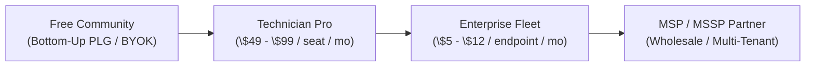

# 💡 SPLAT Idea Ledger & Product Strategy (IDEAS.md)

> **Status:** Living Idea File / Non-Binding Strategic Exploration  
> **Master Strategy:** See [Platten Industries Commercial Master Strategy](docs/PLATTEN-INDUSTRIES-MASTER-PROPOSAL.md) for the unified executive brief, ARR model, and CorpDev thesis.  
> **Target Horizon:** Post-v1.0 Commercialization & Enterprise Rollout  
> **Relationship to Core Scope:** This document captures business hypotheses, packaging models, monetization tracks, and potential feature explorations. It serves as strategic context and does not impose engineering constraints on immediate core engine deliverables in `scope.md`.

---

## 🎯 1. Core Commercial Value Hypothesis

Enterprises, MSPs, and campus IT organizations are actively looking to deploy autonomous AI agents to slash IT support costs and MTTR (Mean Time to Resolution). However, **CISOs and IT Directors block adoption due to 3 critical fears:**
1. **Kernel & OS Stability Risk:** Uncontrolled AI running destructive scripts.
2. **Data & Credential Leakage:** Sensitive corporate data (hashes, passwords, PII) leaking into public LLM clouds.
3. **Audit Non-Compliance:** Inability to prove non-repudiation or review exact execution logs for regulatory bodies (HIPAA, SOC 2, NIST 800-207).

**SPLAT's Commercial Moat:** It provides **in-kernel enforcement inside a hardware-isolated Hyper-V guest** alongside native **Win32 Job Objects / NTFS ACL directory jails**, **in-memory DLP redactors**, and **tamper-evident SHA-256 Merkle audit chains**, turning AI from a security hazard into an approved enterprise operational tool.

### 🏛️ The Architecture Arc: Earning the Right to Autonomy
* **Today (v1.0 Windows-Native Production):** SPLAT strictly enforces a **1:1:1 Governance Invariant** ($\text{1 Template} \rightarrow \text{1 Model} \rightarrow \text{1 Dedicated Native Tool} \rightarrow \text{1 Approved Egress FQDN}$) over an approved catalog with Win32 Job Object resource clamps, stripped Admin SIDs (`S-1-5-32-544`), severed NTFS inheritance, pre-egress DLP scrubbing, and SHA-256 Merkle ledger notarization.
* **Structural Design Seams:** The core engine interfaces (`IJailManager`, `IProcessLauncher`, `IJobSandbox`) were architected so that guest VM and kernel substrates slot in additively behind existing interfaces without rewriting the orchestration, DLP, or audit layers.
* **Tomorrow (v2.0 eBPF Substrate Roadmap):** The Linux/eBPF substrate provides in-kernel BPF-LSM policy enforcement inside stock Microsoft WSL2 guests. This in-kernel blast-radius containment is what **earns the right** to safely loosen the 1:1:1 invariant into multi-step autonomous tool execution without sacrificing determinism or risk posture.

### 🛡️ Technical Precision & Security Tenets
* **In-Kernel Enforcement, Hardware Guest Isolation:** BPF-LSM provides software policy enforcement directly in kernel space; the Hyper-V micro-VM around WSL2 provides the hardware isolation boundary.
* **Zero-Fork Stock Microsoft Kernel:** Operates on the stock Microsoft WSL2 kernel (6.6+/6.18+) with `CONFIG_BPF_LSM=y`, `CONFIG_HYPERV_VSOCKETS=y`, `CONFIG_OVERLAY_FS=y`, and `CONFIG_DEBUG_INFO_BTF=y`. Activating BPF-LSM requires only a single `kernelCommandLine = ...lsm=...,bpf` entry in `.wslconfig`—eliminating custom kernel fork maintenance, CVE tracking burdens, and global Docker Desktop conflicts.
* **Blast-Radius Containment (Not Magic Detection):** Kernel policy contains the blast radius of compromised or injected agents; it does not claim semantic detection of prompt injection. If an allowed endpoint or path is leased, an injected agent's actions are constrained strictly to that lease's boundaries.
* **Compiled Tool Contracts & Leased Tokens:** Tool contracts compile down to cgroup-scoped kernel capabilities with deterministic, seconds-scale single-use leases (robust against scheduler jitter).
* **Enforcement Performance:** Near-zero overhead on the kernel enforcement path.
* **Market Comps:** Anchored against verified priced rounds (e.g., n8n's \$2.5B valuation from their \$180M Series C in October 2025).

---

## 💎 2. Monetization & Packaging Tiers

### Track A: Technician Pro (Bottom-Up PLG)
* **Target:** Solo SysAdmins, IT Contractors, Tier-1/2 Helpdesk Technicians.
* **Pricing Hypothesis:** **\$49 – \$99 / technician / month** (or \$499/year).
* **Delivery:** Standalone single-seat desktop license with BYOK (Bring Your Own Key for Anthropic / Gemini).
* **Value Delivered:** Instant local diagnosis and 1-click self-healing fixes with zero complex setup.

### Track B: Enterprise Fleet License (Primary ARR Engine)
* **Target:** Mid-Market to Global Enterprise IT Operations (500 to 50,000+ endpoints).
* **Pricing Hypothesis:** **\$5 – \$12 / managed endpoint / month** (Annual contracts: \$30k – \$250k+ ARR).
* **Delivery:** Silent Intune/SCCM MSIX bundle distribution with group policy enforcement.
* **Value Delivered:**
  * Centralized policy enforcement & fleet-wide template deployments.
  * Live SIEM forwarding (Microsoft Sentinel, Splunk CEF, RFC 5424 Syslog).
  * Cryptographic Merkle compliance exports for regulatory audits.
  * DPAPI enterprise credential management.

### Track C: Managed Service Providers (MSP / MSSP Partner Program)
* **Target:** IT Service Providers managing multiple client tenants.
* **Pricing Hypothesis:** **\$2 – \$4 / managed seat / month** (Wholesale tiered volume pricing).
* **Value Delivered:**
  * Multi-tenant reporting and billing attribution.
  * White-labeled / co-branded executive remediation reports for their clients.
  * Proves service value to end-customers via signed audit records.

### Track D: Sovereign / Air-Gapped Edition
* **Target:** Defense, GovCloud, National Labs, and Critical Infrastructure.
* **Pricing Hypothesis:** **\$100k – \$500k+ / year** (Perpetual or High-Value Core Subscription).
* **Value Delivered:**
  * Complete offline execution with local on-premises LLM inference engines (vLLM / Ollama).
  * Strict physical hardware token enforcement.

---

## 🚀 3. Expansion Revenue Streams & Add-Ons

1. **Platten Cloud AI Gateway (Inference Margin Markup):**
   * *Concept:* For organizations that prefer bundled billing over BYOK API keys.
   * *Model:* Bill direct token consumption with a **20%–35% margin markup**, abstracting API key creation and rate-limit management.

2. **Governed Compliance Runbook Marketplace:**
   * *Concept:* Sell plug-and-play governed agent packs tailored for specific compliance frameworks.
   * *Packs:*
     * *CMMC Level 2 & NIST 800-171 Readiness Squad*
     * *HIPAA Workstation Hardening & Drift Remediator*
     * *Ransomware Persistence & Lateral Movement Hunter*
   * *Pricing:* \$1,999 – \$4,999 / pack / year.

3. **Enterprise ITSM & EDR Connectors:**
   * *Concept:* Charge recurring connector fees for bidirectional synchronization with ServiceNow, Jira Service Management, CrowdStrike Falcon, and Defender for Endpoint.

4. **Implementation & Custom Template Engineering:**
   * *Concept:* High-touch professional services for converting legacy enterprise PowerShell / VBScript runbooks into governed 1:1:1 SPLAT templates (\$200–\$300/hr or \$15k quick-start packages).

---

## 📈 4. Go-To-Market (GTM) Acceleration Channels

* **Microsoft Commercial Marketplace & Azure MACC Co-Sell:**
  * List SPLAT on Azure Marketplace / AppSource so enterprise buyers can draw down from their pre-committed **MACC (Microsoft Azure Consumption Commitment)** budgets.
* **Intune Ecosystem Synergy:**
  * Package as a turnkey Intune App catalog entry, making rollout as simple as a single policy assignment.
* **The "ROI Calculator" Pitch:**
  $$\text{Net Annual Savings} = (\text{Tickets Deflected} \times \$25\text{ avg ticket cost}) - \text{SPLAT License}$$
  *(A 3,000-seat organization resolving 600 tickets/month with SPLAT yields over \$150k/year in net operational savings).*

---

## 🔮 5. Future Product Exploration Ideas (Idea Backlog)

- [ ] **Fleet-Wide Telemetry Rollup Dashboard:** A lightweight cloud or on-prem web portal summarizing fleet health scores across thousands of SPLAT endpoints.
- [ ] **Natural-Language Template Synthesizer:** An internal studio tool allowing Senior SysAdmins to describe an IT problem in English and automatically draft a sandboxed, parameter-checked 1:1:1 JSON template.
- [ ] **Hardware Health & Battery Diagnostics Agent:** Dedicated sensor for mobile enterprise laptop fleets (battery wear, thermal throttling, NVMe lifespan).
- [ ] **Cross-Workstation Mesh Troubleshooting:** Safe peer-to-peer latency and network routing probes between two internal SPLAT nodes without exposing gateway credentials.

---

## 📝 6. Idea Evaluation Notes & Open Inquiries

* **BYOK vs. Managed Gateway Friction:** Test whether enterprise buyers prefer providing their own Azure OpenAI / Anthropic Enterprise keys or buying bundled credits.
* **Campus IT Buying Cycles:** Verify whether universities prefer academic-year software licensing or multi-year capital grants.
