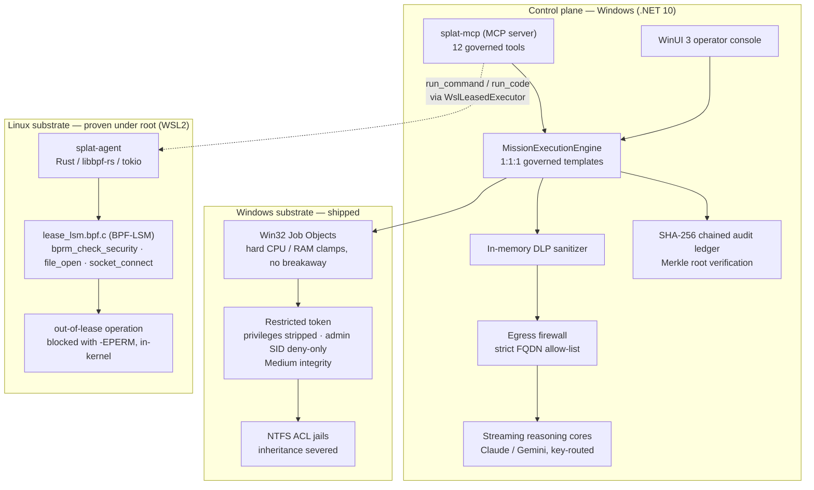

# SPLAT — Sandboxed Process Lease & Agent Telemetry

> **An execution substrate for autonomous AI agents, by Platten Industries.** Agents don't get trust — they get a *lease*: a time-boxed, resource-clamped, kernel-enforced capability grant, with every action written to a hash-chained ledger that is **unkeyed by default**, and that says so on every host it runs on.

[](src/)
[](native/splat-agent/)
[](src/MissionController.UI/)
[](tests/MissionController.Tests/Fixtures/Missions/README.md)
[](src/)
[](LICENSE)

**New here, or allergic to jargon?** Start with **[The SPLAT Field Guide](docs/TUTORIAL.md)** — the whole system explained in plain English.

---

Platten Industries is a one-person company, and this repository is that person's work. No second engineer has reviewed it, no auditor has assessed it, and most commits name an AI assistant as co-author because that is how they were written. None of that is load-bearing either way: what holds the claims up is machine-checked evidence — probe files, recorded runs pinned to the SHA-256 of the source that produced them, and tests that fail the build when prose and evidence disagree. Run the probes rather than trusting the voice. Every section below also names what it does **not** establish, and [`SUPPORTED_POLICY.md`](native/splat-agent/SUPPORTED_POLICY.md) enumerates what a lease does not enforce at all.

---

## Why not just a container, gVisor, or seccomp?

The three answers that matter, before the long version below.

1. **A container's unit is a machine; a lease's unit is one task.** `docker run` and gVisor both hand the workload a box and let it do what it likes inside that box. A lease names *this binary, this destination, this many seconds* — and an exec or a `connect()` outside it dies with `-EPERM` in the kernel, not in a wrapper the agent shares privilege with. Seccomp has the granularity but filters syscall *numbers and arguments*; it cannot say "this path, for this mission."
2. **It runs on the machine the agent is already on, on a kernel you did not build.** No cloud round trip, no shipping private source to someone else's infrastructure, no custom kernel and no fork — stock WSL2 with native BTF and `CONFIG_BPF_LSM=y`. That is the deployment story hosted sandboxes structurally cannot tell.
3. **Every claim here is bound to a probe you can run on your own host,** and the build fails when the documentation oversells *or* undersells what the evidence shows. Claims in this README have been withdrawn after passing once — the status table names each one and why.

If a per-machine perimeter is what you need, use a container: it is simpler, older and better understood. The case for this project starts where "the machine" is too coarse a boundary.

## The thesis

Every mainstream approach to "safe" AI agent execution filters in user space — regex guards, prompt rules, wrapper APIs. All of it runs *beside* the agent, at the same privilege, where a hijacked agent can route around it. SPLAT's position is that containment belongs **below** the agent:

- On **Windows**, tool processes execute inside suspended-spawn Job Objects under a restricted token whose privileges are stripped, whose Administrators SID is marked deny-only, and whose integrity level is dropped to Medium — inside NTFS ACL jails with inheritance severed. The OS object manager enforces the boundary.
- On **Linux**, a BPF-LSM program is written to enforce a per-cgroup *capability lease* inside the kernel itself, so that an exec, file-open, or connect outside the lease dies with `-EPERM` before it happens. This half is **proven in operation on a stock WSL2 kernel** — a recorded canary run shows all three hooks returning `-EPERM` while a permitted action succeeds ([evidence](native/splat-canary/evidence)) — and **proven through the daemon**: a tool executed by `splat-agent` running as uid 0 was refused `/etc/shadow` by the kernel, and an allow-listed shell was refused its exec of an unleased binary. The last hop is **Demonstrated end to end**, as of 2026-09-26 and against the kernel program that ships (`496cc634`): a `run_command` sent to `splat-mcp` by an MCP client travelled the C# bridge into that kernel and was refused there, while the command the lease permitted ran as `nobody` ([evidence](native/splat-agent/evidence/last-hop-probe.json)). See the status table and the substrate section below for what each run does and does not establish.

This is **blast-radius containment, not detection**. SPLAT does not claim to know when an agent has been prompt-injected; it guarantees that whatever the agent has become, it cannot act outside the lease it was granted. Prompt injection is not a bug with a patch; it is a structural property of putting untrusted text into the same channel as instructions. Every mitigation running at the agent's own privilege fails at the moment the agent is compromised. The only defenses that survive are the ones the agent cannot reach.

## What makes SPLAT different (and what does not)

Technical evaluations of agent sandboxes tend to blur together into generic "isolation." In reality, three concrete architectural choices separate SPLAT from anything else on the market, in descending order of defensibility:

1. **The unit of containment is a task, not a box.** Sandboxes-for-agents (E2B, Modal, Daytona, Fly) hand an agent an entire microVM where it can do whatever it wants inside the machine perimeter. Isolation is real, but the granularity is "the machine." Runtime security tools (Falco, Tetragon) do eBPF enforcement, but their unit is a long-lived cluster workload and their operator is a security team writing deployment-wide policy. SPLAT's unit is **one mission**: *this model, this binary, this destination, for this many seconds*. That is a capability grant, not a perimeter. Enforcing at that granularity requires a policy compiler, a dynamic lease lifecycle, and an in-kernel hook—most sandboxing efforts stop at the container.
2. **It runs on the box the agent is already on, on an unmodified kernel.** This is SPLAT's sharpest commercial wedge. Every cloud sandbox requires shipping workloads and private corporate data to someone else's infrastructure—an absolute non-starter for the exact buyers who most need containment: health systems, defense, finance, and anyone with data that cannot leave the host. SPLAT contains an agent locally on stock WSL2 (`6.18.33.2-microsoft-standard-WSL2`), native BTF, with no custom kernel build and no proprietary kernel fork. That is a deployment story cloud sandboxes structurally cannot tell.
3. **The evidence discipline is itself the differentiator.** In an early security category where 90% of claims are aspirational, SPLAT makes every claim load-bearing:
   - Automated tests (`DocumentationDriftTests`) fail the build in both directions: if the documentation undersells proven capability *and* if it oversells unproven capability.
   - Proof records are cryptographically pinned to the SHA-256 digest of the exact BPF source that generated them; a proof cannot outlive its code.
   - When [`src/splat-bench`](src/splat-bench) benchmarked real containment overhead and retired the inherited `<1ms` marketing figure by recording **4.12 ms p50 / 9.88 ms p95**, the project published the worse measured numbers rather than preserving marketing optics. Evaluators reading this codebase can trust that claims represent verified reality.

**What is NOT differentiated:** The Windows half. Win32 Job Objects, restricted tokens with `USE_FOR_DENY_ONLY` on the Administrators SID, Medium integrity drops, and NTFS ACL jails are essentially the Chromium sandbox architecture, well-trodden and proven in production browsers since 2008. It is competently implemented and asserted against `whoami` running inside the sandbox, but it is standard defense-in-depth, not the defensible moat. The moat is the Linux capability lease enforced by BPF-LSM on an unmodified kernel.

## Status at a glance

| Component | State |
| :--- | :--- |
| Windows containment substrate (Job Objects, restricted tokens, ACL jails) | **Shipped** — in the tested control plane |
| Governance plane (1:1:1 templates, DLP, egress firewall, audit ledger, semantic memory) | **Built, unproven** — 890 automated tests; the live analysis corpus gate is incomplete |
| Zero-warning build gate | **Enforced** — [`src`](src/Directory.Build.props) and [`tests`](tests/Directory.Build.props) compile with `TreatWarningsAsErrors`, so a cold solution build reports 0 warnings and 0 errors. No project is exempt: the console joined on 2026-09-18, when it moved to Windows App SDK 2.5.1 on .NET 10 and built without a warning, and `WarningGateTests` fails if an exemption appears |
| `splat-mcp` — MCP server exposing governed execution to agent clients | **Implemented; the hop is Demonstrated end to end against the program that ships** — stdio JSON-RPC, 12 tools. Re-recorded PASS on 2026-09-26 against kernel program `496cc634`, which is the source in this tree ([evidence](native/splat-agent/evidence/last-hop-probe.json)): a client's command travelled to the kernel and was refused there, the permitted one ran as `uid=65534`, an undeclared exec and a connect outside the lease each returned `-EPERM`, and a destination outside the host's egress policy was refused before any lease was requested. This claim was withdrawn twice before, on 2026-09-20 and again on 2026-09-25, each time because the kernel program changed hours after a passing run - once by our own edit. A proof cannot outlive the program it tested, including when the change is ours and the same day; what is new is that the hash comparison now runs on a schedule instead of waiting to be noticed. `packaging\reprove-substrate.ps1` restores it. `run_command` / `run_code` route to the Linux lease daemon and are therefore gated on the substrate below; the remaining ten run on the Windows control plane today |
| Linux kernel substrate (BPF-LSM lease enforcement) | **Proven in isolation** — canary recorded all three hooks returning `-EPERM` on stock WSL2 `6.18.33.2`, machine-checked, evidence committed |
| Linux lease daemon (`splat-agent`) | **Enforcing, proven under root on 2026-10-01** — sixty-five checks against a root daemon on kernel 6.18.33.2, every one of them passing ([docs/GUIDE-operator.md](docs/GUIDE-operator.md)). This claim was withdrawn from 2026-09-20, when the kernel program gained a per-record clock, sequence number and drop counter and the recorded run stopped naming the program that ships; it is restored because the probe was re-run against `496cc634`, which is the source in this tree. Eleven of those checks are the pinned hooks surviving a `kill -9`: with no daemon listening, a process in the still-leased cgroup was refused an exec and a file it had been refused before, was allowed the one it had been allowed, and the same kernel objects were still there after a restart - with a foreign source hash, a partial pin set and a substituted map each refusing startup as controls. Eight more are the copy-on-write scratch layer: private writes, an unchanged host lowerdir, concurrent isolation and teardown. That run: recorded in [evidence/daemon-probe.json](native/splat-agent/evidence/daemon-probe.json) and bound to the SHA-256 of the BPF source it exercised, so the proof cannot outlive the program it tested. All three hooks: a protected file the workload *could* read (`/etc/hostname`, 644 — a control run reads it, the leased run is denied, so only the lease accounts for the difference), an unleased second exec refused mid-`sh`, and egress held to one address and one port. Two concurrent leases proven not to lend each other permissions. The tool runs as `uid=65534(nobody)` with supplementary groups cleared, not as the daemon's root. IPv6 denied outright. An overrunning workload killed by the reaper 5.5s into a 60s sleep rather than merely unpoliced. A lease dimension the caller did not declare refused rather than defaulted. It proves it holds its token before a caller sends anything, and refuses the token sent in the clear. The daemon refuses to start at all unless enforcement is live |
| Host↔guest caller identity | **Partly built** — the bridge speaks a versioned JSON protocol over loopback TCP, and protocol 3 authenticates both ends with a root-owned shared secret that never crosses the wire: the daemon proves it holds the secret before the bridge sends anything but a nonce, every request proves it back, and since 2026-09-23 every frame the daemon answers with proves itself for its place on the connection. A process that takes the port while the daemon is down learns nothing it can use. It does not stop another process running as the same Windows user, which can read the secret exactly as the bridge does. The code's own notes name AF_VSOCK, or `SO_PEERCRED` over a Unix socket, as the way to identify the peer instead — which callers either would actually exclude is not yet worked out. See the [roadmap](docs/ROADMAP.md) |
| Launch-overhead benchmark ([`src/splat-bench`](src/splat-bench)) | **Recorded** — the governed Windows path adds **4.12 ms p50 / 9.88 ms p95** over the same tool run bare, on Windows `10.0.26200`, 50 alternating iterations ([evidence](src/splat-bench/evidence)). The locks account for ~2.4 ms; the rest is process creation both arms pay. This retired the inherited `<1ms` marketing figure, which the measurement missed by about 4× |

That table is the contract: nothing above it is aspirational, and nothing below it is hidden.

## Architecture



The code-level map — which assembly owns each box, how a mission moves between them, and which
boundaries a kernel enforces rather than SPLAT's own process — is
[docs/ARCHITECTURE.md](docs/ARCHITECTURE.md).

## Windows containment substrate (shipped)

Sensor tools never run as trusted children of the app. Each execution passes through:

| Stage | Implementation |
| :--- | :--- |
| Suspended spawn | [`SuspendedProcessLauncher.cs`](src/MissionController.Infrastructure.Windows/SuspendedProcessLauncher.cs) — native `CreateProcessW` with `CREATE_SUSPENDED`, so clamps attach before the first instruction runs |
| Resource clamps | [`Win32JobSandbox.cs`](src/MissionController.Infrastructure.Windows/Win32JobSandbox.cs) — Job Object hard RAM/CPU limits |
| Privilege strip | [`RestrictedTokenProvider.cs`](src/MissionController.Infrastructure.Windows/RestrictedTokenProvider.cs) — `DISABLE_MAX_PRIVILEGE` leaves only `SeChangeNotifyPrivilege`; Administrators (`S-1-5-32-544`) is marked `USE_FOR_DENY_ONLY`, so the SID can no longer grant access; integrity is lowered to Medium (`S-1-16-8192`) via `SetTokenInformation`. Asserted end-to-end against `whoami /priv` and `/groups` running inside the sandbox |
| Filesystem jail | [`NtAclJailManager.cs`](src/MissionController.Infrastructure.Windows/NtAclJailManager.cs) — per-mission NTFS ACL jail with `SetAccessRuleProtection` inheritance severed |
| Network denial | [`SensorAppContainer.cs`](src/MissionController.Infrastructure.Windows/SensorAppContainer.cs) — the tool is launched into an AppContainer holding **zero capability SIDs**, so it has no network stack rather than a filtered one. A job object clamps CPU, memory and PIDs but has no concept of a socket, so until this landed a tool that declared it only reads the local machine could still open any connection it liked. Proven differentially in [`SensorNetworkContainmentTests.cs`](tests/MissionController.Tests/SensorNetworkContainmentTests.cs): the same command that reaches a listener (and `1.1.1.1:443` by raw IP, so DNS cannot explain it) when unconfined is refused inside the container. **Coverage is partial, and measured.** The container is an RPC wall as well as a network one: `Get-WinEvent`, `Get-CimInstance` and `Get-MpComputerStatus` all fail inside it, so templates built on WMI, the Event Log service, Defender or the SCM keep their network stack rather than being silently broken — a live test asserts that WMI really is blocked, so the exemption cannot become folklore. Roughly half the catalog is contained today; closing the rest needs per-template verification or an egress control that is not also an RPC wall |
| Governed remediation | [`SandboxedRemediationEngine.cs`](src/MissionController.Infrastructure.Windows/Remediation/SandboxedRemediationEngine.cs) — a template's fix, and its rollback, run in their own sandbox only when each declares a postcondition, and the verdict is that measurement, not the exit code. The shipped catalog defines no fixes yet |
| Secrets at rest | [`DpapiCredentialVault.cs`](src/MissionController.Infrastructure.Windows/DpapiCredentialVault.cs) — Windows DPAPI CurrentUser vault |

## Linux kernel substrate (proven under root, 2026-10-01)

The Linux side is a per-cgroup **capability lease** enforced by a BPF-LSM program ([`native/splat-agent/src/bpf/lease_lsm.bpf.c`](native/splat-agent/src/bpf/lease_lsm.bpf.c)), loaded by a resident Rust daemon ([`native/splat-agent`](native/splat-agent), libbpf-rs 0.24 + tokio, CO-RE via `vmlinux.h`):

| Hook | Policy for a leased cgroup | Out-of-lease result |
| :--- | :--- | :--- |
| `lsm/bprm_check_security` | exec only allow-listed inodes | `-EPERM` |
| `lsm/file_open` | protected inodes never open | `-EPERM` |
| `lsm/socket_connect` | egress only to allow-listed IPv4 | `-EPERM` |

Policy matches on inode identity, not path strings — full-path resolution in BPF is racy (TOCTOU) and slow. Only cgroups present in the lease map are policed; the host and every other workload are untouched. Violations stream to user space over a BPF ring buffer.

**The key defect the first canary run exposed.** `struct inode_key` is a `(dev, ino)` pair, but the two sides built it from different device encodings: userspace seeded the maps with glibc's `st_dev` from `stat()`, while the BPF program keys on the kernel's `inode->i_sb->s_dev`, which packs `(major << 20) | minor`. Measured here, `/bin/sh` is `st_dev` 2096 and `s_dev` 8388656 — so *every* lookup missed. The failure was asymmetric and that is the part worth remembering: a miss in `allowed_exec_inodes` denies (loud — the first run denied an allow-listed `/bin/sh` and the canary script never started), while a miss in `protected_inodes` reads as "not protected" and **allows** (silent — `/etc/shadow` was unprotected in that run and nothing said so). Fixed on both sides with unit tests pinning the conversion. A related user-space gap has closed since: `splat-mcp` used to send placeholder inode numbers and an empty exec allow-list, which the BPF program treats as deny-everything. It now sends paths, which the daemon `stat`s inside the guest, and an exec allow-list pinned to the one command being run.

**Execution proof is recorded.** The kernel gate was confirmed GREEN on the live stock WSL2 kernel: `6.18.33.2-microsoft-standard-WSL2`, native BTF at `/sys/kernel/btf/vmlinux`, unified cgroup v2, and `CONFIG_BPF_LSM=y` — no custom kernel, no fork. The recorded run reads `active_lsms` as `unavailable`, because securityfs has to be mounted by hand and does not survive a WSL restart; that list would only have corroborated the result, never established it. What establishes it is that the program attached at all — the kernel refuses to load a BPF-LSM program when `bpf` is absent from the list — and then denied three operations from inside it. On 2026-09-03 the [`native/splat-canary`](native/splat-canary) harness produced the observable proof: a permitted `connect()` to the leased address succeeded while `open()` on `/etc/shadow`, `connect()` to an unleased address, and `exec()` of an unleased binary each returned `-EPERM` from the kernel. The run is machine-checked — the harness computes its own verdict and exits non-zero on a bad run — and its [evidence file](native/splat-canary/evidence) records the kernel release, the violations, and the SHA-256 of the BPF source that produced them. `DocumentationDriftTests` holds this README to that evidence in both directions, and stops accepting it if the BPF source changes without a fresh run. The daemon path is proven too, as of 2026-09-03: run under root, `splat-agent` spawned a tool as uid 0 that was refused `/etc/shadow` by `file_open`, and an allow-listed `/bin/sh` whose exec of `dpkg` was refused by `bprm_check_security` — root privilege did not defeat the lease. Reaching that took two fixes the first root run exposed: the tool now joins its leased cgroup in `pre_exec`, between fork and exec, because attaching after `spawn()` returned left its own exec unpoliced; and the lease now allow-lists the tool it was asked to run, which it previously did not. **The last hop is Demonstrated end to end**, as of 2026-09-26, against the kernel program this tree builds. [`probe-last-hop.ps1`](native/splat-agent/probe-last-hop.ps1) drives `splat-mcp.exe` over stdio exactly as an MCP client does, and scores controls as well as refusals: the permitted command ran as `nobody`, the operator-approved endpoint stayed reachable, `sh`'s undeclared exec of `dpkg` and a `connect()` to an address outside the lease both returned `-EPERM` from the kernel, and a request for an endpoint outside the operator's `--egress` policy was refused inside the MCP host before any lease existed ([evidence](native/splat-agent/evidence/last-hop-probe.json)). That run also found the defect which had made the hop unusable in practice and which no unit test could see: the bridge's `wsl.exe` children inherited `splat-mcp`'s standard input — the JSON-RPC channel itself — and consumed the client's own bytes, so the sixth request of a session arrived truncated. The Windows-side bridge ([`WslLeasedExecutor.cs`](src/MissionController.Infrastructure.Linux/WslLeasedExecutor.cs), [`TemplatePolicyCompiler.cs`](src/MissionController.Infrastructure.Linux/TemplatePolicyCompiler.cs), [`WslSubstrateHealthChecker.cs`](src/MissionController.Infrastructure.Linux/WslSubstrateHealthChecker.cs)) compiles governed templates into leases and health-checks the substrate. Since 2026-09-24 that compiler is on a live path: four catalog templates name the Linux lease as their substrate, and the console and `splat-mcp` alike hand such a mission whole to the daemon, which makes the mission's workspace, runs the tool as nobody in a policed cgroup, and reports in a `LEASE` frame what it installed. The kernel's part of that path was covered by withdrawn claims from 2026-09-20 until 2026-10-01, when the root probe was re-run against the source that ships and returned PASS over sixty-five checks.

## `splat-mcp` — governed execution for agent clients

[`src/splat-mcp`](src/splat-mcp) is a Model Context Protocol server that exposes SPLAT's governance to any MCP-speaking agent (Claude Code, IDE agents, orchestrators). Thirteen tools, and they do not all sit at the same depth — the distinction matters, because an agent decides what is safe to attempt from the description it is given:

| Tool | Enforced by |
| :--- | :--- |
| `run_command`, `run_code` | The Linux lease daemon. **Demonstrated end to end on 2026-09-26**, against the kernel program that ships — a recorded run drove `splat-mcp` over stdio as a client does, and the kernel refused both an undeclared exec and a connect outside the lease while the permitted command ran as `nobody` ([evidence](native/splat-agent/evidence/last-hop-probe.json)) |
| `fs_read`, `fs_write` | Windows control plane. Confined by canonical-path containment to a governed workspace root — a user-space boundary, not a kernel one |
| `diagnose_system`, `investigate_system`, `run_agent_brain`, `run_governed_crew` | The full 1:1:1 mission pipeline: validated argument binding, Job Object clamps, restricted token, ACL jail, DLP, audit ledger, Layer-2 cognitive planning, and multi-agent crew execution |
| `get_substrate_health`, `list_diagnostic_templates`, `search_incident_memory`, `list_governed_crews` | Read-only queries against the local host, catalog, memory, and crew registry |
| `export_run_record` | Reads one finished mission out of the ledger: the facts the engine sealed when it ended, the mission's entries with a Merkle proof for each, and scripts that check them. Signed when the host was given a run record key, and the bundle says so either way |
| `verify_run_record` | Holds a bundle up against this host's ledger. Everything inside a bundle agrees with itself however many of the mission's rows were left out of it, so this reports, row by row, whether the live chain still holds exactly those entries at those positions and nothing more for that mission |

Run it as `splat-mcp --workspace <dir>`. `fs_read` and `fs_write` are confined to that directory, which must already exist — it is never created for you. Without the flag they fall back to a private folder under `%LOCALAPPDATA%\SPLAT\mcp-workspace`, and the server names it on stderr at startup; stdout carries nothing but JSON-RPC. A bad option exits with status 2 before anything is built. `--ledger-key <file>` keys the audit ledger with a file you keep; an MCP client may start the server without your environment variables, so give it in the stanza's `args`. `--run-record-key <file>` signs exported run records with a key you keep, which `splat-mcp new-run-record-key <file>` will make for you, printing the fingerprint to publish; without it bundles export unsigned and say so. `splat-mcp --help` prints the rest. On a fresh host, `splat-mcp provision --apply` does the Linux setup that `splat-mcp doctor` reports missing: it installs the lease daemon it carries at `/opt/splat/splat-agent`, starts it under systemd so it survives a restart, and succeeds only when the daemon is enforcing. Without `--apply` it changes nothing and lists what it would do.

**Installing it.** One self-contained file; the target machine needs no .NET, and its WSL guest needs no Rust toolchain, because the Linux daemon travels inside it:

```powershell
powershell -ExecutionPolicy Bypass -File packaging\publish-splat-mcp.ps1
```

That builds the daemon in WSL first — so the build machine needs a Rust toolchain in WSL, and only the build machine — then produces `dist\splat-mcp.exe` (~77 MB, with its native SQLite and the daemon packed inside) and
`dist\splat-mcp.exe.sha256`, which names the daemon's build ID and the oldest glibc it accepts (2.39). It refuses to report success if the publish returns non-zero, produces
nothing, leaves a file beside the executable, yields something that cannot print its own usage, links the daemon against libelf, zlib or zstd, or ships an executable that does not carry the daemon it built.
Point an MCP client at the file:

```json
{
  "mcpServers": {
    "splat": {
      "command": "C:\\tools\\splat-mcp.exe",
      "args": ["--workspace", "C:\\path\\to\\your\\project"]
    }
  }
}
```

There is no `dotnet tool` package: `PackAsTool` rejects a platform target framework (NETSDK1146), and
this server targets `net10.0-windows` because its containment primitives are Win32.

`splat-mcp doctor` answers the question that comes before trusting it with an agent: what will this host actually enforce? It reports the kernel, whether `bpf` is on its boot command line, whether the daemon is reachable *and* holding live BPF maps, and whether its token is in place — then what a lease enforces, refuses and does not police, copied from [`SUPPORTED_POLICY.md`](native/splat-agent/SUPPORTED_POLICY.md) and held to it by a test. It exits 0 only when a lease on this host would reach the kernel, so a setup script can gate on it. It serves nothing and creates nothing.

`splat-mcp provision` gets a host from "WSL2 is installed" to "a lease reaches the kernel". It checks WSL, systemd and `bpf` on the boot line, installs the daemon it carries at `/opt/splat/splat-agent` — a build from this repository carries none, and builds it in the guest with cargo instead — writes and enables a systemd unit, and passes only when the authenticated health check says a lease reaches the kernel. It changes nothing without `--apply`, and even then leaves two steps to you and names them: `wsl --install`, which needs administrator rights and a reboot, and `wsl --shutdown`, which ends every WSL session you have open.

`--egress a.b.c.d:port,...` names the only endpoints a `run_command` or `run_code` lease may connect to. A calling agent may ask for some of them and never for others, and without the flag both tools get no network: the agent's own request used to write the network half of its lease, so the kernel would faithfully enforce whatever an injected prompt had talked it into asking for.

Every call lands in the audit ledger attributed to a resolved principal — the Windows logon session, or a validated credential where `SPLAT_MCP_CLIENT_CREDENTIAL` is configured. A credential that fails to validate refuses the call rather than falling back to an anonymous row.

## Telemetry, audit & data-loss prevention

- **Tamper-evident ledger** — [`SqliteChainedAuditLedger.cs`](src/MissionController.Infrastructure.Data/SqliteChainedAuditLedger.cs): every action, argument, token, and fix is committed to a SHA-256 chained hash ledger (WAL-mode SQLite) with Merkle-root verification. The chain commits to a *salted digest* of the payload rather than the plaintext, which is what makes retention erasure possible without forging a tamper signal — a purged row still recomputes. Each row is attributed to a resolved principal (the Windows logon session, or a validated credential) with its provenance recorded inline, never to a caller-supplied name.

  **What this detects, and what it does not.** Editing any historical row in place breaks the chain verifiably. Unkeyed — the default — it does **not** detect a rewrite: `ComputeEntryHashV2` is public, so anyone who can write the database file can recompute the whole chain from genesis undetectably, and `splat-mcp doctor` says so on every unkeyed host. Since 2026-09-18 the operator can key it with a file they keep (`--ledger-key <file>` on `splat-mcp`, or `SPLAT_LEDGER_KEY_FILE` for either host). Each keyed entry is HMAC-SHA256 under that key, and each row records which chain it is on. The first keyed entry records the switch and commits to the unkeyed history before it. A keyed ledger refuses to be extended without its key or with another. Keyed, nobody without the key file can rewrite it unnoticed. Two things a key does not change: deleting the newest entries is caught only by a saved audit anchor, and whoever can read the key file — the operator's own account included — can rewrite it as freely as SPLAT can write it.
- **SIEM streaming** — [`SiemForwarder.cs`](src/MissionController.Infrastructure.Network/Siem/SiemForwarder.cs): Microsoft Sentinel (HMAC), CEF, and RFC 5424 syslog export; [`EdrIngestionBridge.cs`](src/MissionController.Infrastructure.Network/Edr/EdrIngestionBridge.cs) bridges Defender / CrowdStrike endpoint posture.
- **Pre-egress DLP** — [`RegexDataLossPreventionSanitizer.cs`](src/MissionController.Infrastructure.Network/Dlp/RegexDataLossPreventionSanitizer.cs) masks private-key blocks, NTLM hash pairs, passwords/API keys/bearer tokens, CLI password parameters, emails, card and SSN patterns — in memory, before anything reaches a model provider.
- **Local semantic memory** — [`SqliteSemanticMemoryIndex.cs`](src/MissionController.Infrastructure.Data/Vector/SqliteSemanticMemoryIndex.cs): in-process 128-dim embeddings with sub-second cosine similarity over incident history; no cloud embedding calls.

## Governance model

- **The 1:1:1 invariant.** Every governed template binds **1 template → 1 model → 1 dedicated native tool → 1 approved egress FQDN**, enforced by strict validation and an in-memory egress firewall ([`EgressFirewallHandler.cs`](src/MissionController.Infrastructure.Network/EgressFirewallHandler.cs)). A 40+ template catalog covers network, identity, endpoint, SysOps, and compliance runbooks.

  **Which leg that FQDN governs.** Two different processes can reach a destination, and they are not contained the same way. Almost every template's rule names the **AI gateway**, which SPLAT's own process calls — that leg is pinned by the provider client and the firewall handler above. A template may instead declare that its **sensor** opens the destination (`EgressScope.ToolProcess`; today only the Grants.gov discovery suite). The distinction is enforced, not documentary: a gateway-scoped template's tool is launched with no network stack at all *where the container does not also break it* (see the network-denial row above), and on Linux `TemplatePolicyCompiler` no longer opens a kernel network lease for it — reading the FQDN alone previously granted one to the entire catalog. What Windows still cannot do is pin *which* host a sensor-scoped tool reaches: an AppContainer chooses network or no network, not a destination, so for that one suite the declared FQDN remains an audited governance claim until a loopback broker or WFP filter lands. Those templates are read-only and present no credential.
- **Bounded composition, not swarms.** Project Studio chains at most six ordered agent stages with a bounded, DLP-filtered evidence hand-off between them. No recursive routing, no parallel swarm, no open-ended loops — multi-step autonomy is *earned* as the kernel substrate lands, not assumed.
- **Reasoning cores are pluggable** — streaming Anthropic Claude and Google Gemini clients behind [`ModelClientRouter.cs`](src/MissionController.Infrastructure.Network/Ai/ModelClientRouter.cs), routed by available key.

## Verification

```text
$ dotnet test tests/MissionController.Tests/MissionController.Tests.csproj
```

The full suite currently fails its live corpus coverage gate: shipped templates need reviewed
recordings of their current definitions. Replaying an old answer cannot validate a changed prompt.
The [recording guide](tests/MissionController.Tests/Fixtures/Missions/README.md) describes promotion
and the adversarial checks. Analysis assurance remains **built, unproven** until those live runs
are recorded; the test count below is an inventory, not a passing result.

890 xUnit unit, integration, and security tests. Coverage spans the sandbox clamps (`HardeningSubsystemTests`), the Job Object containment flags read back out of the live kernel object, the restricted token asserted against `whoami` running inside the sandbox, governed argument binding, DLP masking, ledger tamper-detection, egress-firewall enforcement, operator attribution, token lifecycle and circuit breakers, the remediation/rollback engine, the MCP server, and end-to-end multi-layer verification.

**On the warning count.** The 2026-10-01 cold solution build (`--no-incremental`) completed with zero warnings and errors, including the WinUI project. This verifies compilation; it does not fill the missing live corpus or establish runtime containment.

## Repository map

```
SPLAT/
├── src/
│   ├── MissionController.Core/                  # Domain contracts, mission & project execution engines
│   ├── MissionController.Infrastructure.Windows/# Job Objects, restricted tokens, ACL jails, remediation, DPAPI vault
│   ├── MissionController.Infrastructure.Linux/  # WSL substrate bridge: leased executor, policy compiler, health checks
│   ├── MissionController.Infrastructure.Network/# DLP, egress firewall, identity/JWT, AI clients, SIEM/EDR
│   ├── MissionController.Infrastructure.Data/   # SQLite storage, chained audit ledger, Merkle engine, vector memory
│   ├── MissionController.UI/                    # WinUI 3 operator console (MVVM)
│   └── splat-mcp/                               # MCP server — governed execution for agent clients
├── native/
│   ├── splat-agent/                             # Rust eBPF daemon: lease_lsm.bpf.c + libbpf-rs loader
│   └── splat-canary/                            # Minimal -EPERM proof harness (preflight → canary)
├── tests/MissionController.Tests/               # 890 xUnit unit / integration / security tests
├── packaging/                                   # Signed MSIX build + Intune/SCCM silent install scripts
└── docs/                                        # Architecture, context and module maps; briefs, plans, audits - index in docs/README.md
```

## Compliance alignment

| Framework | Mapping |
| :--- | :--- |
| SOC 2 Type II | CC6.1 restricted tokens & privilege separation · CC6.8 egress allow-listing · CC7.2 continuous audit |
| HIPAA Security Rule | § 164.312(b) cryptographic chained audit controls · § 164.312(e)(1) transmission security & DLP masking |
| NIST SP 800-171 / CMMC 2.0 | AU.2.041–042 attributed, chained audit logs · SC.3.177 strict egress isolation |

These are the controls the architecture is *built against*; they are not an attestation, and SPLAT has not been assessed by an auditor. One qualification worth stating rather than burying: AU.2.041 non-repudiation has two halves, and only one is complete. Actions are now attributed to a principal the OS or a validator established, but the chain protecting that attribution is unkeyed unless the operator supplies a key (see the ledger note above). Unkeyed, a local administrator can still rewrite history including their own name in it; keyed, so can anyone who can read the key file, which an administrator can. Read the mapping as design intent with a known gap, not as a passed control.

## Roadmap

Every open item — who can do it, what "done" means, and the evidence for its current state — is in
[docs/ROADMAP.md](docs/ROADMAP.md), checked against the tree rather than carried forward from older
plans. In order:

1. **Installable and provable by a stranger** (done 2026-09-18, on a second machine) — a `splat-mcp` command line with an explicit
   workspace, a `doctor` command that prints what this host will and will not enforce, first-run
   WSL provisioning, single-file distribution, and one recorded end-to-end run of an MCP client's
   command being refused by the kernel.
2. **The workload's own mount namespace** — copy-on-write overlays inside the child and BPF links/maps
   pinned by their source hash are **built, unproven**. The root probe now checks isolated writes,
   scratch teardown, enforcement across daemon SIGKILL, restart reuse and rejection of foreign pins.
   Scratch-specific execution authorization remains open; no new containment claim is proven until
   a root run records PASS for these checks.
3. **Caller identity on the bridge** — AF_VSOCK or `SO_PEERCRED`, so the daemon identifies its peer
   rather than trusting a secret. Which callers that actually excludes has to be worked out before
   it is claimed.
4. **The per-mission run record** — a bundle from which someone who did not run a mission can verify
   what it was permitted to do and what it did. It needs a keyed ledger, which the operator can now
   supply; unkeyed is still the default, as the compliance note above says.
5. **A kit you mount** — SPLAT on a flash drive or from one downloaded script. It mounts onto a host
   only after showing what that host can enforce and what mounting will change, and it unmounts
   cleanly. None of it is built yet; the design is [docs/END-GOAL.md](docs/END-GOAL.md).

## License

**[GNU AGPL-3.0](LICENSE)** — © 2026 Platten Industries.

Run it, read it, change it, ship it. The obligation attaches in one place: convey a modified
version, or let anyone use a modified version **over a network**, and those users are owed your
source under the same terms. Running SPLAT to contain your own agents, on your own machines, asks
nothing of you, and nothing a governed mission produces — run records, ledgers, evidence bundles —
carries a licence claim from this project.

That network clause is the point rather than an accident. The commercial shape of a containment
substrate is somebody else's platform running it for their customers, and the AGPL says that is fine
as long as it stays open. **If it cannot stay open, [COMMERCIAL.md](COMMERCIAL.md) is the other
door** — the same code, on terms that do not propagate, for embedding SPLAT in a product you ship
closed or offer as a service.

Third-party components (.NET Runtime, Windows App SDK, Win2D, Microsoft.Data.Sqlite,
CommunityToolkit, SQLite, the libbpf ecosystem) remain under their own licences.

---

**Built by Sean Platten** ([GitHub](https://github.com/Spplatten) · [LinkedIn](https://www.linkedin.com/in/sean-platten-916686376/)) — systems engineer applying a decade of high-throughput line discipline to kernel-level agent containment: *mise en place before execution, no black boxes, zero wasted motion, and boundaries the hardware enforces.*
