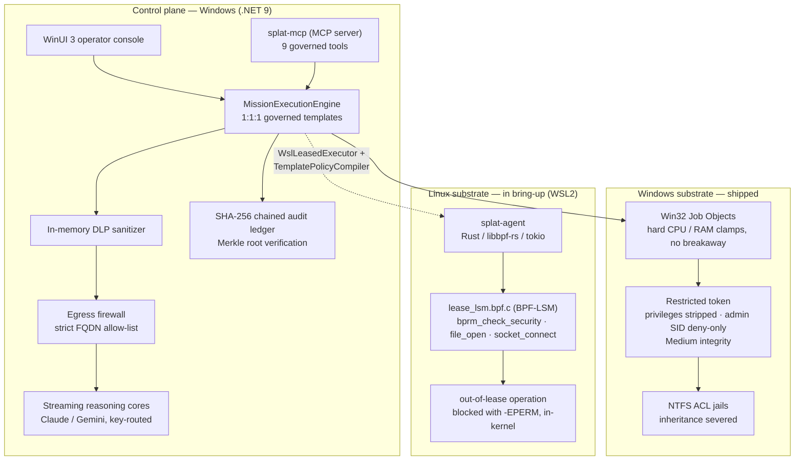

# SPLAT — Sandboxed Process Lease & Agent Telemetry

> **A zero-trust execution substrate for autonomous AI agents, by Platten Industries.** Agents don't get trust — they get a *lease*: a time-boxed, resource-clamped, kernel-enforced capability grant, with every action sealed in a tamper-evident cryptographic ledger.

[](src/)
[](native/splat-agent/)
[](src/MissionController.UI/)
[](tests/MissionController.Tests/)
[](src/)

**New here, or allergic to jargon?** Start with **[The SPLAT Field Guide](docs/TUTORIAL.md)** — the whole system explained in plain English.

---

## The thesis

Every mainstream approach to "safe" AI agent execution filters in user space — regex guards, prompt rules, wrapper APIs. All of it runs *beside* the agent, at the same privilege, where a hijacked agent can route around it. SPLAT's position is that containment belongs **below** the agent:

- On **Windows**, tool processes execute inside suspended-spawn Job Objects under a restricted token whose privileges are stripped, whose Administrators SID is marked deny-only, and whose integrity level is dropped to Medium — inside NTFS ACL jails with inheritance severed. The OS object manager enforces the boundary.
- On **Linux**, a BPF-LSM program is written to enforce a per-cgroup *capability lease* inside the kernel itself, so that an exec, file-open, or connect outside the lease dies with `-EPERM` before it happens. This half is **proven in operation on a stock WSL2 kernel** — a recorded canary run shows all three hooks returning `-EPERM` while a permitted action succeeds ([evidence](native/splat-canary/evidence)) — and **proven through the daemon**: a tool executed by `splat-agent` running as uid 0 was refused `/etc/shadow` by the kernel, and an allow-listed shell was refused its exec of an unleased binary. What remains unproven is the last hop - no request has yet travelled from the MCP tools through the C# bridge into that path. See the status table and the substrate section below before relying on it.

This is **blast-radius containment, not detection**. SPLAT does not claim to know when an agent has been prompt-injected; it guarantees that whatever the agent has become, it cannot act outside the lease it was granted. Prompt injection is not a bug with a patch; it is a structural property of putting untrusted text into the same channel as instructions. Every mitigation running at the agent's own privilege fails at the moment the agent is compromised. The only defenses that survive are the ones the agent cannot reach.

## What makes SPLAT different (and what does not)

Technical evaluations of agent sandboxes tend to blur together into generic "isolation." In reality, three concrete architectural choices separate SPLAT from anything else on the market, in descending order of defensibility:

1. **The unit of containment is a task, not a box.** Sandboxes-for-agents (E2B, Modal, Daytona, Fly) hand an agent an entire microVM where it can do whatever it wants inside the machine perimeter. Isolation is real, but the granularity is "the machine." Runtime security tools (Falco, Tetragon) do eBPF enforcement, but their unit is a long-lived cluster workload and their operator is a security team writing deployment-wide policy. SPLAT's unit is **one mission**: *this model, this binary, this destination, for this many seconds*. That is a capability grant, not a perimeter. Enforcing at that granularity requires a policy compiler, a dynamic lease lifecycle, and an in-kernel hook—most sandboxing efforts stop at the container.
2. **It runs on the box the agent is already on, on an unmodified kernel.** This is SPLAT's sharpest commercial wedge. Every cloud sandbox requires shipping workloads and private corporate data to someone else's infrastructure—an absolute non-starter for the exact buyers who most need containment: health systems, defense, finance, and anyone with data that cannot leave the host. SPLAT contains an agent locally on stock WSL2 (`6.18.33.2-microsoft-standard-WSL2`), native BTF, with no custom kernel build and no proprietary kernel fork. That is a deployment story cloud sandboxes structurally cannot tell.
3. **The evidence discipline is itself the differentiator.** In an early security category where 90% of claims are aspirational, SPLAT makes every claim load-bearing:
   - Automated tests (`DocumentationDriftTests`) fail the build in both directions: if the documentation undersells proven capability *and* if it oversells unproven capability.
   - Proof records are cryptographically pinned to the SHA-256 digest of the exact BPF source that generated them; a proof cannot outlive its code.
   - When [`src/splat-bench`](src/splat-bench) benchmarked real containment overhead and retired the inherited `<1ms` marketing figure by recording **4.12 ms p50 / 9.88 ms p95**, the project published the worse measured numbers rather than preserving marketing optics. Evaluators reading this codebase can trust that claims represent verified reality.

**What is NOT differentiated:** The Windows half. Win32 Job Objects, restricted tokens with `USE_FOR_DENY_ONLY` on the Administrators SID, Medium integrity drops, and NTFS ACL jails are essentially the Chromium sandbox architecture, well-trodden and proven in production browsers since 2008. It is competently implemented and asserted against `whoami` running inside the sandbox, but it is standard defense-in-depth, not the defensible moat. The moat is the Linux capability lease enforced by BPF-LSM on an unmodified kernel.

## Status at a glance

| Component | State |
| :--- | :--- |
| Windows containment substrate (Job Objects, restricted tokens, ACL jails) | **Shipped** — in the tested control plane |
| Governance plane (1:1:1 templates, DLP, egress firewall, audit ledger, semantic memory) | **Shipped** — 443/443 automated tests passing |
| `splat-mcp` — MCP server exposing governed execution to agent clients | **Implemented** — stdio JSON-RPC, 9 tools. `run_command` / `run_code` route to the Linux lease daemon and are therefore gated on the substrate below; the remaining seven run on the Windows control plane today |
| Linux kernel substrate (BPF-LSM lease enforcement) | **Proven in isolation** — canary recorded all three hooks returning `-EPERM` on stock WSL2 `6.18.33.2`, machine-checked, evidence committed |
| Linux lease daemon (`splat-agent`) | **Enforcing, proven under root** — fifteen checks in one run against a root daemon on kernel 6.18.33.2, recorded in [evidence/daemon-probe.json](native/splat-agent/evidence/daemon-probe.json) and bound to the SHA-256 of the BPF source that ships, so the proof cannot outlive the program it tested. All three hooks: a protected file the workload *could* read (`/etc/hostname`, 644 — a control run reads it, the leased run is denied, so only the lease accounts for the difference), an unleased second exec refused mid-`sh`, and egress held to one address and one port. Two concurrent leases proven not to lend each other permissions. The tool runs as `uid=65534(nobody)` with supplementary groups cleared, not as the daemon's root. IPv6 denied outright. An overrunning workload killed by the reaper 5.3s into a 60s sleep rather than merely unpoliced. The daemon refuses to start at all unless enforcement is live |
| VSOCK low-latency RPC transport | **Roadmap** — design notes in internal docs |
| Launch-overhead benchmark ([`src/splat-bench`](src/splat-bench)) | **Recorded** — the governed Windows path adds **4.12 ms p50 / 9.88 ms p95** over the same tool run bare, on Windows `10.0.26200`, 50 alternating iterations ([evidence](src/splat-bench/evidence)). The locks account for ~2.4 ms; the rest is process creation both arms pay. This retired the inherited `<1ms` marketing figure, which the measurement missed by about 4× |

That table is the contract: nothing above it is aspirational, and nothing below it is hidden.

## Architecture



## Windows containment substrate (shipped)

Sensor tools never run as trusted children of the app. Each execution passes through:

| Stage | Implementation |
| :--- | :--- |
| Suspended spawn | [`SuspendedProcessLauncher.cs`](src/MissionController.Infrastructure.Windows/SuspendedProcessLauncher.cs) — native `CreateProcessW` with `CREATE_SUSPENDED`, so clamps attach before the first instruction runs |
| Resource clamps | [`Win32JobSandbox.cs`](src/MissionController.Infrastructure.Windows/Win32JobSandbox.cs) — Job Object hard RAM/CPU limits |
| Privilege strip | [`RestrictedTokenProvider.cs`](src/MissionController.Infrastructure.Windows/RestrictedTokenProvider.cs) — `DISABLE_MAX_PRIVILEGE` leaves only `SeChangeNotifyPrivilege`; Administrators (`S-1-5-32-544`) is marked `USE_FOR_DENY_ONLY`, so the SID can no longer grant access; integrity is lowered to Medium (`S-1-16-8192`) via `SetTokenInformation`. Asserted end-to-end against `whoami /priv` and `/groups` running inside the sandbox |
| Filesystem jail | [`NtAclJailManager.cs`](src/MissionController.Infrastructure.Windows/NtAclJailManager.cs) — per-mission NTFS ACL jail with `SetAccessRuleProtection` inheritance severed |
| Network denial | [`SensorAppContainer.cs`](src/MissionController.Infrastructure.Windows/SensorAppContainer.cs) — the tool is launched into an AppContainer holding **zero capability SIDs**, so it has no network stack rather than a filtered one. A job object clamps CPU, memory and PIDs but has no concept of a socket, so until this landed a tool that declared it only reads the local machine could still open any connection it liked. Proven differentially in [`SensorNetworkContainmentTests.cs`](tests/MissionController.Tests/SensorNetworkContainmentTests.cs): the same command that reaches a listener (and `1.1.1.1:443` by raw IP, so DNS cannot explain it) when unconfined is refused inside the container. **Coverage is partial, and measured.** The container is an RPC wall as well as a network one: `Get-WinEvent`, `Get-CimInstance` and `Get-MpComputerStatus` all fail inside it, so templates built on WMI, the Event Log service, Defender or the SCM keep their network stack rather than being silently broken — a live test asserts that WMI really is blocked, so the exemption cannot become folklore. Roughly half the catalog is contained today; closing the rest needs per-template verification or an egress control that is not also an RPC wall |
| Governed remediation | [`SandboxedRemediationEngine.cs`](src/MissionController.Infrastructure.Windows/Remediation/SandboxedRemediationEngine.cs) — 1-click fixes run in their own sandbox, with rollback support for state-mutating actions |
| Secrets at rest | [`DpapiCredentialVault.cs`](src/MissionController.Infrastructure.Windows/DpapiCredentialVault.cs) — Windows DPAPI CurrentUser vault |

## Linux kernel substrate (in bring-up)

The Linux side is a per-cgroup **capability lease** enforced by a BPF-LSM program ([`native/splat-agent/src/bpf/lease_lsm.bpf.c`](native/splat-agent/src/bpf/lease_lsm.bpf.c)), loaded by a resident Rust daemon ([`native/splat-agent`](native/splat-agent), libbpf-rs 0.24 + tokio, CO-RE via `vmlinux.h`):

| Hook | Policy for a leased cgroup | Out-of-lease result |
| :--- | :--- | :--- |
| `lsm/bprm_check_security` | exec only allow-listed inodes | `-EPERM` |
| `lsm/file_open` | protected inodes never open | `-EPERM` |
| `lsm/socket_connect` | egress only to allow-listed IPv4 | `-EPERM` |

Policy matches on inode identity, not path strings — full-path resolution in BPF is racy (TOCTOU) and slow. Only cgroups present in the lease map are policed; the host and every other workload are untouched. Violations stream to user space over a BPF ring buffer.

**The key defect the first canary run exposed.** `struct inode_key` is a `(dev, ino)` pair, but the two sides built it from different device encodings: userspace seeded the maps with glibc's `st_dev` from `stat()`, while the BPF program keys on the kernel's `inode->i_sb->s_dev`, which packs `(major << 20) | minor`. Measured here, `/bin/sh` is `st_dev` 2096 and `s_dev` 8388656 — so *every* lookup missed. The failure was asymmetric and that is the part worth remembering: a miss in `allowed_exec_inodes` denies (loud — the first run denied an allow-listed `/bin/sh` and the canary script never started), while a miss in `protected_inodes` reads as "not protected" and **allows** (silent — `/etc/shadow` was unprotected in that run and nothing said so). Fixed on both sides with unit tests pinning the conversion. The user-space side retains a related gap: `splat-mcp` compiles leases with placeholder inode numbers rather than `stat`-ing the paths, and with an empty exec allow-list, which the BPF program treats as deny-everything.

**Execution proof is recorded.** The kernel gate was confirmed GREEN on the live stock WSL2 kernel: `6.18.33.2-microsoft-standard-WSL2`, native BTF at `/sys/kernel/btf/vmlinux`, unified cgroup v2, and `CONFIG_BPF_LSM=y` — no custom kernel, no fork. The recorded run reads `active_lsms` as `unavailable`, because securityfs has to be mounted by hand and does not survive a WSL restart; that list would only have corroborated the result, never established it. What establishes it is that the program attached at all — the kernel refuses to load a BPF-LSM program when `bpf` is absent from the list — and then denied three operations from inside it. On 2026-09-03 the [`native/splat-canary`](native/splat-canary) harness produced the observable proof: a permitted `connect()` to the leased address succeeded while `open()` on `/etc/shadow`, `connect()` to an unleased address, and `exec()` of an unleased binary each returned `-EPERM` from the kernel. The run is machine-checked — the harness computes its own verdict and exits non-zero on a bad run — and its [evidence file](native/splat-canary/evidence) records the kernel release, the violations, and the SHA-256 of the BPF source that produced them. `DocumentationDriftTests` holds this README to that evidence in both directions, and stops accepting it if the BPF source changes without a fresh run. The daemon path is proven too, as of 2026-09-03: run under root, `splat-agent` spawned a tool as uid 0 that was refused `/etc/shadow` by `file_open`, and an allow-listed `/bin/sh` whose exec of `dpkg` was refused by `bprm_check_security` — root privilege did not defeat the lease. Reaching that took two fixes the first root run exposed: the tool now joins its leased cgroup in `pre_exec`, between fork and exec, because attaching after `spawn()` returned left its own exec unpoliced; and the lease now allow-lists the tool it was asked to run, which it previously did not. What this still does **not** establish is production use: no request has travelled from `run_command` / `run_code` through the C# bridge into the daemon, so the last hop remains a separate claim needing its own evidence. The Windows-side bridge ([`WslLeasedExecutor.cs`](src/MissionController.Infrastructure.Linux/WslLeasedExecutor.cs), [`TemplatePolicyCompiler.cs`](src/MissionController.Infrastructure.Linux/TemplatePolicyCompiler.cs), [`WslSubstrateHealthChecker.cs`](src/MissionController.Infrastructure.Linux/WslSubstrateHealthChecker.cs)) compiles governed templates into leases and health-checks the substrate.

## `splat-mcp` — governed execution for agent clients

[`src/splat-mcp`](src/splat-mcp) is a Model Context Protocol server that exposes SPLAT's governance to any MCP-speaking agent (Claude Code, IDE agents, orchestrators). Twelve tools, and they do not all sit at the same depth — the distinction matters, because an agent decides what is safe to attempt from the description it is given:

| Tool | Enforced by |
| :--- | :--- |
| `run_command`, `run_code` | The Linux lease daemon. **Not yet demonstrated from here.** The daemon itself is now proven to enforce leases under root, but no run has carried a request from these tools through the C# bridge into it — treat them as uncontained until one does |
| `fs_read`, `fs_write` | Windows control plane. Confined by canonical-path containment to a governed workspace root — a user-space boundary, not a kernel one |
| `diagnose_system`, `investigate_system`, `run_agent_brain`, `run_governed_crew` | The full 1:1:1 mission pipeline: validated argument binding, Job Object clamps, restricted token, ACL jail, DLP, audit ledger, Layer-2 cognitive planning, and multi-agent crew execution |
| `get_substrate_health`, `list_diagnostic_templates`, `search_incident_memory`, `list_governed_crews` | Read-only queries against the local host, catalog, memory, and crew registry |

Every call lands in the audit ledger attributed to a resolved principal — the Windows logon session, or a validated credential where `SPLAT_MCP_CLIENT_CREDENTIAL` is configured. A credential that fails to validate refuses the call rather than falling back to an anonymous row.

## Telemetry, audit & data-loss prevention

- **Tamper-evident ledger** — [`SqliteChainedAuditLedger.cs`](src/MissionController.Infrastructure.Data/SqliteChainedAuditLedger.cs): every action, argument, token, and fix is committed to a SHA-256 chained hash ledger (WAL-mode SQLite) with Merkle-root verification. The chain commits to a *salted digest* of the payload rather than the plaintext, which is what makes retention erasure possible without forging a tamper signal — a purged row still recomputes. Each row is attributed to a resolved principal (the Windows logon session, or a validated credential) with its provenance recorded inline, never to a caller-supplied name.

  **What this detects, and what it does not.** Editing any historical row in place breaks the chain verifiably. It does **not** detect a rewrite: the chain is unkeyed and `ComputeEntryHashV2` is public, so anyone who can write the database file can delete the tail and re-append, or recompute the whole chain from genesis, undetectably. Closing that needs a key the rewriter does not hold — an HMAC under the DPAPI vault, or periodic anchoring to append-only external storage. Until then this is integrity against accident and casual editing, not against a determined local administrator.
- **SIEM streaming** — [`SiemForwarder.cs`](src/MissionController.Infrastructure.Network/Siem/SiemForwarder.cs): Microsoft Sentinel (HMAC), CEF, and RFC 5424 syslog export; [`EdrIngestionBridge.cs`](src/MissionController.Infrastructure.Network/Edr/EdrIngestionBridge.cs) bridges Defender / CrowdStrike endpoint posture.
- **Pre-egress DLP** — [`RegexDataLossPreventionSanitizer.cs`](src/MissionController.Infrastructure.Network/Dlp/RegexDataLossPreventionSanitizer.cs) masks private-key blocks, NTLM hash pairs, passwords/API keys/bearer tokens, CLI password parameters, emails, card and SSN patterns — in memory, before anything reaches a model provider.
- **Local semantic memory** — [`SqliteSemanticMemoryIndex.cs`](src/MissionController.Infrastructure.Data/Vector/SqliteSemanticMemoryIndex.cs): in-process 128-dim embeddings with sub-second cosine similarity over incident history; no cloud embedding calls.

## Governance model

- **The 1:1:1 invariant.** Every governed template binds **1 template → 1 model → 1 dedicated native tool → 1 approved egress FQDN**, enforced by strict validation and an in-memory egress firewall ([`EgressFirewallHandler.cs`](src/MissionController.Infrastructure.Network/EgressFirewallHandler.cs)). A 40+ template catalog covers network, identity, endpoint, SysOps, and compliance runbooks.

  **Which leg that FQDN governs.** Two different processes can reach a destination, and they are not contained the same way. Almost every template's rule names the **AI gateway**, which SPLAT's own process calls — that leg is pinned by the provider client and the firewall handler above. A template may instead declare that its **sensor** opens the destination (`EgressScope.ToolProcess`; today only the Grants.gov discovery suite). The distinction is enforced, not documentary: a gateway-scoped template's tool is launched with no network stack at all *where the container does not also break it* (see the network-denial row above), and on Linux `TemplatePolicyCompiler` no longer opens a kernel network lease for it — reading the FQDN alone previously granted one to the entire catalog. What Windows still cannot do is pin *which* host a sensor-scoped tool reaches: an AppContainer chooses network or no network, not a destination, so for that one suite the declared FQDN remains an audited governance claim until a loopback broker or WFP filter lands. Those templates are read-only and present no credential.
- **Bounded composition, not swarms.** Project Studio chains at most six ordered agent stages with a bounded, DLP-filtered evidence hand-off between them. No recursive routing, no parallel swarm, no open-ended loops — multi-step autonomy is *earned* as the kernel substrate lands, not assumed.
- **Reasoning cores are pluggable** — streaming Anthropic Claude and Google Gemini clients behind [`ModelClientRouter.cs`](src/MissionController.Infrastructure.Network/Ai/ModelClientRouter.cs), routed by available key.

## Verification

```text
$ dotnet test tests/MissionController.Tests/MissionController.Tests.csproj
Passed!  - Failed: 0, Passed: 443, Skipped: 0, Total: 443, Duration: 4 s - MissionController.Tests.dll (net9.0)
```

443 xUnit unit, integration, and security tests. Coverage spans the sandbox clamps (`HardeningSubsystemTests`), the Job Object containment flags read back out of the live kernel object, the restricted token asserted against `whoami` running inside the sandbox, governed argument binding, DLP masking, ledger tamper-detection, egress-firewall enforcement, operator attribution, token lifecycle and circuit breakers, the remediation/rollback engine, the MCP server, and end-to-end multi-layer verification.

**On the warning count.** An incremental `dotnet build` reports zero warnings, but that is an artifact of caching rather than a property of the source: a cold `--no-incremental` build re-runs the CommunityToolkit source generators and emits **186 `MVVMTK0045` warnings**, one per `[ObservableProperty]` field that should be declared as a partial property for WinRT marshalling. They are cosmetic and confined to the view models, but a "zero warnings" claim would only have been true on the build nobody runs from clean. Converting the fields is tracked work; the badge above claims zero *errors*, which holds either way.

## Repository map

```
SPLAT/
├── src/
│   ├── MissionController.Core/                  # Domain contracts, mission & project execution engines
│   ├── MissionController.Infrastructure.Windows/# Job Objects, restricted tokens, ACL jails, remediation, DPAPI vault
│   ├── MissionController.Infrastructure.Linux/  # WSL substrate bridge: leased executor, policy compiler, health checks
│   ├── MissionController.Infrastructure.Network/# DLP, egress firewall, identity/JWT, AI clients, SIEM/EDR
│   ├── MissionController.Infrastructure.Data/   # SQLite storage, chained audit ledger, Merkle engine, vector memory
│   ├── MissionController.UI/                    # WinUI 3 operator console (MVVM)
│   └── splat-mcp/                               # MCP server — governed execution for agent clients
├── native/
│   ├── splat-agent/                             # Rust eBPF daemon: lease_lsm.bpf.c + libbpf-rs loader
│   └── splat-canary/                            # Minimal -EPERM proof harness (preflight → canary)
├── tests/MissionController.Tests/               # 350 xUnit unit / integration / security tests
├── packaging/                                   # Signed MSIX build + Intune/SCCM silent install scripts
└── docs/                                        # Architecture notes & briefs
```

## Compliance alignment

| Framework | Mapping |
| :--- | :--- |
| SOC 2 Type II | CC6.1 restricted tokens & privilege separation · CC6.8 egress allow-listing · CC7.2 continuous audit |
| HIPAA Security Rule | § 164.312(b) cryptographic chained audit controls · § 164.312(e)(1) transmission security & DLP masking |
| NIST SP 800-171 / CMMC 2.0 | AU.2.041–042 attributed, chained audit logs · SC.3.177 strict egress isolation |

These are the controls the architecture is *built against*; they are not an attestation, and SPLAT has not been assessed by an auditor. One qualification worth stating rather than burying: AU.2.041 non-repudiation has two halves, and only one is complete. Actions are now attributed to a principal the OS or a validator established, but the chain protecting that attribution is unkeyed (see the ledger note above), so a local administrator can still rewrite history including their own name in it. Read the mapping as design intent with a known gap, not as a passed control.

## Roadmap

1. **Canary `-EPERM` run** — record the observable kernel-enforcement proof on the verified WSL2 substrate.
2. **VSOCK RPC transport** — low-latency host↔guest streaming path.
3. **Auto-provisioned WSL substrate** — zero-touch guest lifecycle from the Windows control plane.
4. **Substrate-gated autonomy** — expand multi-step investigation depth only where kernel-lease enforcement is active.

## License

**Proprietary — © Platten Industries. All rights reserved.** Published for technical evaluation. Third-party components (.NET Runtime, Windows App SDK, Win2D, Microsoft.Data.Sqlite, CommunityToolkit, SQLite, the libbpf ecosystem) remain under their respective licenses.

---

**Built by Sean Platten** ([GitHub](https://github.com/Spplatten) · [LinkedIn](https://www.linkedin.com/in/sean-platten-916686376/)) — systems engineer applying a decade of high-throughput line discipline to kernel-level agent containment: *mise en place before execution, no black boxes, zero wasted motion, and boundaries the hardware enforces.*
