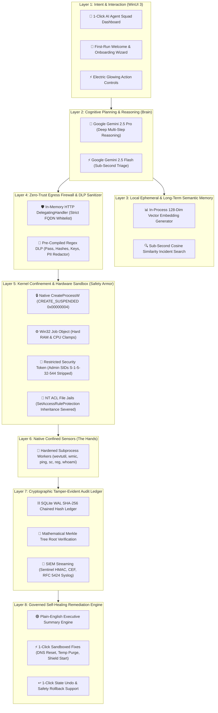

# SPLAT 🛡️⚡

> **Security & Performance Live Autonomous Toolkit — Autonomous AI Agent Fleet, Zero-Trust Execution Runtime, & Self-Healing Kernel Appliance by Platten Industries**

[](https://dotnet.microsoft.com/)
[-0078D6?style=flat&logo=windows)](https://microsoft.com/windows)
[](https://csrc.nist.gov/publications/detail/sp/800-207/final)
[-success)](https://github.com/Platten-Industries/SPLAT/tree/main/tests/MissionController.Tests)
[](https://github.com/Platten-Industries/SPLAT)

---

## 🌟 Executive Overview

**SPLAT** (internal codename: *Mission Controller* — the name carried by the solution and project files) is an enterprise-grade AI-native operational appliance engineered for Windows enterprise and campus workstations. Developed by **Platten Industries**, it empowers everyone—from senior SecOps threat hunters down to everyday staff and Tier-1 helpdesk technicians—to dispatch **autonomous, specialized AI agents** that safely investigate, diagnose, and self-heal system issues.

Unlike unmonitored consumer AI chatbots or dangerous unrestricted script engines, every agent in SPLAT is confined by an **8-Layer Governed Architecture**:
* **Zero Kernel Risk:** Native sensor tools execute inside suspended Win32 Job Objects with Admin privileges stripped (`S-1-5-32-544`) and parent directory inheritance severed.
* **Zero Data Leakage:** In-memory DLP filters automatically redact passwords, NTLM hashes, private keys, and personal emails before cloud transmission.
* **Ground-Truth Telemetry:** Agents reason over real kernel telemetry rather than guesses, and synthesize plain-English executive answers alongside signed 1-click self-healing fixes.
* **Tamper-Evident Non-Repudiation:** Every action, argument, token, and fix is cryptographically sealed in a SHA-256 chained hash ledger with Merkle root verification.

---

## 🏛️ The 8-Layer Enterprise Governed AI Stack



---

## 🤖 The 8 Governed Autonomous AI Agents

The platform includes 8 out-of-the-box specialized AI agents bound to the **Strict 1:1:1 Governance Invariant** ($\text{1 Template} \rightarrow \text{1 Model} \rightarrow \text{1 Dedicated Native Tool} \rightarrow \text{1 Allowed Egress FQDN}$):

| # | Agent Identity | Specialization | Confined Sensor Tool | Governed 1-Click Fix |
| :---: | :--- | :--- | :--- | :--- |
| **1** | 🌐 **Atlas-Net** | Network Intelligence | `ping.exe` / DNS Latency Probe | ⚡ **Flush DNS Cache & Reset WinSock Sockets** |
| **2** | 🛡️ **Sentinel-SecOps** | Security Incident Hunter | `wevtutil.exe` (Event 4624/4625) | ⚡ **Enforce Account Lockout Threshold** *(Rollback enabled)* |
| **3** | 💾 **Titan-SysOps** | Storage Optimization | `wmic.exe` Volume Headroom Sensor | ⚡ **Purge Temporary User & System Caches** |
| **4** | 🔒 **Aegis-Endpoint** | Compliance & Antivirus | `sc.exe` Service Controller (WinDefend) | ⚡ **Start & Enable Defender Real-Time Shield** |
| **5** | 🏛️ **Vanguard-AD** | Active Directory / Identity | `cmd.exe /c "whoami /all & net accounts"` | ⚡ **Purge Stale Kerberos Tickets & Reset SIDs** |
| **6** | ☁️ **Zephyr-Azure** | Cloud Health & Hybrid Sync | `powershell.exe` Entra ID SSO Probe | ⚡ **Flush Cloud SSO Endpoints & DNS Cache** |
| **7** | 🛡️ **Chronos-Patch** | Patch & CVE Compliance | `powershell.exe` HotFix & Rollup Sensor | ⚡ **Trigger Windows Update Detection Scan** |
| **8** | 🧹 **Cypher-Registry** | Forensics & Persistence | `cmd.exe /c "reg query ...\Run"` | ⚡ **Clear Stale RunOnce Keys** *(Rollback enabled)* |

---

## ⚡ Layer 8: Governed 1-Click Self-Healing Remediations

When an agent identifies a system bottleneck or misconfiguration, it presents a **Governed Self-Healing Action Card**:
1. **Isolated Execution:** The remediation script runs inside a dedicated Win32 Job Object sandbox (`SandboxedRemediationEngine.cs`).
2. **Audit Hash Sealing:** Every executed fix (`REMEDIATION_FIX_COMPLETED`) and rollback (`REMEDIATION_ROLLBACK_COMPLETED`) is permanently committed to the SHA-256 chained audit ledger.
3. **Safety Rollbacks:** State-mutating fixes (such as account lockout thresholds or registry keys) feature a dedicated **`↩️ Rollback`** button to immediately restore the prior system state.

---

## 🔏 Layer 4: In-Memory Data Loss Prevention (DLP) Sanitizer

The built-in DLP engine (`RegexDataLossPreventionSanitizer.cs`) automatically scans all command-line arguments, process outputs, and system logs **before** they egress to Vertex AI:
* **Private Keys:** Masks `-----BEGIN RSA/EC PRIVATE KEY-----` blocks $\rightarrow$ `[REDACTED_PRIVATE_KEY_BLOCK]`.
* **NTLM Hashes:** Identifies LM:NTLM 32-byte hex hash pairs $\rightarrow$ `[REDACTED_NTLM_HASH]`.
* **Passwords & API Keys:** Scrubs `password=...`, `apikey=...`, `bearer ...` $\rightarrow$ `[REDACTED_SECRET]`.
* **CLI Password Parameters:** Scrubs `-p <pass>`, `-password <pass>`, `/p:<pass>` $\rightarrow$ `[REDACTED_PASSWORD]`.
* **Personal & Corporate Emails:** RFC 5322 regex $\rightarrow$ `[REDACTED_EMAIL]`.
* **Credit Cards & SSNs:** Scrubs 13–16 digit numbers and `###-##-####` SSNs.

---

## 🧠 Layer 3: Local In-Process Semantic Vector Memory

The local semantic memory index (`SqliteSemanticMemoryIndex.cs`) allows operators to perform sub-second similarity search over historical incidents:
* **128-Dimensional Embedding Engine:** Generates normalized term frequency and character trigram hashing vectors directly in-process without cloud API calls.
* **Sub-Second Cosine Similarity:** Computes vector dot products in sub-millisecond time to rank and recall past incident remediations.

---

## 📁 Repository Structure

```
SPLAT/
├── src/
│   ├── MissionController.Core/                     # Domain models, strict contracts, & engine orchestration
│   │   ├── Enums.cs                                # System states, compliance frameworks, SIEM protocols
│   │   ├── Interfaces.cs                           # Core contracts & zero-trust interfaces
│   │   ├── Models.cs                               # Immutable records (SingleToolTemplate, RemediationAction, etc.)
│   │   └── MissionExecutionEngine.cs               # 8-Layer orchestrator with DLP & semantic memory hooks
│   │
│   ├── MissionController.Infrastructure.Windows/   # Win32 & OS kernel integration
│   │   ├── Jails/NtAclJailManager.cs               # NT ACL jail directory manager (severed inheritance)
│   │   ├── JobObjects/Win32JobSandbox.cs           # Win32 Job Object resource governor (RAM/CPU clamps)
│   │   ├── Process/SuspendedProcessLauncher.cs     # CREATE_SUSPENDED execution coordinator
│   │   ├── Remediation/SandboxedRemediationEngine.cs # Layer 8 Sandboxed Self-Healing & Rollback Engine
│   │   ├── Security/RestrictedTokenProvider.cs     # Drops Admin SIDs (S-1-5-32-544)
│   │   └── Vault/DpapiCredentialVault.cs           # Windows DPAPI CurrentUser credential vault
│   │
│   ├── MissionController.Infrastructure.Network/   # Network security & identity
│   │   ├── Dlp/RegexDataLossPreventionSanitizer.cs  # Layer 4 In-Memory DLP Sanitizer
│   │   ├── Http/EgressFirewallHandler.cs           # SocketsHttpHandler with 1:1:1 FQDN whitelist
│   │   ├── Identity/                               # JWT, API Key, Token Lifecycle, & Circuit Breaker
│   │   ├── Vertex/VertexAiStreamClient.cs          # Google Vertex AI / Gemini 2.5 streaming client
│   │   ├── Siem/SiemForwarder.cs                   # Sentinel HMAC, CEF, & RFC 5424 Syslog streaming
│   │   └── Edr/EdrIngestionBridge.cs               # Defender & CrowdStrike endpoint posture bridge
│   │
│   ├── MissionController.Infrastructure.Data/      # Storage & Compliance
│   │   ├── SqliteStorageContext.cs                 # WAL-mode SQLite database context with schema migration
│   │   ├── SqliteChainedAuditLedger.cs             # Cryptographic SHA-256 chained hash ledger
│   │   ├── SqliteTemplateRegistry.cs               # 8 Governed Autonomous Agent Fleet catalog
│   │   ├── Vector/SqliteSemanticMemoryIndex.cs     # Layer 3 In-Process Vector Embedding Index
│   │   └── Compliance/                             # Merkle Tree engine & ZIP compliance archive exporter
│   │
│   └── MissionController.UI/                       # WinUI 3 / Windows App SDK Desktop Application
│       ├── App.xaml / App.xaml.cs                  # Electric glowing styles & Dependency Injection container
│       ├── MainWindow.xaml / MainWindow.xaml.cs    # Mica backdrop window shell with auto-centering
│       ├── Views/
│       │   ├── QuickDiagnosticianView.xaml         # 1-Click 8-Agent Squad & Self-Healing Dashboard
│       │   ├── WelcomeOnboardingView.xaml          # First-Run 3-Step Onboarding Wizard
│       │   ├── LiveMissionMonitorView.xaml         # Real-time token streaming & Job Object gauges
│       │   ├── TemplateCatalogView.xaml            # Parameter-guided template configuration form
│       │   ├── SecurityAuditView.xaml              # Cryptographic audit ledger & circuit breaker
│       │   └── SemanticSearchView.xaml             # Local semantic incident search UI
│       └── ViewModels/                             # Reactive MVVM ViewModels
│
├── tests/
│   └── MissionController.Tests/                    # 41 xUnit unit, integration, & security test suites
│       ├── RemediationEngineTests.cs               # Layer 8 Sandboxed Fix & Rollback verification
│       ├── DlpSanitizerTests.cs                    # Layer 4 Password, Hash, Key, & PII masking tests
│       ├── SemanticMemoryTests.cs                  # Layer 3 Vector embedding & Cosine similarity tests
│       ├── HardeningSubsystemTests.cs              # NT ACL inheritance & Job Object clamp tests
│       ├── TokenValidationAndLifecycleTests.cs      # JWT validation, API keys, & token renewal tests
│       ├── SanitizationAndRevocationTests.cs        # Circuit breaker emergency trip tests
│       └── EndToEndVerificationTests.cs            # Full multi-layer integration verification
│
└── packaging/                                      # Enterprise Deployment Tooling
    ├── build-msix.ps1                              # Automated Release build, cert gen, & signed MSIX packaging
    ├── install-enterprise.ps1                      # Silent installer for Intune & SCCM Group Policy
    └── uninstall-enterprise.ps1                    # Clean de-provisioning script (purges DPAPI & jails)
```

---

## 🧪 Verification & Automated Test Suite

Every subsystem is validated with comprehensive automated tests:

```text
Passed!  - Failed: 0, Passed: 41, Skipped: 0, Total: 41, Duration: 5 s - MissionController.Tests.dll (net9.0)
  ✓ RemediationEngineTests.ExecuteFixAsync_RunsSafeFix_AndLogsToAuditLedger
  ✓ RemediationEngineTests.ExecuteRollbackAsync_RollsBackAction_WhenConfigured
  ✓ DlpSanitizerTests.Sanitize_MasksPasswordsAndSecretsInText
  ✓ DlpSanitizerTests.Sanitize_MasksCliPasswordArguments
  ✓ DlpSanitizerTests.Sanitize_MasksNtlmHashes
  ✓ DlpSanitizerTests.Sanitize_MasksEmailAddresses
  ✓ DlpSanitizerTests.Sanitize_MasksPrivateKeys
  ✓ SemanticMemoryTests.GenerateEmbeddingVector_ReturnsNormalizedVector
  ✓ SemanticMemoryTests.SemanticMemoryIndex_IndexesAndRetrievesSimilarIncidents
  ✓ HardeningSubsystemTests.NtAclJailManager_InheritanceStripped_Successfully
  ✓ HardeningSubsystemTests.Win32JobSandbox_CreationAndLimits_Succeeds
  ✓ ProcessLauncherTests.SuspendedProcessLauncher_SpawnsAndCapturesOutput
  ✓ AuditAndSecurityTests.ChainedAuditLedger_DetectsTampering_AndValidatesIntegrity
  ✓ AuditAndSecurityTests.EgressFirewall_EnforcesWhitelist_ThrowsOnMismatch
  ✓ AuditAndSecurityTests.DpapiVault_EncryptAndDecrypt_RoundtripsSuccessfully
  ✓ AuditAndSecurityTests.SingleToolTemplate_StrictRuleValidation_ThrowsOnInvalidConfig
  ✓ SecurityHubViewModelTests.IncidentRevocationManager_EmergencyRevocation_BlacklistsAndAppendsAudit
  ✓ SecurityHubViewModelTests.TokenLifecycleManager_ProactiveTokenRefresh_RenewsSuccessfully
  ... (41 total automated test suites)
```

---

## 🚀 Running & Deploying

### Quick Launch on Desktop
Double-click the **`SPLAT`** shortcut on your Windows Desktop, or from the repository root run:
```powershell
.\dist\App\MissionController.UI.exe
```

### Running All Automated Tests
```powershell
dotnet test .\tests\MissionController.Tests\MissionController.Tests.csproj
```

### Enterprise MSIX Silent Distribution (Intune / SCCM)
```powershell
# Build signed enterprise bundle
powershell.exe -ExecutionPolicy Bypass -File .\packaging\build-msix.ps1

# Silent deployment
powershell.exe -ExecutionPolicy Bypass -File .\packaging\install-enterprise.ps1
```

---

## 📜 License & Compliance Standards
Internal Enterprise License — Confidential & Proprietary.
* **SOC 2 Type II:** CC6.1, CC6.8, CC7.2
* **HIPAA Security Rule:** 45 CFR § 164.312(b), § 164.312(e)(1)
* **CMMC 2.0 / NIST SP 800-171:** AU.2.041, AU.2.042, SC.3.177
