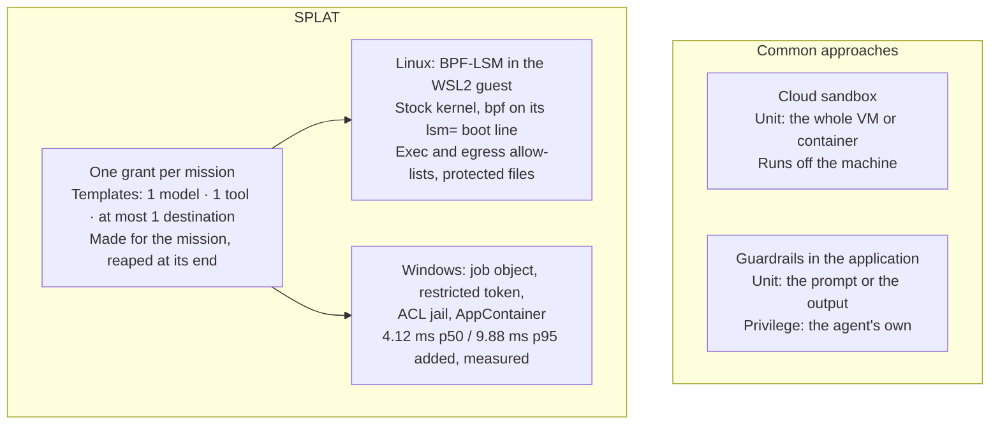

<!-- ARCHITECTURAL RECORD: what SPLAT builds on, what it adds, and what is still open.
     Relative links are verified by DocumentationDriftTests.
     The only latency figure here is the one src/splat-bench recorded; no other system's latency is quoted.
     Written by a parallel session on 2026-09-18 and corrected against the code and evidence on 2026-09-19;
     the corrections are listed in docs/audits/2026-09-19-claims-audit.md. -->

# SPLAT's Lineage: What It Builds On and What It Adds

---

## 1. Summary

SPLAT (Sandboxed Process Lease & Agent Telemetry) lets an AI model run shell commands, code and
system tools on the machine it serves, under limits the operating system enforces, without handing the
model the user's whole account.

This document separates:
1. What SPLAT builds on: operating system mechanisms other people built.
2. The problem it aims at.
3. What it adds, each claim with the evidence behind it.
4. How its BPF program uses the kernel's primitives, and whose primitives they are.
5. What is still open.

---

## 2. What Was Already Done

* **Job objects and restricted tokens** date from Windows 2000. Chromium's sandbox (2008) is the
  best-known use of them together: a token whose Administrators SID is deny-only, a lowered integrity
  level, and a job object around the process tree. SPLAT uses the same mechanisms.
* **AppContainers** arrived in Windows 8 (2012) for Store apps, and Microsoft Defender's own sandbox
  runs in one. An AppContainer granted no capabilities has no network access, which is how SPLAT
  launches its network-denied sensors.
* **eBPF security tooling.** Falco, Tracee and Tetragon watch Linux systems with eBPF, and Tetragon
  can also enforce, killing a process or failing a call in the kernel. In-kernel confinement on a
  stock kernel is older still: seccomp-bpf (Linux 3.5, 2012), AppArmor and SELinux, and Landlock
  (Linux 5.13, 2021).
* **eBPF itself** is Alexei Starovoitov's design, maintained with Daniel Borkmann. **BPF-LSM**
  (Linux 5.7) is KP Singh's work, and the **BPF ring buffer** (Linux 5.8) and **CO-RE** relocation are
  Andrii Nakryiko's.

SPLAT invented none of these. What it adds is the unit it applies them to: one grant per mission,
made for the mission and gone when it ends, on the machine the agent already runs on.

---

## 3. The Problem It Aims At

Agents that call tools, such as Anthropic's computer use, OpenAI's Operator, Copilot Studio, Semantic
Kernel, LangGraph and Devin, run commands with whatever authority the process hosting them has. Two
common answers leave a gap:

```
PARADIGM A: guardrails in the application
  - NeMo Guardrails, Llama Guard, system-prompt rules, output filters.
  - They judge text, at the agent's own privilege. A command that gets past them runs
    with the user's full account, and a subshell it starts is outside their view.

PARADIGM B: a sandbox in someone else's cloud
  - E2B, Modal, Daytona, Fly.io, Azure Container Instances.
  - The code runs off the machine, so the files it works on travel with it, unless
    the sandbox is self-hosted.
  - The unit is the whole VM or container: inside it, the code has everything the box has.
```

---

## 4. What SPLAT Adds



### 1. One grant per mission, not one policy per machine
* **Before:** container security (Docker, Kubernetes, Falco, Tetragon) applies policy to a pod or
  container that lives for hours or months.
* **What SPLAT adds:** the unit is one mission. A governed template binds one model, one pre-approved
  tool and at most one destination. On the Linux path a lease is made for one command:
  1. The daemon resolves the paths the lease names to `(dev, ino)`, and takes destinations as an IPv4
     address and a port.
  2. It writes them into BPF maps keyed by the lease's own cgroup id, before the tool starts.
  3. The child joins that cgroup in `pre_exec`, before `exec`, so the tool never runs unleased.
  4. `bprm_check_security` holds exec to the lease's allow-list, and `socket_connect` holds egress to
     its address-and-port list. `file_open` refuses the protected files the lease names and leaves
     every other open alone.
  5. When the tool exits or the lease expires, the reaper kills whatever is left and the lease's map
     entries go.

Two leases running at once do not lend each other permissions: the
[daemon probe](../native/splat-agent/evidence/daemon-probe.json) records
`concurrent_lease_isolation_held`.

### 2. In-kernel enforcement on the stock WSL2 kernel, from a local MCP server
* **Before:** in-kernel confinement on a stock kernel is not new (section 2). What agents lacked is
  confinement an MCP client can ask for per call, on the Windows machine the agent already runs on.
* **What SPLAT adds:** the BPF program runs on Microsoft's stock WSL2 kernel
  (`6.18.33.2-microsoft-standard-WSL2` in the recorded evidence), with no kernel build and no
  out-of-tree module. The one change to the host is `bpf` on the kernel's `lsm=` boot line, which
  `splat-mcp provision --apply` writes to `.wslconfig` and which takes a WSL restart.
* The tool runs as `nobody` (uid 65534) with its supplementary groups cleared, and the daemon probe
  records `workload_not_root`. No run has put a root workload under a lease. A root process can move
  itself into another cgroup, out from under lists keyed by cgroup, which is one reason the tool never
  runs as root.
* The tool runs on this machine, not in a cloud. What reaches the model is what the host sends it,
  after the output DLP.

### 3. A measured overhead, on the Windows path
* On Windows `10.0.26200`, over 50 alternating iterations in [`src/splat-bench`](../src/splat-bench),
  the governed Windows path added **4.12 ms p50 / 9.88 ms p95** over the same tool run bare
  ([evidence](../src/splat-bench/evidence)).
* That figure covers the Windows path: the job object, the restricted token and the ACL jail. The Linux
  lease has no recorded overhead figure yet.
* It replaced an inherited figure of under a millisecond, which the measurement missed by about four
  times.

### 4. An authenticated bridge between Windows and the guest (protocol 3)
* The daemon runs as root in the guest, and the bridge reaches it over loopback TCP, where any local
  process can connect.
* The bridge sends a nonce, and the daemon proves it holds the shared token over that nonce before
  the bridge sends anything else. Every request then proves the token back over both nonces, its place
  on the connection and its bytes, with HMAC-SHA256 compared in fixed time on both sides.
* The token never crosses the wire. The daemon reads at most 1 MiB per frame, so a peer that never
  sends a newline cannot exhaust its memory.
* Still open ([roadmap](ROADMAP.md) 2.4): a shared secret names no caller, and another process
  running as the same Windows user can read the token just as the bridge does.

### 5. Evidence bound to what it tested
* Each probe writes its results as JSON, with the kernel it ran on and the SHA-256 of the BPF source
  it tested ([evidence](../native/splat-agent/evidence)).
* `DocumentationDriftTests` hold particular claims to that evidence and to the code: the substrate's
  proof state, the daemon's and the last hop's enforcement claims, latency promises, the advertised
  test count, every relative link and a list of retired overclaims. When one of those drifts, a test
  fails. A claim outside that list is held only by review.

---

## 5. How the BPF Program Uses the Kernel's Primitives

| Principle | Where it comes from | In [`lease_lsm.bpf.c`](../native/splat-agent/src/bpf/lease_lsm.bpf.c) |
| :--- | :--- | :--- |
| **Never turn a denial into an allow** | LSM hook chaining, which BPF-LSM (KP Singh, Linux 5.7) joins | Each hook first returns an earlier LSM's denial untouched: `if (ret != 0) return ret;`. Exec and connect then deny what the lease's allow-lists leave out; open denies only the protected files the lease names. |
| **Build the event in place** | The BPF ring buffer (Andrii Nakryiko, Linux 5.8): `bpf_ringbuf_reserve` and `bpf_ringbuf_submit` | `report()` reserves the event in the ring's memory and fills it there, with no copy through the stack. |
| **Enforcement does not wait on telemetry** | A ring buffer reservation can fail | When `bpf_ringbuf_reserve` returns `NULL` under a flood, the event is dropped and the hook still returns `-EPERM`. |
| **Map keys with no hidden padding** | Hash map keys are compared byte for byte | `struct lease_inode_key` (24 B) and `struct lease_ipv4_key` (16 B) spell their padding out as `_pad` fields. `struct violation_event`, which is not a key, is 40 B with 4 B of tail padding. |
| **One binary across kernels** | CO-RE and BTF (Andrii Nakryiko, libbpf) | `BPF_CORE_READ` and a generated `vmlinux.h` read kernel structs without the host's kernel headers. |

---

## 6. Comparison

| Dimension | Plain subshell (`sh`, `powershell`) | Cloud sandbox (E2B, Modal) | eBPF on a cluster (Tetragon, Falco) | SPLAT |
| :--- | :--- | :--- | :--- | :--- |
| **Unit of containment** | None: the user's full account | The VM or container | A pod or container, chosen by policy selectors | One mission |
| **Where the tool runs** | This machine | The provider's cloud, unless self-hosted | The cluster | This machine |
| **What enforces** | Nothing | The hypervisor and the guest kernel | The node's kernel (Tetragon); Falco only alerts | The WSL2 guest kernel (BPF-LSM), and the Windows kernel (job object, token, AppContainer) |
| **What it needs** | Nothing | An account, and the code shipped to it | Linux nodes, and the privileges to load eBPF | Windows with WSL2, `bpf` on the kernel's boot line, and a root daemon in the guest |
| **Added latency** | None | Not measured by us | Not measured by us | 4.12 ms p50 / 9.88 ms p95 on the Windows path, measured |
| **Lifetime of a grant** | The process's | The sandbox's | The policy's | The mission's |

---

## 7. What Is Still Open

P1, a stranger installing SPLAT and proving it on a machine that had never seen it, was met on a second
machine on 2026-09-18 ([roadmap](ROADMAP.md)). Three phases remain:

1. **P2: the workload's own mount namespace.** A script an agent has just written cannot run under the
   exec allow-list, because it is not on it. The plan is `unshare(CLONE_NEWNS)` and `pivot_root` in the
   same `pre_exec`, giving the tool a scratch layer that is gone after teardown.
2. **P3: the per-mission run record.** A bundle from which someone who did not run a mission can check
   what it was permitted to do and what it did. The bundle exists, and its scripts check that its files
   agree with each other. It is not yet signed, and nothing writes it when a mission ends (roadmap 3.1).
3. **P4: SPLAT you can mount.** From a drive or one downloaded script: show what this host can enforce
   and what mounting will change, mount on consent, and later unmount to a host that is as it was.
   Mounting changes one thing for the whole machine, the kernel's boot line and the WSL restart it
   takes ([END-GOAL.md](END-GOAL.md)).

---

### Reference Links
* Architecture Map: [ARCHITECTURE.md](ARCHITECTURE.md)
* Linux Substrate: [ARCHITECTURE-linux-substrate.md](ARCHITECTURE-linux-substrate.md)
* Windows Substrate: [ARCHITECTURE-windows-substrate.md](ARCHITECTURE-windows-substrate.md)
* Policy Contract: [SUPPORTED_POLICY.md](../native/splat-agent/SUPPORTED_POLICY.md)
* Roadmap & Phases: [ROADMAP.md](ROADMAP.md)
* Destination Design: [END-GOAL.md](END-GOAL.md)
