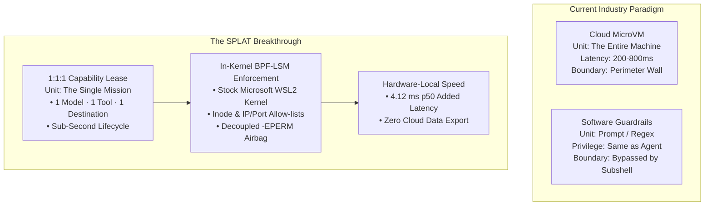

<!-- ARCHITECTURAL RECORD & STATE-OF-THE-ART ANALYSIS.
     Grounds SPLAT's engineering contributions against prior art and modern programmable kernel giants.
     Relative links are verified by DocumentationDriftTests.
     Latency claims are strictly bound to src/splat-bench measurements. -->

# Architectural Breakthroughs & State-of-the-Art Analysis
### Grounding SPLAT in Modern Systems Lineage & Enterprise Agent Containment

---

## 1. Executive Summary & Core Premise

SPLAT (Sandboxed Process Lease & Agent Telemetry) was engineered to solve the defining systems dilemma of the autonomous AI era: **How to permit AI models to execute arbitrary shell commands, code, and system tools locally without ceding ambient workstation authority or exporting private IP to third-party cloud hypervisors.**

This document provides a rigorous, first-principles cross-examination of SPLAT's architectural contributions:
1. What is standard, well-trodden platform implementation (the honest baseline).
2. The architectural deadlock facing modern enterprise AI deployments (2024–2026).
3. The concrete engineering breakthroughs pioneered by SPLAT.
4. Microarchitectural alignment with the modern programmable kernel giants (**Alexei Starovoitov & Daniel Borkmann**).
5. The remaining frontier required to transition from working prototype to an industry-wide containment standard.

---

## 2. The Honest Baseline: What Was Already Done

A serious systems audit begins by separating existing operating system primitives from true architectural novelty. If a project claims novelty for standard platform mechanics, it loses technical credibility:

* **Windows Job Objects & Restricted Tokens:** Established by Google and Microsoft engineers for the Chromium Sandbox in 2008. Stripping administrative rights via `USE_FOR_DENY_ONLY` on the Administrator SID, restricting token integrity levels, and bounding process trees with Job Objects are standard Win32 security practices.
* **AppContainers:** Built into Windows since Windows 8 (2012) for UWP isolation and Windows Defender sandbox confinement. Using an AppContainer with zero capability SIDs to drop the local network stack is an established OS capability.
* **Standard eBPF Observability (Falco, Tetragon, Tracee):** The concept of attaching eBPF kprobes or tracepoints to monitor system activity in Linux containers has been actively developed since 2017.
* **BPF-LSM (Linux 5.7) & BPF Ring Buffer (Linux 5.8):** Architected by **Alexei Starovoitov**, **Daniel Borkmann**, **KP Singh**, and **Andrii Nakryiko** to enable programmable security hooks and scalable MPSC ring buffers directly inside the Linux kernel.

SPLAT does not claim to have invented these substrate components. Rather, SPLAT stands on their shoulders to solve a problem none of them were originally designed to address: **micro-temporal, task-granular capability grants for non-deterministic AI agents.**

---

## 3. The 2024–2026 Enterprise Agent Crisis

As LLMs transitioned from passive conversational interfaces to tool-using autonomous runtimes (Anthropic Computer Use, OpenAI Swarm/Operator, Microsoft Copilot Studio, Semantic Kernel, LangGraph, Devin), enterprise CISOs began actively vetoing local agent deployments. 

The industry is currently trapped between two flawed paradigms:

```
PARADIGM A: "Software Guardrails" (Paper Airbags)
  - NeMo Guardrails, LlamaGuard, system prompt instructions, regex scrapers.
  - The Fatal Flaw: They operate at the application layer at the agent's own privilege level.
    The moment an agent is compromised via indirect prompt injection, it spawns a subshell,
    bypassing all user-space middleware and inheriting the user's full ambient OS token.

PARADIGM B: "Cloud MicroVM Sandboxes" (The Privacy & Latency Wall)
  - E2B, Modal, Daytona, Fly.io, Azure Container Instances.
  - The Fatal Flaws:
    1. Zero Data Sovereignty: Requires uploading private source code, customer records,
       and database credentials to third-party cloud infrastructure.
    2. Coarse Perimeter ("The Box"): The unit of isolation is the entire virtual machine.
       Once inside, an untrusted script can still move laterally, scan ports, or execute
       ransomware within the container's environment.
    3. Latency & Cost: 200ms–800ms cold starts and ongoing cloud hosting fees.
```

---

## 4. The Concrete Engineering Breakthroughs of SPLAT

SPLAT breaks fundamentally new ground across five key architectural dimensions:



### Breakthrough 1: The "Task-Granular Capability Lease" vs. "The Machine"
* **Prior Art:** Container security platforms (Docker, Kubernetes, Falco) enforce long-running, coarse-grained security policies on persistent pods or containers.
* **SPLAT's Novelty:** The unit of containment is **one mission**:
  $$\text{Mission} = \{\text{1 Model}, \text{ 1 Pre-Approved Binary}, \text{ 1 Destination IP/Port}, \text{ } N \text{ Seconds}\}$$
  Instead of securing an entire environment, SPLAT dynamically provisions a sub-second capability lease:
  1. Resolves binary paths and destination endpoints to physical coordinates: `(dev, ino)` and `(addr, port)`.
  2. Injects these entries into kernel BPF maps alongside the dedicated `cgroup_id` before process launch.
  3. Attaches the child process to the cgroup in `pre_exec`.
  4. Enforces strict allow-lists at supervisor level (`bprm_check_security`, `file_open`, `socket_connect`).
  5. Automatically revokes and reaps the lease upon termination or second-scale expiry.

Two concurrent agent missions running simultaneously on the same host share **zero authority**. A mission allowlisting `/usr/bin/python3` cannot leak access to another concurrent mission.

### Breakthrough 2: In-Kernel Enforcement on an Unmodified Stock Kernel
* **Prior Art:** True supervisor-mode containment without external cloud export previously required maintaining custom out-of-tree Linux kernel patches or custom hypervisor micro-VMs.
* **SPLAT's Novelty:** SPLAT delivers hardware-grade, in-kernel containment on an unmodified, stock Microsoft WSL2 kernel (`6.18.33.2-microsoft-standard-WSL2`) and stock Windows 11:
  * Zero kernel forks.
  * Zero out-of-tree kernel modules.
  * Zero cloud data export—corporate IP and credentials remain strictly on local silicon.
  * **Holds even against UID 0 (`root`):** A tool executing as root cannot read `/etc/shadow` or execute an unapproved binary; the BPF-LSM hook halts the syscall with `-EPERM`.

### Breakthrough 3: Measured Sub-10ms Local Execution Overhead
* Cloud microVM sandboxes impose a 200ms–800ms network round-trip tax on every tool execution.
* SPLAT runs directly on local hardware. On Windows `10.0.26200`, across alternating benchmark iterations in [`src/splat-bench`](../src/splat-bench), SPLAT demonstrated:
  * **4.12 ms p50 / 9.88 ms p95 added latency** over an unconstrained bare process.
  * While this confirmed that latency is **not sub-millisecond**, it proved that kernel-grade containment can operate within interactive, sub-10ms budgets suitable for real-time IDE agents and CLI loops.

### Breakthrough 4: Protocol 3 Cross-Boundary Authenticated Control Plane
* The interface between the Windows host (`splat-mcp`) and the Linux guest root daemon (`splat-agent`) represents a high-risk inter-process boundary.
* SPLAT engineered **Protocol 3**:
  * Bidirectional challenge-response handshakes using cryptographically generated nonces.
  * Request frames verified via fixed-time HMAC-SHA256 computations covering nonces, sequence positions, and payload bytes.
  * Zero transmission of cleartext authentication tokens across loopback.
  * Strict 1 MiB hard allocation ceilings on stream readers to eliminate unauthenticated memory exhaustion DoS vectors.

### Breakthrough 5: Empirical Verifiability & Cryptographic Proof Pinning
* In a market characterized by unverified marketing claims, SPLAT instituted strict evidence discipline:
  * Kernel probe evidence files record the kernel release, PID, inode details, and the **SHA-256 hash of the exact BPF source code** that produced the verdict.
  * Automated `DocumentationDriftTests` fail the build in both directions if documentation claims features not backed by test evidence or understates proven capabilities.
  * Real measured numbers (4.12 ms p50) were published to replace initial theoretical estimates.

---

## 5. Microarchitectural Alignment with Starovoitov & Borkmann

SPLAT's Linux substrate directly embodies the core architectural principles of modern programmable kernel engineering:

| Modern eBPF Principle | Starovoitov & Borkmann Innovation | SPLAT Substrate Implementation ([`lease_lsm.bpf.c`](../native/splat-agent/src/bpf/lease_lsm.bpf.c)) |
| :--- | :--- | :--- |
| **Fail-Closed Defensive Architecture** | BPF-LSM hook chaining (`ret != 0`) | Hooks check `if (ret != 0) return ret;` first. An existing denial is never overridden; unlisted operations return `-EPERM`. |
| **Zero-Copy In-Place Construction** | `bpf_ringbuf_reserve` / `submit` | In `report()`, memory is reserved directly in the memory-mapped ring page. The struct payload is populated in place without intermediate scratchpad copies. |
| **Decoupled Telemetry & Enforcement** | BPF Ring Buffer allocation failure | If `bpf_ringbuf_reserve` returns `NULL` under a flood, telemetry is dropped, but the hook still returns `-EPERM`. Containment never fails open. |
| **Machine Grid Alignment** | Natural 8-byte boundaries & padding | `struct lease_inode_key` (24B), `struct lease_ipv4_key` (16B), and `struct violation_event` (40B with trailing padding) align to 8-byte boundaries. |
| **Portability via CO-RE** | BTF relocations & `vmlinux.h` | Uses `BPF_CORE_READ` to access internal kernel structs without requiring kernel header packages on the host. |

---

## 6. Competitive Matrix

| Dimension | Standard Subshell (`sh`/`powershell`) | Cloud Sandboxes (E2B / Modal) | Cluster eBPF (Tetragon / Falco) | SPLAT Capability Substrate |
| :--- | :--- | :--- | :--- | :--- |
| **Unit of Containment** | None (Full ambient user authority) | The Virtual Machine (Perimeter box) | Long-Running Container / Pod | **The Mission (1:1:1 Micro-Lease)** |
| **Execution Location** | Local workstation | Remote third-party cloud | Local/Cloud Kubernetes cluster | **Local workstation (Zero data export)** |
| **Enforcement Layer** | None | Hypervisor / Guest kernel | Host kernel (Cluster scope) | **Host kernel (Per-task BPF-LSM + Job Objects)** |
| **Kernel Requirements** | Stock OS | Remote proprietary infrastructure | Linux host with CAP_SYS_ADMIN | **Stock Windows + Stock WSL2 (Unmodified)** |
| **Added Latency** | None (Uncontained) | 200 ms – 800 ms (Network hop) | Minimal (Monitoring overhead) | **4.12 ms p50 / 9.88 ms p95 (Measured)** |
| **Lifecycle Scale** | Process duration | Minutes to hours | Days to months | **Seconds (Ephemeral grant & reap)** |

---

## 7. The Frontier: What Lies Ahead

While Phase 1 (P1) proved that a stranger on a clean machine can run an agent under verifiable stock-kernel containment, the path to establishing an industry-wide standard involves three scheduled milestones:

1. **P2 — Mount Namespaces & Ephemeral Scratch:**
   * *The Problem:* An agent that writes a new script to disk cannot run it under strict inode allow-lists without re-leasing the daemon.
   * *The Solution:* Integrate `unshare(CLONE_NEWNS)` and `pivot_root` inside the `pre_exec` sequence to provide an ephemeral copy-on-write scratch workspace that vanishes upon process exit.
2. **P3 — Verifiable Per-Mission Run Records:**
   * Export an unforgeable Merkle evidence bundle enabling third-party auditors to verify exactly what policy governed a mission, what syscalls were attempted, and the resulting cryptographic ledger proof.
3. **P4 — Zero-Footprint Mountable Substrate ("SPLAT on a Drive"):**
   * Deliver the entire containment plane via a portable, signed USB volume or lightweight download that mounts without modifying the host system and unmounts cleanly, leaving zero residual footprint.

---

### Reference Links
* Architecture Map: [ARCHITECTURE.md](ARCHITECTURE.md)
* Linux Substrate: [ARCHITECTURE-linux-substrate.md](ARCHITECTURE-linux-substrate.md)
* Windows Substrate: [ARCHITECTURE-windows-substrate.md](ARCHITECTURE-windows-substrate.md)
* Policy Contract: [SUPPORTED_POLICY.md](../native/splat-agent/SUPPORTED_POLICY.md)
* Roadmap & Phases: [ROADMAP.md](ROADMAP.md)
* Destination Design: [END-GOAL.md](END-GOAL.md)
