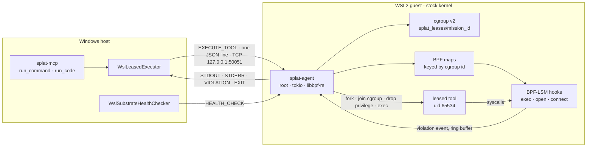

<!-- Companion to ARCHITECTURE.md. Covers native/splat-agent (the daemon and its BPF program),
     native/splat-canary (the standalone proof) and MissionController.Infrastructure.Linux (the
     Windows-side bridge). Read out of the tree at 0027e57 on 2026-09-10; the daemon section
     re-read at 965366b on 2026-09-20, when SCHEMA.md and RUNBOOK.md were added. What a lease enforces,
     refuses and does not police is deliberately NOT restated here - SUPPORTED_POLICY.md owns that
     list, and two copies of it would drift. -->

# Linux substrate — the capability lease

A **lease** is a per-cgroup grant: these executables, not these files, these IPv4 endpoints, this
much CPU, memory and PIDs, for this many seconds. The kernel enforces the first three through
BPF-LSM hooks; the daemon enforces the rest.
[`SUPPORTED_POLICY.md`](../native/splat-agent/SUPPORTED_POLICY.md) is the authoritative list of
what is enforced, what is refused and what is not policed — read it before relying on anything
below. [SCHEMA.md](SCHEMA.md) has the frames and the byte layouts; [RUNBOOK.md](RUNBOOK.md) has
what a kernel and a guest need, and how the daemon is installed.

**Status.** The program is proven in operation on a stock WSL2 kernel — standalone, and through the
daemon under root — with evidence bound to the source it ran. The last hop, an agent's request
travelling from `splat-mcp` through the C# bridge into the daemon, is recorded, most recently on 2026-09-15 under protocol 3, in
[`last-hop-probe.json`](../native/splat-agent/evidence/last-hop-probe.json). **On 2026-09-20 the
daemon's copy of the program changed** — each denial record gained the kernel's clock, a sequence
number and a drop counter, and the connect hook refuses an address too short to hold one — so the
daemon and last-hop evidence no longer name the program that ships, and the root probes are pending;
[GUIDE-operator.md](GUIDE-operator.md) has the steps. The same day the daemon gained the workload's
mount namespace, which the daemon probe now checks and has not yet recorded. The canary's frozen
copy, and its evidence, are unaffected. The README's status table is the test-bound statement of this; where it and this
paragraph disagree, trust the README.

## The pieces, and where they run

## The kernel program

[`lease_lsm.bpf.c`](../native/splat-agent/src/bpf/lease_lsm.bpf.c) — CO-RE against a `vmlinux.h`
generated from the live kernel's BTF, compiled by [`build.rs`](../native/splat-agent/build.rs) into
a libbpf-rs skeleton.

| Map | Key | Meaning |
| --- | --- | --- |
| `leased_cgroups` | cgroup id | Present means this cgroup holds a lease and is policed. Every other process on the host is untouched |
| `allowed_exec_inodes` | cgroup id, dev, ino | The only executables this lease may exec |
| `protected_inodes` | cgroup id, dev, ino | Files this lease may not open |
| `allowed_connect_ipv4` | cgroup id, address, port | The only IPv4 endpoints this lease may connect to |
| `violations` | ring buffer | One 56-byte record per denial: cgroup, kernel clock, sequence number, pid, hook, detail, `comm` |
| `counters` | two words | The next sequence number, and how many denials the ring buffer had no room for |

| Hook | Decision for a leased cgroup |
| --- | --- |
| `lsm/bprm_check_security` | Exec allowed only when `(cgroup, dev, ino)` is on this lease's allow-list — including an exec by a tool that is already running |
| `lsm/file_open` | Denied when `(cgroup, dev, ino)` is on this lease's deny-list |
| `lsm/socket_connect` | IPv4 allowed only to an approved `(address, port)`; IPv6 denied outright; an AF_INET address too short to hold a `sockaddr_in` denied rather than read past; other families, such as AF_UNIX and AF_NETLINK, not policed |

Three properties are load-bearing:

- **Every key carries the cgroup id.** Before it did, concurrent leases held the union of each
  other's permissions, and revoking one lease could unprotect a file another still relied on.
- **Identity is the inode, not the path.** Resolving paths inside BPF is racy and slow. The catch
  is the device number: `stat()` in userspace reports glibc's `st_dev`, while the kernel keys on
  `inode->i_sb->s_dev`, packed as `(major << 20) | minor`. A mismatch fails asymmetrically —
  *closed* for exec, which is loud, and *open* for protected files, which is silent.
  [`lease.rs`](../native/splat-agent/src/lease.rs) converts (`kernel_dev_from_st_dev`) and asserts
  at compile time that the Rust key layouts match the C structs.
- **An earlier LSM's denial is never turned into an allow.** Each hook returns an existing
  non-zero verdict unchanged.

[`native/splat-canary`](../native/splat-canary) carries a deliberate fork of this program, frozen at
the shape its recorded evidence was produced against. It proves the primitive with one lease at a
time; the daemon's copy is the one that ships.

## The daemon

[`main.rs`](../native/splat-agent/src/main.rs) — tokio and libbpf-rs, reading one JSON request per
line from a TCP socket.

**Startup, in order.** Load and attach the skeleton, start the ring-buffer drain, and duplicate the
four map descriptors. If any of that failed and `--mock-bpf` was not passed, the daemon **exits**
rather than serve work it cannot contain. Then it loads or creates the auth token — root-owned,
0600, and refuses to start without one — refuses a workload uid or gid of 0, and ends any
`splat_leases/mission_*` cgroup a previous daemon left behind: those workloads have run unpoliced
since that daemon's maps died with it, nothing can re-police them, and a tree that will not drain
is a reason to exit rather than serve beside it. It installs a SIGTERM handler that does the same
for every live lease before exiting, starts the expiry reaper, and binds, loopback by default.

**The ring buffer.** Each denial is a 56-byte record ([SCHEMA.md](SCHEMA.md#struct-violation_event--one-ring-buffer-record-per-denial))
carrying the kernel's monotonic clock and a sequence number, in a 1 MiB `BPF_MAP_TYPE_RINGBUF`. A
dedicated thread polls it every 100 ms and fans each event out through a 128-slot broadcast
channel; every `EXECUTE_TOOL` subscribes before it spawns and forwards only the events for its own
cgroup. A forwarder that falls behind a burst is told how many events it missed and carries on —
treating that as the end of the stream once silenced every later denial of a lease while the
kernel went on denying. A full ring buffer drops the record; the `-EPERM` still happens, the
record's number is skipped so the gap is visible, the program's drop counter moves, and the lease's
`EXIT` frame reports how far it moved while the lease ran.

**Every connection, first.** Protocol 3 opens with a handshake, and nothing else is read until it
holds. The caller's `HELLO` names a nonce; the daemon answers with its own and an HMAC-SHA256 of both
under the token, which the caller checks before it sends anything more. Each request then travels in
an `AUTHENTICATED` frame whose proof covers both nonces, the request's place on the connection and its
exact bytes, checked in fixed time before any of them is parsed. A frame that does not prove itself —
including a protocol 2 request carrying the token itself — is refused, and the connection closed.

**`EXECUTE_TOOL`, in order:**

1. Require `protocolVersion` 3 and an `argv` array. Version 1 carried arguments as one string the
   daemon split on whitespace, and nothing can reconstruct that correctly.
2. Refuse policy it cannot enforce: `overlayFs.enableCow: true`, and `readOnlyFs: true` from a
   daemon that is not enforcing, since that one jails nothing. A mission id that is not a safe
   path component is refused here too.
3. Resolve the clamps. A request may lower the daemon-wide ceilings (`MAX_MEMORY_BYTES_CEILING`,
   `MAX_CPU_PERCENT_CEILING`, `MAX_PIDS_CEILING`), never raise them.
4. Create `splat_leases/mission_<id>`, delegate the controllers to it, write `memory.max`,
   `cpu.max` and `pids.max`, and **read them back**. A clamp that did not take refuses the request.
5. Build the lease. Egress addresses and ports come from the request, and an explicit empty list
   means nothing is permitted. Protected paths are the daemon's own defaults **unioned** with the
   request's — a caller can add protection, never remove it. Exec paths come from the request. An
   absent `allowedExecPaths`, or an absent egress list with the network on, is **refused**, never
   defaulted: an empty list is a decision, a missing key is the absence of one. Then the
   ceiling, when the guest has one: every executable under its directories, every endpoint in
   its set, the duration shortened and the clamps lowered to it, its always-protected paths added.
6. Refuse a lease that does not permit its own command.
7. Register the lease: resolve each path to an inode, write every map entry, and roll back the
   partial writes on failure.
8. Prepare the jail's root under `/run/splat/roots/mission_<id>`
   ([`jail.rs`](../native/splat-agent/src/jail.rs)): the skeleton of empty directories and the
   `CString` paths the child will need, built here in the parent where allocating is allowed. A
   root that cannot be prepared refuses the request.
9. Spawn. In `pre_exec` — async-signal-safe code in the forked child of a multithreaded process —
   write `0` to the cgroup's `cgroup.procs`; then, still root, `unshare(CLONE_NEWNS)`, make `/`
   private, bind `/usr`, `/bin`, `/sbin`, `/lib*` and `/etc` read-only, mount a fresh `tmpfs` on
   `/tmp`, bind the working directory (read-only under `readOnlyFs`), bind six device nodes, mount
   `/proc`, `pivot_root` and detach the old root; then `setgroups(0)`, `setresgid` and `setresuid`
   to the workload identity (`nobody` by default), and refuse if anything is still root. Joining
   the cgroup before exec is what puts the tool's *own* exec under the allow-list; the mounts sit
   between the join and the drop because they need root and the workload must not have it. Bind
   mounts keep inode identity, so the allow-list and the deny-list hold unchanged inside.
10. Verify from outside: the child's cgroup membership and effective uid, logged loudly if wrong.
11. Stream `STDOUT` and `STDERR` in frames of at most 64 KiB — a tool's single long line no longer
    sits whole in a root process's memory before a byte of it is forwarded — and `VIOLATION` frames
    for this lease's cgroup, then `EXIT`, then revoke the lease and remove the jail's skeleton,
    one entry at a time and never recursively, so a mount that somehow leaked would stop the
    removal rather than be descended into.

A client that disconnects mid-run ends the lease the way expiry does: **kill inside the policy,
then withdraw it.** The reaper follows the same order every second. Deleting the map entries first
would leave a live process in a cgroup the hooks no longer recognise — and an unlisted cgroup is
allowed everything.

`HEALTH_CHECK` is answered only inside a session, like everything else — since 2026-09-11, because
it returns `bpfLsmActive`, `cgroupV2Active`, `overlayFsSupported`, `kernelVersion`,
`activeLeaseCount` and **`enforcing`**, which told an unauthenticated caller exactly when this
daemon would run work it cannot contain. `enforcing` is the field to gate on: reachable is not
enforcing.

Supporting modules: [`auth.rs`](../native/splat-agent/src/auth.rs) — the token's lifecycle, and a
precise account of what a shared secret does and does not stop;
[`cgroup.rs`](../native/splat-agent/src/cgroup.rs) — provisioning, read-back and `kill_tree`;
[`violation.rs`](../native/splat-agent/src/violation.rs) — decoding ring-buffer events;
[`cow.rs`](../native/splat-agent/src/cow.rs) — overlay mount code, parked until the workload has its
own mount namespace.

## The bridge, on Windows

[`MissionController.Infrastructure.Linux`](../src/MissionController.Infrastructure.Linux) is
referenced by `splat-mcp` and the tests. The console does not reference it.

- **[`WslLeasedExecutor`](../src/MissionController.Infrastructure.Linux/WslLeasedExecutor.cs)**
  (`ILeasedExecutor`). Connects to the port, and only when the connection is refused runs
  `systemctl start splat-agent` as root through `wsl.exe` — the unit `splat-mcp provision` installs —
  then waits up to 30 seconds for it to listen; a service that is not installed is refused by name,
  pointing at `splat-mcp provision --apply`. It never launches a daemon binary itself. Takes the token
  from an explicit argument, then `SPLAT_AGENT_TOKEN`, then
  `wsl.exe -u root -e /bin/cat /etc/splat/agent.token`, under a 15-second budget of its own, and
  caches it; the lease's clock starts only when the request is sent.
  Opens a protocol 3 session through
  [`WslAgentSession`](../src/MissionController.Infrastructure.Linux/WslAgentSession.cs): whatever
  answers must prove it holds the token, within 10 seconds, before anything but a nonce is sent to it.
  The envelope travels in UTF-8 **without** a byte-order mark — a BOM once made every request
  invalid JSON — carrying the lease as *paths*, because an inode number read on Windows means
  nothing in the guest. Reports resource metrics as `JobResourceMetrics.Unavailable`, because the
  `EXIT` frame carries no cgroup accounting and inventing figures is how arithmetic on constants
  once reached the ledger as measurements.
- **[`TemplatePolicyCompiler`](../src/MissionController.Infrastructure.Linux/TemplatePolicyCompiler.cs)**
  (`ITemplatePolicyCompiler`). Compiles a governed template into a `LeaseSpec`: an exec allow-list
  from a small Windows-to-Linux tool map plus the shells, a default protected set, a network lease
  **only** for `ToolProcess`-scoped egress, resolved to IPv4 /32s at compile time, clamps from the
  tool definition, and copy-on-write requested off. `splat-mcp` constructs it and passes it to the
  handler, which never calls it; today only the tests exercise it.
- **[`WslSubstrateHealthChecker`](../src/MissionController.Infrastructure.Linux/WslSubstrateHealthChecker.cs)**.
  A `.wslconfig` heuristic plus `HEALTH_CHECK`, asked inside a protocol 3 session, so an answer is believed only from something that proved it holds the token. Its `Enforcing` field is the one to trust.

## Who authors a lease today

The only live route into the daemon is `splat-mcp`'s `run_command`, and `run_code`, which wraps it.
The handler builds the `LeaseSpec` inline, in `McpServerHandler.ExecuteRunCommandAsync`
([source](../src/splat-mcp/McpServerHandler.cs)):

| Lease field | Comes from |
| --- | --- |
| Exec allow-list | **The server** — pinned to the requested command and nothing else, so a request cannot authorize a second binary |
| Protected files | Fixed — `/etc/shadow`, `/etc/sudoers` — and unioned with the daemon's defaults |
| Network on or off, allowed IPv4 addresses | **The operator** — the endpoints given to `splat-mcp --egress`. The caller may request a subset with `allowNetwork` and `allowedEgressIps`; asking outside the policy, asking with no policy, or naming addresses without `allowNetwork` is refused before any lease is requested |
| Ports | **The operator** — only the ports the policy approves for every granted address, because the kernel installs addresses × ports |
| Duration | The caller's `timeoutSeconds`, clamped to 5–300 |
| Clamps | Fixed in the handler; the daemon can only lower them |
| The ceiling on all of the above | **The operator, in the guest** — `/etc/splat/policy.json`, written by `splat-mcp provision --apply [--egress ...]` and read by the daemon at startup. Whatever the request and the MCP host agreed, the daemon refuses anything outside it, so a token that leaked buys at most what the file allows |

The network half used to be written by the agent that asked for it: its addresses as sent, loopback
when it named none, 80 and 443 for all of them. [`McpEgressPolicy`](../src/splat-mcp/McpEgressPolicy.cs)
is the check that replaced that. It runs in the MCP host, so a refusal from it is SPLAT's policy and
is labelled `[SPLAT POLICY]`, never reported as a kernel denial, and ledgered as
`EGRESS_REQUEST_REFUSED`.

## The transport's trust boundary

Loopback TCP, reached from Windows through WSL2 localhost forwarding. Every connection opens with
protocol 3's handshake, and every request — `HEALTH_CHECK` included, because it answers with
`enforcing`, the kernel version and the live lease count — proves the shared secret without sending
it. Both callers read that secret through
[`WslAgentToken`](../src/MissionController.Infrastructure.Linux/WslAgentToken.cs), once per host,
and speak through [`WslAgentSession`](../src/MissionController.Infrastructure.Linux/WslAgentSession.cs).
An unprivileged process **inside the guest** cannot read the token, and taking the port while the
daemon is down no longer yields it: on 2026-09-13 a listener run as `nobody` received what Windows
sent, which under protocol 2 was the token itself, and such a listener is now sent one nonce and
cannot produce the proof the caller checks before sending anything more. That does not stop another
**Windows** process running as the same user, which can read the token exactly as the bridge does. No
transport tells the daemon which Windows process is asking, and a process running as you can already
do everything you can; so since 2026-09-21 the answer is to bound what the token buys: a root-owned
ceiling in the guest ([`ceiling.rs`](../native/splat-agent/src/ceiling.rs)) that every request is
intersected with, written by `provision` where nothing on the Windows side can reach around it.

## Evidence, and how it is re-run

| File | Proves | Held to its source by the suite |
| --- | --- | --- |
| [`canary-6.18.33.2-microsoft-standard-WSL2.json`](../native/splat-canary/evidence/canary-6.18.33.2-microsoft-standard-WSL2.json) | Standalone: a permitted connect succeeds while exec, open and connect outside the lease return `-EPERM` | Yes — the canary's BPF source |
| [`daemon-probe.json`](../native/splat-agent/evidence/daemon-probe.json) | Through the daemon, under root: every row of SUPPORTED_POLICY's two enforced tables | Yes — the daemon's BPF source, plus two result fields re-checked |
| [`last-hop-probe.json`](../native/splat-agent/evidence/last-hop-probe.json) | The whole road: a `run_command` from an MCP client, through `splat-mcp` and the bridge, refused in the kernel — with the permitted command and the permitted endpoint as controls | Yes — the daemon's BPF source, plus four result fields re-checked |
| [`fail-closed-probe.json`](../native/splat-agent/evidence/fail-closed-probe.json) | The daemon refuses to run without live enforcement | No |
| [`peer-auth-probe.json`](../native/splat-agent/evidence/peer-auth-probe.json) | An unauthenticated caller cannot execute | No |
| [`wire-contract-probe.json`](../native/splat-agent/evidence/wire-contract-probe.json) | Arguments survive the wire byte for byte | No |

`DocumentationDriftTests` holds the README to the first two in both directions, and stops accepting
either when the BPF source it names changes. So **editing either copy of `lease_lsm.bpf.c` fails
the build until the matching run is recorded again.** Re-running needs root, and `sudo` prompts, so
it is a human step: the canary with [`run-canary.sh`](../native/splat-canary/run-canary.sh) after
[`preflight.sh`](../native/splat-canary/preflight.sh); the daemon with
[`run-daemon.sh`](../native/splat-agent/run-daemon.sh) in one terminal and
[`probe-daemon.sh`](../native/splat-agent/probe-daemon.sh) in another.
[RUNBOOK-human-steps.md](RUNBOOK-human-steps.md) has the procedure and what a correct run looks
like.

`cargo test` covers what userspace can — key layouts, the device-number conversion, that a
`pre_exec` failure stops the child from running — and says nothing about the kernel. After touching
the daemon, the BPF program or the lease path, the root probe is the test.

## Where it goes next

The workload's mount namespace — P2 of [the live plan](audits/2026-09-09-oem-subtraction-plan.md)
— was built on 2026-09-20 and awaits its root probe, which now carries five checks for it.
`readOnlyFs` left the refused list with it. Two things still stand on that namespace:
`overlayFs.enableCow`, which is `cow.rs` mounted as the working directory inside the jail and is
still refused until it is; and executing code an agent just wrote, which the exec allow-list
refuses by inode and which the jail does not change.
[The hardening note of 2026-09-20](audits/2026-09-20-substrate-hardening.md) sets out what comes
after — UDP, pinning, a guest-side ceiling policy, and cheap re-proof — with how each is proven.
