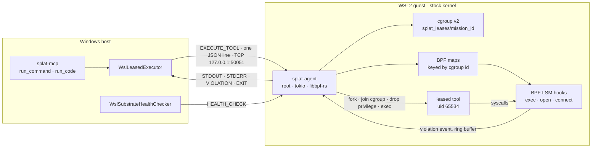

<!-- Companion to ARCHITECTURE.md. Covers native/splat-agent (the daemon and its BPF program),
     native/splat-canary (the standalone proof) and MissionController.Infrastructure.Linux (the
     Windows-side bridge). Read out of the tree at 0027e57 on 2026-09-10. What a lease enforces,
     refuses and does not police is deliberately NOT restated here - SUPPORTED_POLICY.md owns that
     list, and two copies of it would drift. -->

# Linux substrate — the capability lease

A **lease** is a per-cgroup grant: these executables, not these files, these IPv4 endpoints, this
much CPU, memory and PIDs, for this many seconds. The kernel enforces the first three through
BPF-LSM hooks; the daemon enforces the rest.
[`SUPPORTED_POLICY.md`](../native/splat-agent/SUPPORTED_POLICY.md) is the authoritative list of
what is enforced, what is refused and what is not policed — read it before relying on anything
below.

**Status.** The program is proven in operation on a stock WSL2 kernel — standalone, and through the
daemon under root — with evidence bound to the source it ran. The last hop, an agent's request
travelling from `splat-mcp` through the C# bridge into the daemon, is wired but has no recorded
run. The README's status table is the test-bound statement of this; where it and this paragraph
disagree, trust the README.

## The pieces, and where they run

## The kernel program

[`lease_lsm.bpf.c`](../native/splat-agent/src/bpf/lease_lsm.bpf.c) — CO-RE against a `vmlinux.h`
generated from the live kernel's BTF, compiled by [`build.rs`](../native/splat-agent/build.rs) into
a libbpf-rs skeleton.

| Map | Key | Meaning |
| --- | --- | --- |
| `leased_cgroups` | cgroup id | Present means this cgroup holds a lease and is policed. Every other process on the host is untouched |
| `allowed_exec_inodes` | cgroup id, dev, ino | The only executables this lease may exec |
| `protected_inodes` | cgroup id, dev, ino | Files this lease may not open |
| `allowed_connect_ipv4` | cgroup id, address, port | The only IPv4 endpoints this lease may connect to |
| `violations` | ring buffer | One event per denial: cgroup, pid, hook, detail, `comm` |

| Hook | Decision for a leased cgroup |
| --- | --- |
| `lsm/bprm_check_security` | Exec allowed only when `(cgroup, dev, ino)` is on this lease's allow-list — including an exec by a tool that is already running |
| `lsm/file_open` | Denied when `(cgroup, dev, ino)` is on this lease's deny-list |
| `lsm/socket_connect` | IPv4 allowed only to an approved `(address, port)`; IPv6 denied outright; other families, such as AF_UNIX and AF_NETLINK, not policed |

Three properties are load-bearing:

- **Every key carries the cgroup id.** Before it did, concurrent leases held the union of each
  other's permissions, and revoking one lease could unprotect a file another still relied on.
- **Identity is the inode, not the path.** Resolving paths inside BPF is racy and slow. The catch
  is the device number: `stat()` in userspace reports glibc's `st_dev`, while the kernel keys on
  `inode->i_sb->s_dev`, packed as `(major << 20) | minor`. A mismatch fails asymmetrically —
  *closed* for exec, which is loud, and *open* for protected files, which is silent.
  [`lease.rs`](../native/splat-agent/src/lease.rs) converts (`kernel_dev_from_st_dev`) and asserts
  at compile time that the Rust key layouts match the C structs.
- **An earlier LSM's denial is never turned into an allow.** Each hook returns an existing
  non-zero verdict unchanged.

[`native/splat-canary`](../native/splat-canary) carries a deliberate fork of this program, frozen at
the shape its recorded evidence was produced against. It proves the primitive with one lease at a
time; the daemon's copy is the one that ships.

## The daemon

[`main.rs`](../native/splat-agent/src/main.rs) — tokio and libbpf-rs, reading one JSON request per
line from a TCP socket.

**Startup, in order.** Load and attach the skeleton, start the ring-buffer drain, and duplicate the
four map descriptors. If any of that failed and `--mock-bpf` was not passed, the daemon **exits**
rather than serve work it cannot contain. Then it loads or creates the auth token — root-owned,
0600, and refuses to start without one — refuses a workload uid or gid of 0, starts the expiry
reaper, and binds, loopback by default.

**`EXECUTE_TOOL`, in order:**

1. Authenticate `authToken`, in fixed time, before reading any policy field.
2. Require `protocolVersion` 2 and an `argv` array. Version 1 carried arguments as one string the
   daemon split on whitespace, and nothing can reconstruct that correctly.
3. Refuse policy it cannot enforce: `readOnlyFs: true`, `overlayFs.enableCow: true`.
4. Resolve the clamps. A request may lower the daemon-wide ceilings (`MAX_MEMORY_BYTES_CEILING`,
   `MAX_CPU_PERCENT_CEILING`, `MAX_PIDS_CEILING`), never raise them.
5. Create `splat_leases/mission_<id>`, delegate the controllers to it, write `memory.max`,
   `cpu.max` and `pids.max`, and **read them back**. A clamp that did not take refuses the request.
6. Build the lease. Egress addresses and ports come from the request, and an explicit empty list
   means nothing is permitted. Protected paths are the daemon's own defaults **unioned** with the
   request's — a caller can add protection, never remove it. Exec paths come from the request; a
   legacy default applies only when the field is absent, with a warning.
7. Refuse a lease that does not permit its own command.
8. Register the lease: resolve each path to an inode, write every map entry, and roll back the
   partial writes on failure.
9. Spawn. In `pre_exec` — async-signal-safe code in the forked child of a multithreaded process —
   write `0` to the cgroup's `cgroup.procs`, then `setgroups(0)`, `setresgid` and `setresuid` to the
   workload identity (`nobody` by default), then refuse if anything is still root. Joining before
   exec is what puts the tool's *own* exec under the allow-list.
10. Verify from outside: the child's cgroup membership and effective uid, logged loudly if wrong.
11. Stream `STDOUT`, `STDERR` and `VIOLATION` frames, then `EXIT`, then revoke the lease.

A client that disconnects mid-run ends the lease the way expiry does: **kill inside the policy,
then withdraw it.** The reaper follows the same order every second. Deleting the map entries first
would leave a live process in a cgroup the hooks no longer recognise — and an unlisted cgroup is
allowed everything.

`HEALTH_CHECK` needs no token. It returns `bpfLsmActive`, `cgroupV2Active`, `overlayFsSupported`,
`kernelVersion`, `activeLeaseCount` and **`enforcing`**, which is the field to gate on: reachable is
not enforcing.

Supporting modules: [`auth.rs`](../native/splat-agent/src/auth.rs) — the token's lifecycle, and a
precise account of what a shared secret does and does not stop;
[`cgroup.rs`](../native/splat-agent/src/cgroup.rs) — provisioning, read-back and `kill_tree`;
[`violation.rs`](../native/splat-agent/src/violation.rs) — decoding ring-buffer events;
[`cow.rs`](../native/splat-agent/src/cow.rs) — overlay mount code, parked until the workload has its
own mount namespace.

## The bridge, on Windows

[`MissionController.Infrastructure.Linux`](../src/MissionController.Infrastructure.Linux) is
referenced by `splat-mcp` and the tests. The console does not reference it.

- **[`WslLeasedExecutor`](../src/MissionController.Infrastructure.Linux/WslLeasedExecutor.cs)**
  (`ILeasedExecutor`). Probes the port; if nothing answers, starts the daemon as root through
  `wsl.exe` from the build's `CARGO_TARGET_DIR` or the in-tree `target/`, bound to loopback and
  logging to `/tmp/splat-agent.log`. Takes the token from an explicit argument, then
  `SPLAT_AGENT_TOKEN`, then `wsl.exe -u root -e /bin/cat /etc/splat/agent.token`, and caches it.
  Sends a version-2 envelope in UTF-8 **without** a byte-order mark — a BOM once made every request
  invalid JSON — carrying the lease as *paths*, because an inode number read on Windows means
  nothing in the guest. Reports resource metrics as `JobResourceMetrics.Unavailable`, because the
  `EXIT` frame carries no cgroup accounting and inventing figures is how arithmetic on constants
  once reached the ledger as measurements.
- **[`TemplatePolicyCompiler`](../src/MissionController.Infrastructure.Linux/TemplatePolicyCompiler.cs)**
  (`ITemplatePolicyCompiler`). Compiles a governed template into a `LeaseSpec`: an exec allow-list
  from a small Windows-to-Linux tool map plus the shells, a default protected set, a network lease
  **only** for `ToolProcess`-scoped egress, resolved to IPv4 /32s at compile time, clamps from the
  tool definition, and copy-on-write requested off. `splat-mcp` constructs it and passes it to the
  handler, which never calls it; today only the tests exercise it.
- **[`WslSubstrateHealthChecker`](../src/MissionController.Infrastructure.Linux/WslSubstrateHealthChecker.cs)**.
  A `.wslconfig` heuristic plus `HEALTH_CHECK`. Its `Enforcing` field is the one to trust.

## Who authors a lease today

The only live route into the daemon is `splat-mcp`'s `run_command`, and `run_code`, which wraps it.
The handler builds the `LeaseSpec` inline, in `McpServerHandler.ExecuteRunCommandAsync`
([source](../src/splat-mcp/McpServerHandler.cs)):

| Lease field | Comes from |
| --- | --- |
| Exec allow-list | **The server** — pinned to the requested command and nothing else, so a request cannot authorize a second binary |
| Protected files | Fixed — `/etc/shadow`, `/etc/sudoers` — and unioned with the daemon's defaults |
| Network on or off, allowed IPv4 addresses | **The caller** — `allowNetwork`, `allowedEgressIps`; with the network on and no address given, loopback |
| Ports | Fixed: 80 and 443 |
| Duration | The caller's `timeoutSeconds`, clamped to 5–300 |
| Clamps | Fixed in the handler; the daemon can only lower them |

So the network half of a `run_command` lease is written by the agent that asked for it.

## The transport's trust boundary

Loopback TCP, reached from Windows through WSL2 localhost forwarding and gated by the shared secret.
That stops an unprivileged process **inside the guest** from issuing itself a lease. It does not
stop another **Windows** process running as the same user, which can read the token exactly as the
bridge does. A transport that carries peer identity — AF_VSOCK with a guest-side allow-list, or
`SO_PEERCRED` over AF_UNIX — would close that. It is not built; the live plan pencils it into P2.

## Evidence, and how it is re-run

| File | Proves | Held to its source by the suite |
| --- | --- | --- |
| [`canary-6.18.33.2-microsoft-standard-WSL2.json`](../native/splat-canary/evidence/canary-6.18.33.2-microsoft-standard-WSL2.json) | Standalone: a permitted connect succeeds while exec, open and connect outside the lease return `-EPERM` | Yes — the canary's BPF source |
| [`daemon-probe.json`](../native/splat-agent/evidence/daemon-probe.json) | Through the daemon, under root: every row of SUPPORTED_POLICY's two enforced tables | Yes — the daemon's BPF source, plus two result fields re-checked |
| [`fail-closed-probe.json`](../native/splat-agent/evidence/fail-closed-probe.json) | The daemon refuses to run without live enforcement | No |
| [`peer-auth-probe.json`](../native/splat-agent/evidence/peer-auth-probe.json) | An unauthenticated caller cannot execute | No |
| [`wire-contract-probe.json`](../native/splat-agent/evidence/wire-contract-probe.json) | Arguments survive the wire byte for byte | No |

`DocumentationDriftTests` holds the README to the first two in both directions, and stops accepting
either when the BPF source it names changes. So **editing either copy of `lease_lsm.bpf.c` fails
the build until the matching run is recorded again.** Re-running needs root, and `sudo` prompts, so
it is a human step: the canary with [`run-canary.sh`](../native/splat-canary/run-canary.sh) after
[`preflight.sh`](../native/splat-canary/preflight.sh); the daemon with
[`run-daemon.sh`](../native/splat-agent/run-daemon.sh) in one terminal and
[`probe-daemon.sh`](../native/splat-agent/probe-daemon.sh) in another.
[RUNBOOK-human-steps.md](RUNBOOK-human-steps.md) has the procedure and what a correct run looks
like.

`cargo test` covers what userspace can — key layouts, the device-number conversion, that a
`pre_exec` failure stops the child from running — and says nothing about the kernel. After touching
the daemon, the BPF program or the lease path, the root probe is the test.

## Where it goes next

Three refusals — `readOnlyFs`, copy-on-write scratch, and executing code an agent just wrote — are
one missing piece: the workload has no mount namespace of its own. `unshare(CLONE_NEWNS)` plus
`pivot_root`, inside the same `pre_exec` closure, is P2 of
[the live plan](audits/2026-09-09-oem-subtraction-plan.md). `cow.rs` holds the overlay half, parked
until then.
