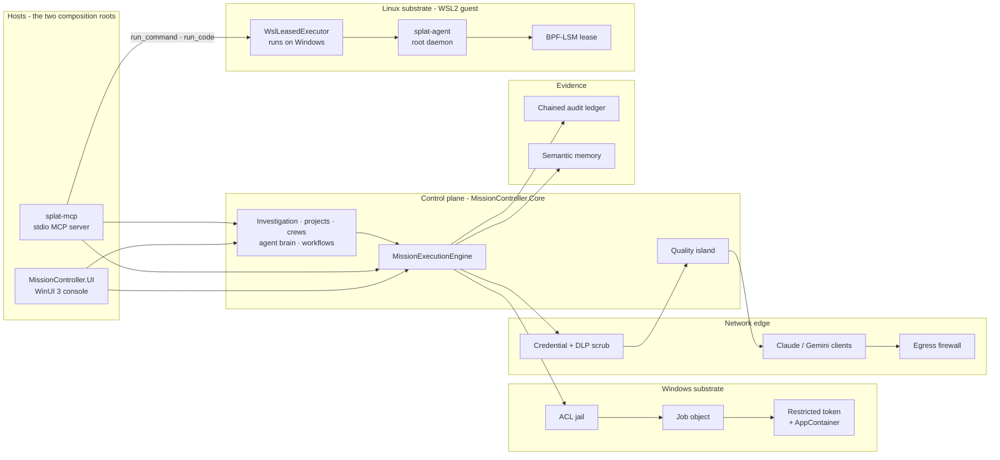

<!-- The map. Four companion documents hold the detail, MODULE_INFO.md holds the inventory, and
     CONTEXT.md holds the why. Read out of the tree at 0027e57 on 2026-09-10; the substrate and
     ledger rows and the continuum map re-read at 965366b on 2026-09-20. Relative links are
     checked by DocumentationDriftTests; everything else is only as current as the last person who
     re-read the code - so where a sentence here disagrees with the code, the code wins and this
     file has the bug. -->

# Architecture

SPLAT turns a request into a **governed mission**: one pre-approved tool, run once, inside limits
it cannot widen, its output scrubbed before anything leaves the process, and every step sealed into
a hash-chained ledger. Most of the code answers one question — **who enforces this boundary?** —
and the answer is always one of four: a kernel object, a kernel LSM hook, a check inside SPLAT's own
process, or nobody, because the boundary is only declared. This page is written so that you can
tell which, for every boundary, without opening a file.

| Read | For |
| --- | --- |
| [CONTEXT.md](CONTEXT.md) | Why the project is shaped this way, the rules it holds itself to, its vocabulary, the traps |
| [ARCHITECTURE-control-plane.md](ARCHITECTURE-control-plane.md) | The 1:1:1 template, the mission pipeline, the model leg, the engines built on missions, the ledger and memory |
| [ARCHITECTURE-windows-substrate.md](ARCHITECTURE-windows-substrate.md) | What a sensor process experiences on Windows — jail, job object, restricted token, AppContainer — and which apply when |
| [ARCHITECTURE-linux-substrate.md](ARCHITECTURE-linux-substrate.md) | The BPF-LSM lease, the `splat-agent` daemon, the bridge on Windows, who authors a lease, and the evidence |
| [ARCHITECTURE-agent-surface.md](ARCHITECTURE-agent-surface.md) | How an external agent gets in: `splat-mcp`, the LangGraph adapter, the Copilot / Semantic Kernel adapter |
| [SCHEMA.md](SCHEMA.md) | The lease's contracts byte for byte and frame by frame — map keys, the ring-buffer record, protocol 3, the C# records — and what none of them promise |
| [RUNBOOK.md](RUNBOOK.md) | What a kernel and a guest need for the daemon to enforce, the setup, the unit, and where developer shortcuts diverge from a hardened host |
| [MODULE_INFO.md](MODULE_INFO.md) | Every buildable unit: target, references, what it owns, its tests, whether it ships |

---

## The shape

Two things the picture says on purpose.

- **Every sensor a template runs goes through `MissionExecutionEngine`.** The engines that look
  like autonomy are policies over missions, not a second way to start a process. Three callers
  use the Windows launcher and job object *without* the mission sequence around them: remediation
  fixes, the workflow engine's `TransactionalScope` node, and the Copilot adapter.
- **Only `splat-mcp` reaches Linux.** The console does not reference `Infrastructure.Linux` at
  all, and no governed mission is routed through the daemon. `run_command` and `run_code` build a
  lease and call the bridge directly.

## Who enforces what

| Boundary | Enforced by | Kind | Holds against |
| --- | --- | --- | --- |
| A Windows sensor's CPU, memory and process count | [`Win32JobSandbox`](../src/MissionController.Infrastructure.Windows/Win32JobSandbox.cs) — armed at construction, no breakaway | Kernel object | The tool and every child it spawns |
| A Windows sensor's privileges | [`RestrictedTokenProvider`](../src/MissionController.Infrastructure.Windows/RestrictedTokenProvider.cs) — privileges stripped, Administrators deny-only, Medium integrity | Kernel object (token) | Authority borrowed from the operator's admin membership |
| A Windows sensor's network | [`SensorAppContainer`](../src/MissionController.Infrastructure.Windows/SensorAppContainer.cs) — zero capability SIDs, so no network stack | Kernel object | Only templates that are gateway-scoped *and* touch no WMI, Event Log, Defender or SCM; the rest keep a network stack |
| **Which host** a Windows sensor reaches | — | Declaration | Nothing yet. An AppContainer is network-or-none, so a `ToolProcess`-scoped template's FQDN is an audited claim |
| SPLAT's own outbound HTTP | [`EgressFirewallHandler`](../src/MissionController.Infrastructure.Network/EgressFirewallHandler.cs) — deny by default, one FQDN per async scope | Check in SPLAT's process | Model, SIEM and OAuth calls made through the hardened client |
| What leaves a mission | Credential sanitizer, then regex DLP, before the first chunk is yielded | Transform in SPLAT's process | Every consumer of the stream: console, MCP result, model prompt, memory |
| The sensor command line | [`GovernedArgumentBinder`](../src/MissionController.Core/GovernedArgumentBinder.cs) — one pass, position-aware allow-lists, refuse rather than repair | Check in SPLAT's process | Injection through operator- or agent-supplied parameters |
| Linux exec, file open, IPv4 connect and datagram | [`lease_lsm.bpf.c`](../native/splat-agent/src/bpf/lease_lsm.bpf.c) — every map key carries the lease's cgroup id | Kernel LSM | A leased process of any uid, root included. The datagram hook closes the UDP path a connect hook never sees, DNS included |
| Linux CPU, memory, PIDs | cgroup v2, written then **read back** by the daemon | Kernel (cgroup) | The leased process tree |
| What a Linux workload can see on disk | [`jail.rs`](../native/splat-agent/src/jail.rs) — a mount namespace and `pivot_root` in `pre_exec`: the system directories read-only, the working directory, a fresh `/tmp`, `/proc`, six device nodes | Kernel (mount namespace) | Every read or write outside those; `/home`, `/mnt`, `/var`, `/sys` are absent. Built 2026-09-20, root proof pending |
| Linux workload identity | `pre_exec`: `setgroups`, `setresgid`, `setresuid` to `nobody` | Kernel (credentials) | The workload keeping or regaining root |
| Linux lease lifetime | Daemon reaper — kill inside the policy, then withdraw it | Daemon | An overrunning workload |
| Who may request a lease | Root-owned 0600 shared secret, loopback TCP | Daemon check | Unprivileged guest processes — **not** another Windows process running as the same user |
| The most any lease may name | [`ceiling.rs`](../native/splat-agent/src/ceiling.rs) — root-owned `/etc/splat/policy.json` in the guest, written by `provision`, intersected with every request | Daemon check | A token holder asking for more than the operator allowed: executables outside the listed directories, endpoints outside the list, longer or larger than the file says |
| Which endpoints a `run_command` / `run_code` lease names | [`McpEgressPolicy`](../src/splat-mcp/McpEgressPolicy.cs) — the operator's `--egress` list; a caller may request part of it, never more | Check in `splat-mcp` | An agent writing its own destinations into the lease the kernel then enforces |
| MCP `fs_read` / `fs_write` | [`WorkspaceGuard`](../src/splat-mcp/WorkspaceGuard.cs) — the final path of the opened handle | Check in `splat-mcp` | `..`, string-prefix tricks, junctions, symlinks, hard links |
| Who acted | Windows logon session; in `splat-mcp`, optionally a validated credential | Check in SPLAT's process | Caller-supplied names |
| The record of what happened | [`SqliteChainedAuditLedger`](../src/MissionController.Infrastructure.Data/SqliteChainedAuditLedger.cs) — SHA-256 chain over salted commitments; HMAC-SHA256 under the operator's key file once one is given (`SPLAT_LEDGER_KEY_FILE`, or `--ledger-key` on `splat-mcp`) | Tamper evidence | Unkeyed: editing a row in place, **not** a rewrite by anyone who can write the database file. Keyed: the rewrite too, since no one without the key can recompute a hash. Neither: the deletion of the newest rows, which only a saved anchor catches |

## Two hosts, one pipeline

Both hosts build the same engines over the same libraries, and differ in what they wire around
them.

| | Console — [`App.xaml.cs`](../src/MissionController.UI/App.xaml.cs) | MCP server — [`Program.cs`](../src/splat-mcp/Program.cs) |
| --- | --- | --- |
| Construction | `Microsoft.Extensions.DependencyInjection` container | Hand-wired, in dependency order |
| Runtime | `net10.0-windows10.0.19041.0`, Windows App SDK 2.5.1, self-contained | `net10.0-windows` |
| Database | `%LOCALAPPDATA%\MissionController\Data\missioncontroller.db` | `%LOCALAPPDATA%\SPLAT\audit_ledger.db` |
| Operator identity | `WindowsOperatorIdentityProvider("winui-console")` | `McpOperatorIdentityProvider` — the logon session, or a validated `SPLAT_MCP_CLIENT_CREDENTIAL` |
| Revocation check before a mission | Wired | Wired since 2026-09-19 (F19): `Program.cs` passes the same `IncidentRevocationManager` the tool-call gate uses. This row said "constructed with `null`" until 2026-09-23 |
| Remediation engine | Wired | Absent |
| Linux substrate | Not referenced | `WslLeasedExecutor` behind `run_command` and `run_code` |
| Workflow engine | Registered; no screen resolves it yet | Absent |
| Copilot safety substrate | Registered; no screen resolves it | Absent |

The two hosts share no state. An action taken through `splat-mcp` lands in a different hash chain
and a different incident memory from one taken in the console, and the console's Security Audit
screen verifies only its own.

## The life of a mission

[`MissionExecutionEngine.ExecuteMissionAsync`](../src/MissionController.Core/MissionExecutionEngine.cs)
streams `MissionChunk`s while it runs. In order:

1. **Validate** the template's shape — one model, one tool, one FQDN, declared exit codes, bounded
   timeout and limits.
2. **Revocation** — both hosts check the operator against the circuit breaker; an unreadable
   list refuses the mission rather than clearing it (F19, 2026-09-19).
3. **Bind** the parameters into the command line. A value the binder cannot place refuses the
   mission before anything is provisioned (`MISSION_BLOCKED_PARAMETER_REJECTED`).
4. **Record** `MISSION_INITIATED`, then provision the jail. From here a `finally` drains the jail on
   every exit path — success, failure, cancellation, an abandoned enumerator.
5. **Launch** the sensor suspended inside a job object, with a restricted token and — when the
   template qualifies — an AppContainer; assign it to the job, then resume. Containment that
   cannot be applied throws, and the mission ends `MISSION_FAILED`.
6. **Scrub** stdout and stderr — credentials, then DLP — *before* the first chunk is yielded
   (`DLP_REDACTION_ENFORCED` when anything matched). No raw copy survives this step.
7. **Judge the tool.** An exit code outside the template's `AllowedExitCodes`, or a timeout, fails
   the mission; nothing is analysed or indexed.
8. **Recall** a few similar past missions from semantic memory, fenced into the prompt as context
   rather than instructions (`SEMANTIC_RECALL_APPLIED`).
9. **Analyse.** With no model key the stream carries a visible `SimulatedNotice`; otherwise the
   quality island generates, scores, escalates once if needed, and accepts or rejects
   (`AI_ANALYSIS_COMPLETED` or `AI_ANALYSIS_REJECTED`).
10. **Index** only an accepted analysis, drain the jail, and finish — `Completed`, or
    `MISSION_FAILED` with the telemetry still shown when the island rejected the analysis.

## One execution tier

Everything that looks like autonomy composes missions. Each of these decides *what runs next*; none
of them runs a process itself.

| Engine | Decides |
| --- | --- |
| [`GovernedInvestigationLoop`](../src/MissionController.Core/GovernedInvestigationLoop.cs) | Whether step N's findings justify a step N+1, and which catalog template it uses — under a hard step ceiling, with no repeats |
| [`ProjectExecutionEngine`](../src/MissionController.Core/ProjectExecutionEngine.cs) | One to six ordered stages, passing bounded, fenced evidence forward |
| [`GovernedCrewEngine`](../src/MissionController.Core/Crew/GovernedCrewEngine.cs) | Sequential or manager-routed crews; tasks with a template run as missions, and delegation cycles are halted |
| [`AgentBrainEngine`](../src/MissionController.Core/Brain/AgentBrainEngine.cs) | Which templates a natural-language goal decomposes into |
| [`WorkflowExecutionEngine`](../src/MissionController.Core/Workflow/WorkflowExecutionEngine.cs) | A node graph; `GovernedMission` nodes run through the mission engine and `SandboxedScript` nodes are refused |

The detail is in [ARCHITECTURE-control-plane.md](ARCHITECTURE-control-plane.md#engines-that-compose-missions).

## Architectural continuum map

Every layer sits somewhere between two ends. At one end, **coupled on purpose**: one process,
static dispatch, a struct laid out the way the kernel lays it out, because the boundary is on a
latency- or safety-critical path and a seam there would only add a place to be wrong. At the other,
**decoupled behind an interface**: because more than one implementation exists, or a test has to
stand one in. The table says where each layer is, where it should be, and why. "Should be" is
judged on what the layer has to hold, not on how enterprise it looks.

| Layer | Today | Should be | Why |
| --- | --- | --- | --- |
| BPF hooks ↔ kernel structs | Coupled: CO-RE reads of `linux_binprm`, `file`, `inode` and `sockaddr_in`; fixed-layout map keys; no serialization | Coupled | The hooks run inside the syscall. Three straight-line programs, no loops, 79–116 instructions, 40 bytes of stack. Any abstraction here is instructions the verifier must prove and latency on every exec, open and connect on the host |
| Ring-buffer record ↔ daemon | Coupled: a `#[repr(C)]` cast of the record, its size asserted at compile time | Coupled | A serializer between kernel and daemon would cost a copy per event and could not make the layout safer than the assertion already does |
| Lease keys ↔ maps | One trait, `BpfMapSync`, with a live implementation and a recording one | As is | The one seam the daemon needs: the isolation tests exercise the real key construction against a fake map, and the rollback test needs a map that fails on purpose |
| Daemon ↔ bridge | Decoupled: JSON lines, a versioned protocol, proofs over exact bytes in both directions | Decoupled | Two languages, two machines, a trust boundary. Zero-copy would buy nothing at the rate a tool prints; what matters is that a frame is refused before it is parsed and that neither side can drift from the other's test vectors |
| Bridge ↔ control plane | Decoupled: `ILeasedExecutor`, `ITemplatePolicyCompiler`, `IHostAddressResolver` | Decoupled | The wire tests need a stand-in daemon and the compiler tests a stand-in resolver; nothing on this path is hot |
| Mission engine | Coupled: one sequence in one process, a `try`/`finally` around the jail | Coupled | The order — validate, bind, record, launch, scrub, judge — *is* the safety property. A pluggable pipeline would let a step be reordered or skipped by configuration |
| Engines that compose missions | Decoupled from each other, all coupled to `IMissionExecutionEngine` | As is | They decide what runs next and never run a process; one execution tier is the invariant |
| Ledger | Behind `IAuditLedger`, one implementation, SQLite in the host's own process | As is — **not** a remote sink | A hash chain's guarantee is local: an entry commits to the one before it in the same file, under one transaction. A remote ledger needs its own chain and an anchor to be worth anything, and this chain already cannot see its newest rows deleted; a network hop would widen that gap, not close it |
| Windows substrate | Coupled to Win32 — job object, restricted token, AppContainer — with one interface per object | As is | The kernel objects are the boundary; the interfaces exist for the doubles in tests, not for a second substrate |

No layer today is more coupled than its row says it should be. The temptation runs the other way:
the ledger and the mission engine would each be *weakened* by the abstraction that would make them
look more configurable.

## Invariants

The code holds itself to these; each one exists because its absence shipped once.

- **Fail closed, and say so.** Required containment that cannot be applied refuses the launch. The
  daemon exits rather than serve without live BPF maps. A cgroup that did not take its clamp
  refuses the request. None of them fall back to running uncontained.
- **Refuse what cannot be enforced, rather than accept it and drop it.** The daemon refuses
  `overlayFs.enableCow`, version-1 envelopes, and `readOnlyFs` when it is not enforcing;
  [`SUPPORTED_POLICY.md`](../native/splat-agent/SUPPORTED_POLICY.md) is the list. A tool whose
  parameter is not enforced says so in its description.
- **Scrub at the boundary.** Tool output is sanitized before the stream yields it, because the
  stream is itself an egress path — `splat-mcp` hands it to an external agent.
- **Every refusal leaves evidence.** Refusals and failures seal a ledger row before the stream
  ends.
- **Never present simulation as output.** No model key means a `SimulatedNotice` in the stream; a
  metric nobody measured is `JobResourceMetrics.Unavailable`, not a plausible number.
- **Measure, then claim.** Clamps are read back from the kernel object that holds them. Kernel
  evidence carries the SHA-256 of the source it exercised, and `DocumentationDriftTests` holds the
  README to it in both directions.
- **Name the tier in the message.** A `WorkspaceGuard` refusal says it is a user-space policy
  check, not a kernel denial.

## Built, but not on a live path

A class that no host constructs is not a capability, however well it is tested. As of 2026-09-10:

| Code | State |
| --- | --- |
| [`TemplatePolicyCompiler`](../src/MissionController.Infrastructure.Linux/TemplatePolicyCompiler.cs) | `splat-mcp` constructs it and hands it to the handler, which never calls it — `run_command` builds its lease inline. Exercised by tests |
| HMAC keying in [`SqliteChainedAuditLedger`](../src/MissionController.Infrastructure.Data/SqliteChainedAuditLedger.cs) | Since 2026-09-18, from a key file the operator keeps: `--ledger-key` on `splat-mcp`, `SPLAT_LEDGER_KEY_FILE` for either host. Unkeyed until one is given |
| [`DataRetentionService`](../src/MissionController.Infrastructure.Data/Retention/DataRetentionService.cs) | Implemented and tested; no host schedules it |
| [`VertexAiStreamClient`](../src/MissionController.Infrastructure.Network/VertexAiStreamClient.cs), [`PkceLoopbackAuthService`](../src/MissionController.Infrastructure.Network/PkceLoopbackAuthService.cs), [`ServiceAccountAuthService`](../src/MissionController.Infrastructure.Network/ServiceAccountAuthService.cs) | Constructed by neither host |
| [`EmbeddedWebhookListener`](../src/MissionController.Infrastructure.Network/Triggers/EmbeddedWebhookListener.cs), `OAuthCallbackCoordinator`, `WorkflowScheduler` | Trigger hosting, constructed by neither host — the orchestration plan's Phase 1, subtracted on 2026-09-09 |
| `InMemoryWorkflowRegistry`, `SqliteGovernedCrewRegistry` | Tests only |
| `IWorkflowExecutionEngine`, `ICopilotSafetySubstrate` in the console | Registered in the container; no view model resolves them |
| [`cow.rs`](../native/splat-agent/src/cow.rs) | Overlay mount code, parked; the workload has had its own mount namespace since 2026-09-20, and mounting the overlay inside it as the working directory is the step that lifts the `overlayFs.enableCow` refusal |

To re-check a row: `git grep -lw <TypeName> -- src`. A type named only by its own file, and by
files under `tests/`, is not wired.
