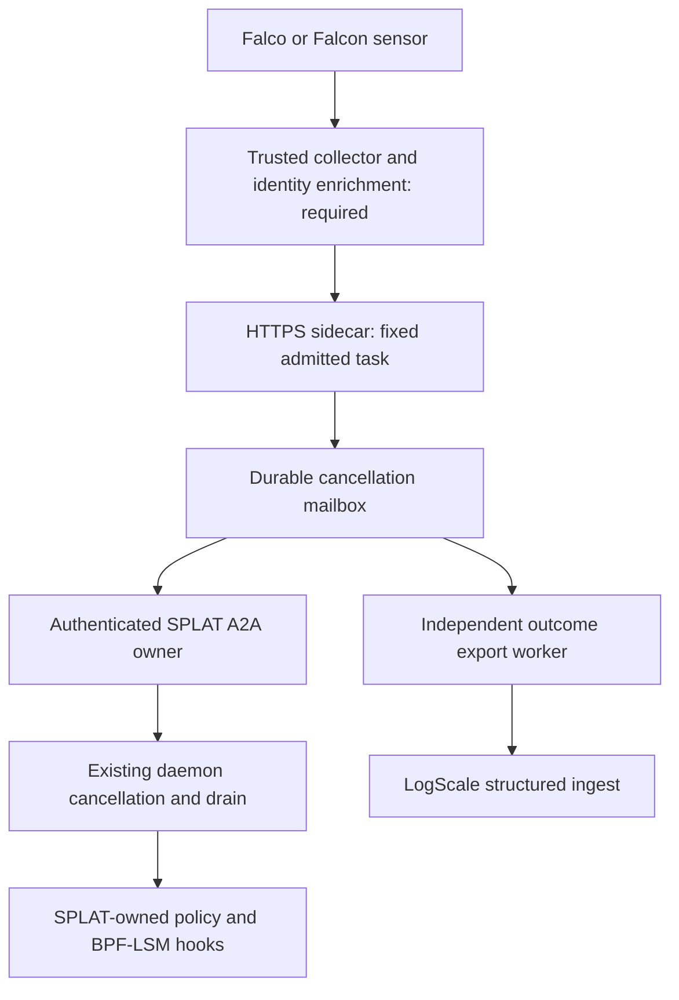

# Decoupled sensor-to-enforcer integration

SPLAT must decide before the protected operation completes. An asynchronous sensor can cancel
future work; it cannot reverse a completed read or retroactively protect an inherited descriptor.
This is a hardened interoperability prototype, not a production-qualified connector or a measured
sub-millisecond response system. It does not establish SOC 2 compliance.

## 1. Physical model and architectural position

The kernel checks preinstalled authority. The sensor describes observations. A separately authenticated
collector may request a monotone reduction in authority for an already admitted task. No sensor
binary, sensor BPF program, shared tail-call table or proprietary agent memory is modified.

Implemented prototype: one immutable task binding per sidecar, an authenticated HTTPS input,
a one-row SQLite cancellation mailbox, the existing SPLAT A2A control interface, and a separate
LogScale structured-ingest exporter. The mailbox coalesces all matching alerts into the same
cancellation. The source token cannot name another task or mint, renew or widen a lease.

The cold path intentionally allocates for HTTPS, JSON, SQL and requests. Durability precedes HTTP
202. It is not a zero-allocation hot path. A separate fixed-record Rust SPSC primitive demonstrates
allocation-free push/pop but is NOT connected to the sidecar or mapped into another process.
This places the current implementation toward pragmatic interoperability; a native mapped transport,
automatic admission binding and independent receipt verification remain engineering work.

## 2. Topology and ownership

- **S/C:** native Falco JSON and Falcon IOA data are observation inputs. The collector must validate
  provenance and enrich identity at observation time. This collector is not implemented here.
- **H/Q:** implemented in the new sidecar; only its exact configured task can be canceled.
- **A/D/K:** existing repository control/enforcement path, not newly reproved by this prototype.
- **X/L:** implemented HTTPS request formatting; no live LogScale account was exercised.

Falco's documented JSON includes rule, time, hostname and output_fields. Those alone are not proof
of a Windows/WSL task binding. The input is therefore explicitly a versioned normalized contract,
not an assertion that raw Falco or an arbitrary Falcon webhook can be plugged in unchanged.
See [Falco output channels](https://falco.org/docs/concepts/outputs/channels/).

The admission owner must retain the task UUID and establish node, guest boot ID, cgroup ID, host-
namespace PID and process start ticks before releasing the workload, using trusted host-namespace
observations. StartTicks means Linux /proc/PID/stat field 22, in boot-relative
clock ticks. A Falcon/Windows creation timestamp is a different representation and cannot simply
be copied into that field. Resolve the cross-platform identity at the trusted admission boundary.
Register descendants from
trusted lifecycle evidence; the prototype matches one process, not an entire inferred process tree.
Never enrich a delayed PID by reading whichever process occupies it now. A Linux registrar should
retain pidfds/cgroup descriptors; a Windows registrar should retain process handles and creation
times. Neither registrar is supplied by this patch. The sidecar never signals an alert-supplied PID:
its only action targets an immutable A2A task UUID, which also limits PID-reuse damage.

## 3. Pass 1 and pass 2 implementation

Pass 1: `src/splat-alert-sidecar/minimal-cancel.ps1` invokes the existing CancelTask RPC for a
disposable admitted task. It uses the task owner's token, normal TLS validation, the required
A2A extension header and a bounded timeout. The result must be inspected for termination evidence;
a successful HTTP response is not sufficient.

Pass 2: `src/splat-alert-sidecar/` is a standalone .NET 10 executable. The repository targets
.NET 10; introducing .NET 9 for this adapter would split the build contract. It binds only to
127.0.0.1 over HTTPS, requires an independent 32-byte random alert token, rejects browser Origin,
limits bodies to 16 KiB, connections to 16 and simultaneous admitted handlers to four.

Startup arguments are admission-binding JSON, SQLite mailbox path and HTTPS PFX path. Environment
inputs are SPLAT_ALERT_TOKEN (base64 32 bytes), SPLAT_ALERT_CERT_PASSWORD (when needed),
SPLAT_A2A_CALLER_TOKEN, and optionally SPLAT_LOGSCALE_INGEST_URL plus SPLAT_LOGSCALE_INGEST_TOKEN.
Protect those inputs and the mailbox directory with operator ACLs. The A2A credential must be the
task owner. The listener certificate must validate for 127.0.0.1; no certificate bypass is installed.
Disable automatic HTTP redirects. The loopback service is not a public cloud-webhook endpoint:
a separately secured collector/relay is required.

State transitions: idle -> pending only after a SQLite FULL-synchronous commit; duplicates retain
the first alert. A worker polls GetTask before CancelTask to recover ambiguous request responses.
Pending ends as host-reports-drain, terminal-without-drain-proof, or expired-unresolved. A terminal
state never upgrades itself on a duplicate. The exporter retries independently and marks exported
only on LogScale HTTP 200. A stable record ID supports receiver deduplication; exactly-once delivery
is not claimed. Sensor events beyond the first are not archived by this coalescing mailbox.

The worker polls at 25 ms and backs off to 1.6 s after failures. Therefore this implementation
does NOT satisfy sub-millisecond telemetry-to-revocation. It demonstrates bounded identity,
durability and outcome semantics first. A faulted worker stops intake. Export failures do not
block control calls; disk admission failures return 503 and concurrency pressure returns 429.
Those responses require retry at the collector. No response says an alert restored authority.

## 4. Kernel experiment and benchmark contract

`native/experiments/lease-open/open_guard.bpf.c` is separate lab source. It does not replace the
shipping 16-byte LeaseState ABI. Its 32-byte open_lease holds a BOOTTIME deadline, protected inode,
epoch, kernel device number and denied read/write f_mode bits. Preallocated hash entries are installed
before launch and remain immutable during a workload. Do not edit a multiword policy in place and
assume readers see an atomic transaction. Do not delete a live policy: a missing entry means the
cgroup is outside the experiment. Drain first; retain the cgroup and an O_PATH reference to the
protected inode to prevent object recycling.

The hook preserves a prior BPF-LSM return value, denies expired registered leases, and returns
-EPERM for a matching protected inode/access mode. Its 1 MiB denial ring is observational; a failed
reservation increments a per-CPU drop counter and cannot change the denial. It does not govern
existing file descriptors, mmap, arbitrary writes, all child authority or all path replacements.
No native loader, admission registrar or reproof was executed here. The source is not a deployable
kernel feature until the loader lifetime rules and native negative controls are verified.

BOOTTIME and MONOTONIC are not interchangeable: the latter excludes Linux suspend. Guest BOOTTIME
still does not prove that WSL host sleep advances a VM clock; retain the measured host-sleep limit.
A 32-byte value is not automatically cache-line aligned. BPF ringbuf reservation itself uses an
internal spinlock; describe the user-space SPSC primitive separately from the kernel ring.

Use a public dummy key fixture, never real SSH credentials. Its exact contents for the supplied
measurement utility are the ASCII line SPLAT_PUBLIC_DUMMY_KEY_DO_NOT_USE followed by LF.

1. Baseline: the dummy read succeeds. Record elapsed syscall samples with all other sensors fixed.
2. Preinstalled lease: the same attempted open returns EPERM while a separate permitted-file control
   still succeeds. Separate policy rejection from process termination; do not call this a kill.
3. Reaction: a real sensor produces an alert and the collector requests cancellation. Record observation,
   collector receipt, durable admission, control request, daemon enforcement and drain acknowledgement.
   A synthetic delayed timer is not a measured Falcon/Falco latency.

`measure_open.py` retains every duration and errno, p50/p95/p99, kernel, architecture and source
hash. Its metric includes userspace/Python, scheduling, the syscall and all hooks. It is not isolated
BPF execution time. Hash the loaded program, policy, benchmark and installed daemon too; record CPU,
affinity, governor, kernel configuration, boot ID and sample ordering in the native run bundle.
No 12 ms, 380 ms, 3.8 us or sub-microsecond result is asserted. All are proposed measurements.

## 5. Syntax and identifier breakdown

| Identifier | Operational role |
| --- | --- |
| Binding | Operator-owned immutable admission record; Check rejects malformed/expired configuration; Fingerprint binds one mailbox to that exact configuration. |
| TaskId, ListenPort, A2aPort | Fixed cancellation target and loopback endpoints, never selected by an alert. |
| Node, Boot, Cgroup, Pid, StartTicks | Identity tuple; boot and creation generation prevent treating a recycled PID/cgroup number as sufficient evidence. |
| Source, Rule, ExpiresUnixMs | Exact allow-listed sensor/rule and binding validity ceiling; no alert can extend the native lease. |
| Alert.Version, AlertId, ObservedUnixMs | Schema version, bounded sensor evidence identifier and replay-age filter. Source/rule/identity fields must match Binding. Wall-clock freshness is not kernel deadline enforcement. |
| Credentials, SHA256, FixedTimeEquals | Separate credential loading and bounded constant-time digest comparison; HTTPS still supplies transport authenticity. |
| Latch, slot, binding, state | One persistent control row and its immutable binding fingerprint; Admit commits the first signal, Read recovers it, Finish records a conservative terminal outcome. |
| alert, observed, received, reported | First evidence ID, sensor time, local acceptance time and independent export marker. |
| Control.Call, GetTask, CancelTask | Existing authenticated A2A operations. JSON-RPC id, result.id and version are checked; request params.id comes only from Binding. |
| A2A-Version, A2A-Extensions | Existing repository protocol/contract headers; no new privileged daemon API is exposed. |
| workloadTerminationConfirmed | Trusted host report only; signed native receipt verification remains separate. |
| ExportAsync, tags, events, timestamp, attributes | LogScale structured-ingest envelope. splat.record_id is stable across retry; HTTP 200 means ingestion-queue acceptance, not final retention. |
| ArrayPool, SemaphoreSlim, CancellationTokenSource | Cold-path body-buffer ownership, bounded concurrent admission and read/request time budgets. They are not kernel hot-path primitives. |
| SqliteConnection, FULL synchronous, owner FileStream | Durable coalescing mailbox and exclusive worker ownership; local administrator/storage compromise remains outside its guarantee. |
| open_lease, policies | Experimental 32-byte value and default-preallocated BPF_MAP_TYPE_HASH keyed by cgroup. Fixed 256-entry capacity; admission must fail if installation fails. |
| deadline_boot_ns, epoch | Expiry in the guest boot clock and correlation generation; epoch is not an atomic multi-map commit mechanism. |
| protected_ino, protected_dev, denied_fmode | Stable protected object and requested read/write-open mask; convert userspace device encoding correctly. |
| file_open, BPF_PROG, BPF_CORE_READ | LSM interception, typed trampoline convention, and CO-RE field reads using BTF. |
| bpf_get_current_cgroup_id, bpf_ktime_get_boot_ns | Current enforcement domain and the deadline clock; no packet parsing or network send occurs here. |
| bpf_get_current_pid_tgid, bpf_ringbuf_reserve/submit | Diagnostic PID and bounded ring reservation/publication. PID is evidence, not control authority. |
| events, denial, drops | BPF_MAP_TYPE_RINGBUF records and BPF_MAP_TYPE_PERCPU_ARRAY loss accounting. Emit failure never permits a denied operation. |
| AlertRecord, binding_hi/lo, boot_hi/lo | Rust fixed 64-byte record and binary correlation identities; not the HTTP ABI. |
| cgroup, start_ticks, observed_boot_ns, pid, reason | Native record's identity/time/reason fields; collector mapping and authentication remain external. |
| Producer, Consumer, Ring, Slots | Single-owner Rust transport handles and preallocated storage; no shared-memory process mapping is implemented. |
| AtomicU64 head/tail, Acquire/Release | Slot ownership publication and reuse ordering. wrapping_sub handles counter rollover within bounded occupancy. |
| UnsafeCell, MaybeUninit, Arc | Interior slot memory, explicitly initialized records, and startup-only shared allocation; unsafe Sync relies on exactly one producer and consumer. |
| Counter, repr(align(64)), CAPACITY | Separate 64-byte-aligned counters and 1024 records; 64-byte cache lines are a target assumption, not universal hardware truth. |
| try_push, try_pop | Bounded nonblocking native operations; full returns the original record, empty returns None. No implicit drop, sleep or allocation. |
| os.open/read/fstat/close, perf_counter_ns | Dummy-file benchmark operations and userspace duration measurement, not a kernel-only profiler. |

## 6. Failure and contention audit

The hot path has bounded map lookups, field reads and optional denial emission. No JSON, SQL,
gRPC or network I/O belongs there. Worst-case latency is not established by source shape:
collect verifier logs, translated/JIT instruction counts and loaded-program statistics on the target
kernel. Prior BPF-LSM denial is preserved, and overall LSM ordering/enablement must be recorded;
a Falco tracing attachment is not the same operation as an LSM denial.

Win32 Job Objects enforce process/resource constraints; they are not an openat-equivalent file
authorization hook. The Windows filesystem boundary additionally relies on restricted tokens,
ACLs and the execution design. Do not transfer a Linux BPF timing result to Job Objects.

The lab ring consumes 1 MiB plus metadata; per-CPU counters grow with configured CPU count.
Map allocation includes keys, hash metadata and per-entry overhead, not merely 256 x 32 bytes.
The SPSC payload is 64 KiB, with padded counters and Arc metadata. Producer/consumer ownership avoids
a shared increment on every event, but head/tail visibility still transfers cache lines. Benchmark
NUMA placement and batches before claiming throughput. The shipping global denial sequence can also
be a contention point. .NET/TLS/SQLite RSS and GC pauses must be measured separately.

Chosen failure policy: expiry enforcement remains local; observability loss must not widen an
existing lease. This is not strict fail-closed across all subsystems. Strict mode would additionally
require a trusted admission gate that refuses new work when collector health/lag/anchoring is bad,
plus a specified treatment of already running work. That gate is not supplied here. External alerts
must never mint fresh authority, even when marked high confidence.

## Evidence and next 30 days

Evidence: `private/sidecar-2026-11-04/`. Native ring: 4 passing tests, including 100,000 allocation-
counted push/pop pairs and concurrent transfer. Sidecar: 28 passing in-process checks using real
SQLite transactions, reopen recovery, identity changes, expiry, duplicate admission and outcome
semantics. These are not live HTTPS, vendor, A2A, native-kernel or crash/power-loss proofs.

Normal sidecar build is blocked by NU1900 (NuGet vulnerability feed unavailable). A diagnostic
compile with only NU1900 demoted locally produced zero compiler errors and two audit warnings;
the repository warning policy was not edited. This is not a release gate pass. WSL still returns
E_ACCESSDENIED; the installed Windows clang advertises no BPF target. The benchmark Python parses
but has not produced results. Independent loopback diagnostics recorded TCP permission denial
and a UDP receive timeout, consistent with the earlier seven socket-test failures, not a waiver.

- Days 1-7: authoritative admission binding/descendant lifecycle registration, scoped collector
  credentials, and independent native receipt verification. Preserve the existing lease ABI.
- Days 8-14: one real Falco rule and one customer-authorized Falcon/LogScale pipeline; schema/version
  fixtures, revocation ownership tests, clock skew and delayed/PID-reuse negative controls.
- Days 15-21: controlled Linux kernel proof, crash recovery, full mailbox/disk/network failures,
  sensor coexistence, and the three-act dummy-key experiment with raw distributions.
- Days 22-30: reproducible pilot package, installation/rollback/support runbook and scoped trials.
  Recruit 5-10 design partners around a measured workload and existing sensor deployment; count
  completed pilots and verified enforcement, not promised acquisition interest.

A strategic acquisition is a possible business outcome, not an engineering invariant or a promised
exit. Start with an integration customers can verify and operate.

Primary references: [LogScale ingest](https://library.humio.com/logscale-api/api-ingest.html),
[structured request format](https://library.humio.com/logscale-gdi/popular-ingest-methods-http-https-api-setup.html),
[BPF LSM](https://docs.kernel.org/bpf/prog_lsm.html), [BPF ring buffers](https://docs.kernel.org/bpf/ringbuf.html),
and [Linux clock semantics](https://man7.org/linux/man-pages/man2/clock_gettime.2.html).
