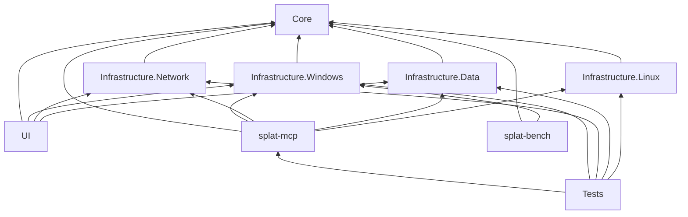

<!-- Inventory of every buildable unit. Read out of the project files at 0027e57 on 2026-09-10; the
     commands at the bottom regenerate each fact. Relative links are checked by
     DocumentationDriftTests, so a moved file fails the build instead of quietly rotting here.
     Package versions are deliberately left to the project files except where the version is itself
     the point. -->

# Module info

## At a glance

| Module | Path | Language · target | Ships | Role |
| --- | --- | --- | --- | --- |
| **MissionController.Core** | [`src/MissionController.Core`](../src/MissionController.Core) | C# · `net9.0;net10.0` | Yes | Contracts, models, the mission pipeline and every engine that composes it |
| **MissionController.Infrastructure.Windows** | [`src/MissionController.Infrastructure.Windows`](../src/MissionController.Infrastructure.Windows) | C# · `net9.0-windows;net10.0-windows` | Yes | Jail, job object, restricted token, AppContainer launch, DPAPI vault, remediation, Copilot adapter |
| **MissionController.Infrastructure.Network** | [`src/MissionController.Infrastructure.Network`](../src/MissionController.Infrastructure.Network) | C# · `net9.0;net10.0` | Yes | Egress firewall, model clients, DLP, identity, SIEM and EDR, trigger listeners |
| **MissionController.Infrastructure.Data** | [`src/MissionController.Infrastructure.Data`](../src/MissionController.Infrastructure.Data) | C# · `net9.0;net10.0` | Yes | SQLite storage, chained ledger, Merkle proofs and compliance export, retention, memory, catalogs, registries |
| **MissionController.Infrastructure.Linux** | [`src/MissionController.Infrastructure.Linux`](../src/MissionController.Infrastructure.Linux) | C# · `net9.0;net10.0` | Yes, inside `splat-mcp` | The Windows-side bridge to `splat-agent` |
| **MissionController.UI** | [`src/MissionController.UI`](../src/MissionController.UI) | C# · WinUI 3 · `net9.0-windows10.0.19041.0` | No — frozen | The operator console; composition root one |
| **splat-mcp** | [`src/splat-mcp`](../src/splat-mcp) | C# · `net10.0-windows` · exe | Yes — the licensee-facing surface | The MCP server; composition root two |
| **splat-bench** | [`src/splat-bench`](../src/splat-bench) | C# · `net10.0-windows` · exe | No | Measures the governed launch path against a bare one |
| **MissionController.Tests** | [`tests/MissionController.Tests`](../tests/MissionController.Tests) | C# · xUnit · `net10.0-windows` | No | The suite |
| **splat-agent** | [`native/splat-agent`](../native/splat-agent) | Rust 2021 and BPF C · Linux | Yes — the licensed daemon | The resident lease daemon and its BPF-LSM program |
| **splat-canary** | [`native/splat-canary`](../native/splat-canary) | Rust 2021 and BPF C · Linux | No — a frozen proof | The standalone `-EPERM` harness |
| **splat-langgraph** | [`src/splat-langgraph-py`](../src/splat-langgraph-py) | Python ≥ 3.10 | As an adapter | LangChain and LangGraph tools over `splat-mcp` |
| **packaging** | [`packaging`](../packaging) | PowerShell | Deferred | Signed MSIX build; Intune and SCCM install and uninstall |

"Ships" follows the live plan: what a licensee embeds. The console and the MSIX pipeline build, but
nothing on the critical path depends on them.

## Project references

Arrows point from a project to what it references; the tests also reference Core directly. The
graph is a plain DAG: the infrastructure libraries reference only Core, and nothing references a
host except the tests, which reference `splat-mcp`. The console does not reference
`Infrastructure.Linux` — it has no Linux path at all. The Rust crates and the Python package sit
outside the solution; the Python package reaches C# only by launching `splat-mcp`.

---

## MissionController.Core

- **Target:** `net9.0;net10.0`. The net9 leg exists only for the console; no .NET-10-only API here.
- **References:** none. **Packages:** none. **Referenced by:** every other C# project.
- **Contracts:** [`Interfaces.cs`](../src/MissionController.Core/Interfaces.cs) — the platform
  seams, plus the Linux lease records (`LeaseSpec`, `LeaseResourceLimits`, `LeaseViolationEvent`);
  [`OperatorIdentity.cs`](../src/MissionController.Core/OperatorIdentity.cs); and the contracts that
  sit beside their engines in `Crew/`, `Workflow/` and `QualityIsland/Contracts/`.
- **Models:** [`Models.cs`](../src/MissionController.Core/Models.cs) — templates, egress rules,
  remediation actions, projects, `MissionChunk`, ledger and Merkle records, `JobResourceMetrics`,
  identity and diagnosis records; [`Enums.cs`](../src/MissionController.Core/Enums.cs);
  [`CopilotSafetyModels.cs`](../src/MissionController.Core/CopilotSafetyModels.cs);
  [`RetentionPolicy.cs`](../src/MissionController.Core/RetentionPolicy.cs).
- **The pipeline:** [`MissionExecutionEngine.cs`](../src/MissionController.Core/MissionExecutionEngine.cs),
  [`GovernedArgumentBinder.cs`](../src/MissionController.Core/GovernedArgumentBinder.cs),
  [`PosixArgumentSplitter.cs`](../src/MissionController.Core/PosixArgumentSplitter.cs),
  [`StructuredDiagnosisContract.cs`](../src/MissionController.Core/StructuredDiagnosisContract.cs),
  [`JsonFindingsExtractor.cs`](../src/MissionController.Core/JsonFindingsExtractor.cs),
  [`TelemetryGrounder.cs`](../src/MissionController.Core/TelemetryGrounder.cs),
  [`DynamicCodeAstValidator.cs`](../src/MissionController.Core/DynamicCodeAstValidator.cs),
  [`FatalErrorLog.cs`](../src/MissionController.Core/FatalErrorLog.cs).
- **Engines:** [`GovernedInvestigationLoop.cs`](../src/MissionController.Core/GovernedInvestigationLoop.cs)
  with [`ReActDecisionContract.cs`](../src/MissionController.Core/ReActDecisionContract.cs),
  [`ProjectExecutionEngine.cs`](../src/MissionController.Core/ProjectExecutionEngine.cs),
  [`Crew/`](../src/MissionController.Core/Crew), [`Brain/`](../src/MissionController.Core/Brain),
  [`Workflow/`](../src/MissionController.Core/Workflow),
  [`QualityIsland/`](../src/MissionController.Core/QualityIsland) — oracles, evaluators and the
  Bradley–Terry arbiter.
- **Tests:** `AgentBrainTests`, `ArgumentVectorContractTests`, `BradleyTerryArbiterTests`,
  `DiagnosticFindingsExtractorTests`, `EngineResilienceTests`, `FailureIsNotEvidenceTests`,
  `FatalErrorLogTests`, `GovernedArgumentBinderTests`, `GovernedCrewDefectRegressionTests`,
  `GovernedCrewEngineTests`, `GovernedInvestigationLoopTests`, `PreMissionRecallTests`,
  `ProjectExecutionEngineTests`, `QualityIslandTests`, `StructuredDiagnosisContractTests`,
  `TelemetryGroundingTests`, `WorkflowEngineTests`, `WorkflowGovernanceTests`, with
  `WorkflowMissionDoubles` as shared fakes.

## MissionController.Infrastructure.Windows

- **Target:** `net9.0-windows;net10.0-windows`, with `AllowUnsafeBlocks`.
- **References:** Core. **Packages:** `System.Security.Cryptography.ProtectedData` for DPAPI;
  `Microsoft.Extensions.DependencyInjection.Abstractions` for `AddSplatCopilotSafety`.
- **Referenced by:** the console, `splat-mcp`, `splat-bench`, the tests.
- **Namespaces do not follow folders.** The root files declare
  `MissionController.Infrastructure.Windows.Jails` (`NtAclJailManager`), `.JobObjects`
  (`Win32JobSandbox`), `.Process` (`SuspendedProcessLauncher`), `.Security`
  (`RestrictedTokenProvider`, `SensorAppContainer`, `WindowsOperatorIdentityProvider`), `.Vault`
  (`DpapiCredentialVault`) and `.Native` (`Win32Interop`). `Remediation/` and `Copilot/` match their
  namespaces.
- **Owns:** [`SuspendedProcessLauncher.cs`](../src/MissionController.Infrastructure.Windows/SuspendedProcessLauncher.cs),
  [`Win32JobSandbox.cs`](../src/MissionController.Infrastructure.Windows/Win32JobSandbox.cs),
  [`RestrictedTokenProvider.cs`](../src/MissionController.Infrastructure.Windows/RestrictedTokenProvider.cs),
  [`NtAclJailManager.cs`](../src/MissionController.Infrastructure.Windows/NtAclJailManager.cs),
  [`SensorAppContainer.cs`](../src/MissionController.Infrastructure.Windows/SensorAppContainer.cs),
  [`Win32Interop.cs`](../src/MissionController.Infrastructure.Windows/Win32Interop.cs),
  [`DpapiCredentialVault.cs`](../src/MissionController.Infrastructure.Windows/DpapiCredentialVault.cs),
  [`WindowsOperatorIdentityProvider.cs`](../src/MissionController.Infrastructure.Windows/WindowsOperatorIdentityProvider.cs),
  [`Remediation/`](../src/MissionController.Infrastructure.Windows/Remediation),
  [`Copilot/`](../src/MissionController.Infrastructure.Windows/Copilot).
- **Tests:** `CopilotSafetySubstrateTests`, `CredentialRemovalTests`,
  `EgressAndPrivilegeHardeningTests`, `HardeningSubsystemTests`, `ProcessLauncherTests`,
  `RemediationEngineTests`, `SensorNetworkContainmentTests`.
- **Detail:** [ARCHITECTURE-windows-substrate.md](ARCHITECTURE-windows-substrate.md).

## MissionController.Infrastructure.Network

- **Target:** `net9.0;net10.0`. **References:** Core. **Packages:** none.
- **Referenced by:** the console, `splat-mcp`, the tests.
- **Namespaces do not follow folders** for the root files: `.Egress` (`EgressFirewallHandler`),
  `.Http` (`HardenedHttpClientFactory`), `.Identity` (`PkceLoopbackAuthService`,
  `ServiceAccountAuthService`) and `.Vertex` (`VertexAiStreamClient`). `Ai/`, `Dlp/`, `Edr/`,
  `Identity/`, `Siem/` and `Triggers/` match.
- **Owns:** [`EgressFirewallHandler.cs`](../src/MissionController.Infrastructure.Network/EgressFirewallHandler.cs),
  [`HardenedHttpClientFactory.cs`](../src/MissionController.Infrastructure.Network/HardenedHttpClientFactory.cs),
  [`Ai/`](../src/MissionController.Infrastructure.Network/Ai) — the Claude and Gemini clients, the
  router and the key classifier;
  [`Dlp/`](../src/MissionController.Infrastructure.Network/Dlp),
  [`Identity/`](../src/MissionController.Infrastructure.Network/Identity) — JWT and API-key
  validation, token lifecycle, revocation, the credential sanitizer;
  [`Siem/`](../src/MissionController.Infrastructure.Network/Siem),
  [`Edr/`](../src/MissionController.Infrastructure.Network/Edr),
  [`Triggers/`](../src/MissionController.Infrastructure.Network/Triggers).
- **Constructed by neither host:** `VertexAiStreamClient`, `PkceLoopbackAuthService`,
  `ServiceAccountAuthService`, and everything in `Triggers/`.
- **Tests:** `AiGatewayTests`, `DlpSanitizerTests`, `LoopbackGateTests`, `ModelStreamClientTests`,
  `SanitizationAndRevocationTests`, `SecurityHubOrchestrationTests`, `SecurityHubViewModelTests`,
  `SiemAndEdrIntegrationTests`, `TokenValidationAndLifecycleTests`.

## MissionController.Infrastructure.Data

- **Target:** `net9.0;net10.0`. **References:** Core.
- **Packages:** `Microsoft.Data.Sqlite`, versioned **per target framework** in the project file:
  the single shared version it replaced pulled a native SQLite carrying `GHSA-2m69-gcr7-jv3q` into
  both legs.
- **Referenced by:** the console, `splat-mcp`, the tests.
- **Namespaces do not follow folders** for two root files: `.Audit` (`SqliteChainedAuditLedger`)
  and `.Templates` (`SqliteTemplateRegistry`). `Catalog/`, `Compliance/`, `Retention/` and `Vector/`
  match.
- **Owns:** [`SqliteStorageContext.cs`](../src/MissionController.Infrastructure.Data/SqliteStorageContext.cs),
  [`SqliteChainedAuditLedger.cs`](../src/MissionController.Infrastructure.Data/SqliteChainedAuditLedger.cs),
  the three registries, [`Catalog/`](../src/MissionController.Infrastructure.Data/Catalog) — the
  template catalog split by domain, plus the project and crew catalogs;
  [`Compliance/`](../src/MissionController.Infrastructure.Data/Compliance),
  [`Retention/`](../src/MissionController.Infrastructure.Data/Retention),
  [`Vector/`](../src/MissionController.Infrastructure.Data/Vector).
- **Constructed by neither host:** `DataRetentionService`, `SqliteGovernedCrewRegistry`.
- **Tests:** `AuditAndSecurityTests`, `DataRetentionTests`, `GovernedCrewRegistryTests`,
  `GovernedProjectCatalogTests`, `HmacAuditLedgerAndAstValidatorTests`,
  `MerkleComplianceArchiveTests`, `SemanticMemoryTests`, `TemplateRegistryExpansionTests`.
- **Detail:** [ARCHITECTURE-control-plane.md](ARCHITECTURE-control-plane.md#evidence-and-memory).

## MissionController.Infrastructure.Linux

- **Target:** `net9.0;net10.0`. **References:** Core. **Packages:** none.
- **Referenced by:** `splat-mcp` and the tests — not the console.
- **Owns:** [`WslLeasedExecutor.cs`](../src/MissionController.Infrastructure.Linux/WslLeasedExecutor.cs),
  [`TemplatePolicyCompiler.cs`](../src/MissionController.Infrastructure.Linux/TemplatePolicyCompiler.cs),
  [`WslSubstrateHealthChecker.cs`](../src/MissionController.Infrastructure.Linux/WslSubstrateHealthChecker.cs).
- **Not on a live path:** `TemplatePolicyCompiler` — constructed, never called.
- **Tests:** `LinuxSubstrateAndCompilerTests`, `SubstrateHealthHonestyTests`,
  `WslLeasedExecutorWireTests`.
- **Detail:** [ARCHITECTURE-linux-substrate.md](ARCHITECTURE-linux-substrate.md#the-bridge-on-windows).

## MissionController.UI

- **Target:** `net9.0-windows10.0.19041.0`, minimum platform `10.0.17763.0`, `win-x64`, unpackaged
  (`WindowsPackageType` `None`) with the Windows App SDK self-contained.
- **References:** Core, Windows, Network, Data.
- **Packages:** `Microsoft.WindowsAppSDK` **1.6** — out of support, and the reason this project is
  frozen rather than migrated; `Microsoft.Graphics.Win2D`; `Microsoft.Windows.SDK.BuildTools`;
  `CommunityToolkit.Mvvm`; `CommunityToolkit.WinUI.Controls.Primitives`;
  `Microsoft.Extensions.DependencyInjection`.
- **Composition root:** [`App.xaml.cs`](../src/MissionController.UI/App.xaml.cs), which also routes
  every fatal path to `FatalErrorLog` and a message box, so a failed start leaves evidence.
- **Screens,** from [`MainWindow.xaml.cs`](../src/MissionController.UI/MainWindow.xaml.cs):
  QuickDiagnostician (the start page), WelcomeOnboarding, LiveMissionMonitor, TemplateCatalog,
  ProjectStudio, SecurityAudit, SemanticSearch, JailInspector and Settings — each a view under
  `Views/` and a view model at the project root.
- **Rendering:** `Effects/` — composition shaders, and Win2D HLSL whose bytecode is built only when
  the SDK's `fxc` is found; `Graphics/` — a Direct3D swap-chain host. The palette is
  [`Styles/SplatDesignTokens.xaml`](../src/MissionController.UI/Styles/SplatDesignTokens.xaml).
- **Suppressed warning:** `MVVMTK0045`, with the reasoning in the project file;
  `UiWarningSuppressionTests` fails if AOT or trimming is ever switched on, the one case where the
  warning would matter.
- **Runs from** `dist\App`, a `dotnet publish` output — see [CONTEXT.md](CONTEXT.md#working-in-this-tree).
- **Tests:** source-level only, because a test project cannot reference the WinUI app:
  `CompositionRootTests`, `UiWarningSuppressionTests`, `ShaderAssetVerificationTests`.

## splat-mcp

- **Target:** `net10.0-windows`, exe, root namespace `SplatMcp`.
- **References:** Core, Linux, Data, Network, Windows. **Packages:** none.
- **Referenced by:** the tests.
- **Owns:** [`Program.cs`](../src/splat-mcp/Program.cs) — composition and the stdio loop;
  [`McpServerCommand.cs`](../src/splat-mcp/McpServerCommand.cs) — the command line, decided before
  anything is built;
  [`McpServerHandler.cs`](../src/splat-mcp/McpServerHandler.cs) — dispatch and the twelve tools;
  [`McpProtocol.cs`](../src/splat-mcp/McpProtocol.cs) — the JSON-RPC and MCP records;
  [`McpEgressPolicy.cs`](../src/splat-mcp/McpEgressPolicy.cs) — the operator's egress endpoints;
  [`McpOperatorIdentityProvider.cs`](../src/splat-mcp/McpOperatorIdentityProvider.cs);
  [`WorkspaceGuard.cs`](../src/splat-mcp/WorkspaceGuard.cs).
- **Tests:** `AuditPayloadAndPreExecutionAuthTests`, `McpServerTests`, `McpTraceAnchorTests`,
  `OperatorAttributionTests`, `SplatMcpCommandLineTests`, `WorkspaceConfinementTests`, and
  `DocumentationDriftTests`, which holds `tools/list` to the README.
- **Detail:** [ARCHITECTURE-agent-surface.md](ARCHITECTURE-agent-surface.md#splat-mcp).

## splat-bench

- **Target:** `net10.0-windows`, exe, with workstation, non-concurrent GC so collection pauses do not
  land in the measured window.
- **References:** Core, Windows.
- **Does:** runs `cmd.exe /c exit 0` through the governed launch path and bare, alternating, and
  writes `bench-*.json` to [`evidence/`](../src/splat-bench/evidence). It is not part of
  `dotnet test` — timing assertions in a suite get flaky and then muted — and is run with
  `dotnet run --project src/splat-bench -c Release`.

## MissionController.Tests

- **Target:** `net10.0-windows`. **Packages:** `xunit`, `xunit.runner.visualstudio`,
  `Microsoft.NET.Test.Sdk`, `coverlet.collector`.
- **References:** Core, Windows, Network, Data, Linux, `splat-mcp`.
- **Constraint:** data-driven tests use `[InlineData]` only. `NoDataSourceEscapesTheTestCounter`
  fails on `[MemberData]` or `[ClassData]`, because the documentation's test count is computed by
  reflection and could not see them.
- **Cross-cutting:** `DocumentationDriftTests`, `EndToEndVerificationTests` with
  `DiagnosticVerificationRunner`.

## splat-agent

- **Crate:** `splat-agent` 0.2.0, edition 2021. **Dependencies:** `libbpf-rs` 0.24 — its API still
  moves, so the version is pinned — plus `tokio`, `clap`, `serde`, `serde_json`, `libc`, `anyhow`,
  `ctrlc`, `tracing`; `libbpf-cargo` 0.24 at build time.
- **Owns:** [`src/main.rs`](../native/splat-agent/src/main.rs) — the daemon and its protocol;
  [`lease.rs`](../native/splat-agent/src/lease.rs), [`cgroup.rs`](../native/splat-agent/src/cgroup.rs),
  [`auth.rs`](../native/splat-agent/src/auth.rs), [`violation.rs`](../native/splat-agent/src/violation.rs),
  [`cow.rs`](../native/splat-agent/src/cow.rs), which is parked;
  [`src/bpf/lease_lsm.bpf.c`](../native/splat-agent/src/bpf/lease_lsm.bpf.c); a generated
  `vmlinux.h` — never hand-edit it.
- **Scripts:** [`run-daemon.sh`](../native/splat-agent/run-daemon.sh) builds with
  `CARGO_TARGET_DIR=/tmp/splat_agent_target` and starts the daemon as root on loopback;
  [`probe-daemon.sh`](../native/splat-agent/probe-daemon.sh) exercises a running daemon.
- **Evidence:** [`evidence/`](../native/splat-agent/evidence). **Policy:**
  [`SUPPORTED_POLICY.md`](../native/splat-agent/SUPPORTED_POLICY.md).
- **Tests:** `cargo test` for what userspace can check; the root probe for everything else.
- **Detail:** [ARCHITECTURE-linux-substrate.md](ARCHITECTURE-linux-substrate.md).

## splat-canary

- **Crate:** `splat-canary` 0.1.0, license `GPL-2.0-only` — a BPF-LSM program must be
  GPL-compatible — with `libbpf-rs` 0.24 pinned like the daemon's.
- **Scripts:** [`preflight.sh`](../native/splat-canary/preflight.sh) gives a GREEN, YELLOW or RED
  verdict on the kernel; [`setup-guest.sh`](../native/splat-canary/setup-guest.sh) installs the
  toolchain and generates `vmlinux.h`; [`run-canary.sh`](../native/splat-canary/run-canary.sh)
  builds and fires the canary and exits non-zero on a bad run.
- **Evidence:** [`evidence/`](../native/splat-canary/evidence).
- **Frozen:** its BPF program is a fork kept at the shape its evidence was produced against. See
  its [README](../native/splat-canary/README.md).

## splat-langgraph

- **Package:** `splat-langgraph` 0.1.0, Python ≥ 3.10. **Dependencies:** `mcp`, `langchain-core`,
  `pydantic`; `langgraph` as an extra. **Declared license:** MIT, in `pyproject.toml` — the
  repository as a whole is proprietary.
- **Owns:** [`splat_langgraph/substrate.py`](../src/splat-langgraph-py/splat_langgraph/substrate.py),
  [`splat_langgraph/tools.py`](../src/splat-langgraph-py/splat_langgraph/tools.py).
- **Tests:** none in this repository.
- **Detail:** [ARCHITECTURE-agent-surface.md](ARCHITECTURE-agent-surface.md#splat-langgraph).

## packaging

- [`build-msix.ps1`](../packaging/build-msix.ps1) publishes the console self-contained for
  `win-x64` and packs and signs an MSIX when the Windows SDK's `makeappx` and `signtool` are
  present. That is a different artifact from `dist\App`, which is framework-dependent.
- [`install-enterprise.ps1`](../packaging/install-enterprise.ps1) and
  [`uninstall-enterprise.ps1`](../packaging/uninstall-enterprise.ps1) are the silent Intune and
  SCCM install and removal.
- Deferred: the runbook leaves MSIX out on purpose, and the live plan ships `splat-mcp` without an
  installer.

---

## Evidence files

| File | Written by | Held by the suite to |
| --- | --- | --- |
| [`native/splat-canary/evidence/canary-6.18.33.2-microsoft-standard-WSL2.json`](../native/splat-canary/evidence/canary-6.18.33.2-microsoft-standard-WSL2.json) | `run-canary.sh` | The canary's BPF source hash, and the README's substrate wording |
| [`native/splat-agent/evidence/daemon-probe.json`](../native/splat-agent/evidence/daemon-probe.json) | `probe-daemon.sh` against a root daemon | The daemon's BPF source hash, and the README's "Enforcing, proven under root" |
| [`native/splat-agent/evidence/fail-closed-probe.json`](../native/splat-agent/evidence/fail-closed-probe.json), [`peer-auth-probe.json`](../native/splat-agent/evidence/peer-auth-probe.json), [`wire-contract-probe.json`](../native/splat-agent/evidence/wire-contract-probe.json) | One-off probes | Nothing — cited by SUPPORTED_POLICY |
| [`src/splat-bench/evidence/bench-windows-10.0.26200.0.json`](../src/splat-bench/evidence/bench-windows-10.0.26200.0.json) | `splat-bench` | Every document's latency claims |

## Re-verifying this page

~~~powershell
$dotnet = "$env:LOCALAPPDATA\Microsoft\dotnet\dotnet.exe"
& $dotnet sln MissionController.sln list                               # the projects
git grep -n "TargetFramework\|ProjectReference\|PackageReference" -- "*.csproj"
git grep -n "^namespace" -- "src/*.cs"                                  # namespace against folder
git grep -lw TemplatePolicyCompiler -- src                               # is a type wired?
~~~

A type named only by its own file and by files under `tests/` is not wired. A module added to
the solution without a section here is this page's bug, and not yet a test's.
