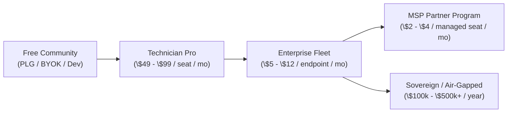

# Platten Industries: SPLAT Commercial Master Strategy & Monetization Blueprint

> **Partly superseded, 2026-09-09.** Tracks A–D below are the four *direct-sales* motions —
> technician PLG, enterprise fleet, MSP wholesale, sovereign. All four were weighed against the
> reality of a solo operator and set aside in favour of **OEM / embedded licensing**, plus paid
> containment assessments as the first revenue. See
> [the OEM subtraction plan](audits/2026-09-09-oem-subtraction-plan.md), §6 and §7. What survives
> here unchanged is the buyer-pain analysis, the unit economics, and the CISO ROI framing — the *reasons* were never the problem,
> the go-to-market was.

**Document Class:** Executive Commercial Strategy & Investment Memorandum  
**Company:** Platten Industries  
**Product:** SPLAT (Sandboxed Process Lease & Agent Telemetry)  
**Positioning:** The Zero-Trust Execution Airbag & Governance Substrate for Enterprise AI Agents  
**Target Audience:** Enterprise CISOs, IT Directors, MSP Leadership, Venture Capitalists, & Microsoft CorpDev  

---

## 1. Executive Summary & The Enterprise Dilemma

Enterprises, Managed Service Providers (MSPs), and higher-education IT organizations are urgently investing in autonomous AI agents (Microsoft Copilot, LangGraph, Claude Code, n8n, Custom ReAct Agents) to lower MTTR (Mean Time to Resolution) and slash tier-1/2 IT operational expenses.

However, **enterprise CISOs and Security Architects are actively vetoing and blocking autonomous local tool execution on corporate endpoints.**

### The Three Blockers Halting Enterprise Agent Adoption:
1. **Unconstrained Ambient Privilege (The Blast-Radius Dilemma):** Traditional AI agent frameworks execute CLI commands, PowerShell scripts, and Python routines using the user’s ambient Windows access token. If a model hallucinates or is coerced via prompt injection, it can wipe filesystems, access DPAPI secrets, read LSASS/SAM hashes, or move laterally across corporate networks.
2. **The MicroVM Latency & Cost Trap:** Cloud-based execution sandboxes (e.g. E2B, Modal, Daytona) require offloading enterprise workloads to external cloud virtual machines. That puts a network round trip on every tool call, moves proprietary data to public clouds, and adds recurring compute costs. We have not measured them, so no numbers here.
3. **The Non-Repudiation Void (Audit Non-Compliance):** Regulatory bodies (HIPAA, SOC 2, NIST 800-207, CMMC) demand tamper-evident proof of every state-changing operational action. Standard orchestrator application logs can be truncated, deleted, or forged by a compromised host process.

### The Platten Industries Thesis:
> **"Don't build n8n, LangGraph, or Microsoft Copilot — Secure Them."**  
> Let high-level orchestrators handle workflow graphs, reasoning, and SaaS connectors. Route every privileged local command, diagnostic probe, and filesystem mutation through **SPLAT’s kernel-enforced, single-mission capability lease.**

---

## 2. Product Architecture & The Defensible Moat

SPLAT provides a local-first, dual-OS containment substrate that runs on stock, unmodified kernels with measured overhead (**4.12 ms p50 / 9.88 ms p95 measured on Windows 10.0.26200**).

```
                            THE SPLAT ENTERPRISE TOPOLOGY
  
  ┌─────────────────────────────────────────────────────────────────────────────────┐
  │  HIGH-LEVEL ORCHESTRATION LAYER                                                 │
  │  • Microsoft Copilot / Semantic Kernel    • LangGraph / Python Multi-Agent      │
  │  • n8n Community Workflows               • Claude Code / MCP Clients            │
  └──────────────────────────────────────┬──────────────────────────────────────────┘
                                         │ MCP stdio (a REST trigger on :5678 is designed, not started)
  ┌──────────────────────────────────────▼──────────────────────────────────────────┐
  │  SPLAT CONTROL PLANE (.NET 10 / MissionController.Infrastructure)                │
  │  • Capability Lease Compiler: Single-use, bounded seconds-scale execution lease │
  │  • In-Memory DLP Sanitizer: Pre-egress redaction of bare keys & corporate PII   │
  │  • In-Memory Egress Firewall: Pinned FQDN HTTP client filtering                 │
  │  • Tamper-Evident Merkle Ledger: SHA-256 chained audit log committed to SQLite  │
  └───────────────────┬─────────────────────────────────────────┬───────────────────┘
                      │ Windows Substrate                       │ Linux MicroVM Substrate
  ┌───────────────────▼─────────────────────┐  ┌────────────────▼───────────────────┐
  │ WINDOWS CONTAINMENT                     │  │ LINUX BPF-LSM AIRBAG               │
  │ • Win32 Job Object (Hard CPU/RAM caps)  │  │ • Unmodified stock WSL2 kernel     │
  │ • Low-Privilege AppContainer isolation │  │ • BPF-LSM hooks (bprm, open, sock) │
  │ • Stripped Admin Token (S-1-5-32-544)   │  │ • -EPERM kernel veto on rogue call │
  │ • Ephemeral NT ACL Jails                │  │ • OverlayFS CoW: roadmap P2        │
  │ • Scratch overlays: NOT BUILT           │  │ • Unified cgroup v2 resource clamps│
  └─────────────────────────────────────────┘  └────────────────────────────────────┘
```

### Core Technological Differentiators:
1. **Task-Level Capability Leases (Not Machine Perimeters):** While cloud sandboxes isolate by creating an entire virtual machine, SPLAT isolates at the granularity of a **single task** (*1 Template $\rightarrow$ 1 Model $\rightarrow$ 1 Tool $\rightarrow$ 1 Egress FQDN*).
2. **Stock Microsoft Kernel Compatibility:** Zero custom kernel forks or CVE burdens. Proven on Windows 11 with the stock WSL2 kernel 6.18, using one standard `.wslconfig` boot-line directive.
3. **Filesystem Atomicity (Ephemeral Scratch Overlays), planned:** the goal is for speculative operations to run in a copy-on-write overlay that commits on success and is purged on failure. It is not built; roadmap P2 is the work, and until then the daemon refuses the request rather than pretending to honour it.
4. **Tamper-Evident Chaining (non-repudiation is half done):** Every action produces a chained entry where:
   ```
EntryHash = SHA256(PreviousHash || Timestamp || MissionId || TemplateId || Action || DetailsCommitment || Operator)
```
   With the operator's key file, HMAC-SHA256 under that key replaces SHA-256. Audit anchors are returned directly to calling orchestrators (LangGraph checkpointers, n8n payloads, Sentinel workbooks).

---

## 3. Commercial Packaging & Monetization Model



### Track A: Technician Pro (Bottom-Up Product-Led Growth)
* **Target Customer:** Solo SysAdmins, IT Contractors, Tier-1/2 Helpdesk Technicians.
* **Pricing:** **\$49 – \$99 / technician / month** (or \$499 billed annually).
* **Delivery:** Standalone signed desktop application with BYOK (Bring Your Own Key for Anthropic / Gemini).
* **Value Metric:** Instant frontline diagnostic runbooks, automated ticket drafts, remediation scripts run with stripped privileges, each with a declared risk level (an undo is optional today).

### Track B: Enterprise Fleet License (Primary Annual Recurring Revenue Engine)
* **Target Customer:** Mid-Market to Global Enterprise IT & SecOps (500 to 50,000+ endpoints).
* **Pricing:** **\$5 – \$12 / managed endpoint / month** (Annual contracts: \$30k – \$250k+ ARR).
* **Delivery:** Silent Microsoft Intune / SCCM MSIX deployment with central group policy management.
* **Features Included:**
  * Fleet-wide template distribution and policy enforcement (planned, not built).
  * Direct streaming to **Microsoft Sentinel** (CEF / RFC 5424 / REST API).
  * Cryptographic Merkle compliance archive export for external SOC 2 / HIPAA audits.
  * Windows DPAPI enterprise credential management.

### Track C: Managed Service Providers (MSP / MSSP Wholesale Program)
* **Target Customer:** IT Managed Service Providers managing multiple client corporate tenants.
* **Pricing:** **\$2 – \$4 / managed seat / month** (Tiered wholesale volume pricing).
* **Features Included:**
  * Multi-tenant reporting and billing attribution.
  * White-labeled executive remediation reports built on the audit ledger (planned, not built).
  * Per-client containment evidence: what each technician agent was allowed to do, and the refusals when it tried more (planned, not built). No containment product can guarantee an endpoint is never compromised, and this one does not claim to.

### Track D: Sovereign & Air-Gapped Edition
* **Target Customer:** Defense, Intelligence Community, National Labs, Critical Infrastructure, Healthcare.
* **Pricing:** **\$100k – \$500k+ / year** (Perpetual or high-value annual subscription).
* **Features Included:**
  * Offline operation with a local model (vLLM / Ollama): planned; no local model client exists yet.
  * Hardware token (YubiKey / SmartCard) enforcement: planned, not built.
  * No cloud telemetry: the containment substrate makes no external calls; the app's own reasoning needs the local model above to go fully offline.

---

## 4. Expansion Revenue Streams & Unit Economics

1. **Platten Cloud AI Gateway (Inference Margin Markup):**
   * *Target:* Enterprises avoiding individual API key provisioning across thousands of workstations.
   * *Model:* Direct token billing with a **20%–35% margin markup**, providing rate-limiting, unified enterprise billing, and central DLP filtering.
2. **Governed Compliance Runbook Packs (Marketplace):**
   * Pre-packaged, signed runbooks tailored to compliance regimes:
     * *CMMC Level 2 & NIST 800-171 Readiness Squad* (\$3,999/yr)
     * *HIPAA Workstation Hardening & Drift Remediation Pack* (\$2,999/yr)
     * *Ransomware Persistence & Lateral Movement Hunter* (\$4,999/yr)
3. **Enterprise ITSM & EDR Recurring Connectors:**
   * Bidirectional sync connectors (\$5k–\$15k/yr) for ServiceNow, Jira Service Management, CrowdStrike Falcon, and Microsoft Defender for Endpoint.
4. **Professional Services & Custom Runbook Engineering:**
   * Enterprise migration converting legacy PowerShell/VBScript runbooks into governed 1:1:1 SPLAT templates (\$250/hr or \$15,000 fixed quick-start packages).

---

## 5. Go-To-Market (GTM) Strategy & Cashflow Velocity

### Speed-to-Cash Execution Phasing:

```
[ Phase 1: High-Velocity Cash (Days to Close) ]
  ├── Startups executing model-generated code (YC, AI Agent batches)
  ├── MCP platform and server developers
  └── AI consultancies building agentic systems for enterprise clients
  
[ Phase 2: Underserved Windows Flank (Weeks to Close) ]
  ├── Regional MSPs & IT automation providers (r/msp, MSP associations)
  └── Mid-size regulated firms (Fintech, Healthtech, Legaltech: 100-1,000 seats)
  
[ Phase 3: Platform Co-Sell & Enterprise Scale (Months to Close) ]
  ├── Microsoft Commercial Marketplace (Azure MACC budget drawdown)
  └── Microsoft Copilot CorpDev partnership ($30/user/mo Copilot unlock)
```

### The CISO ROI Pitch:
```
Net Annual Savings = (Tickets Deflected * $25 avg ticket cost) - SPLAT Fleet License
```

Run that formula on the worked example and it does not close at Track B list price:

| Term | 3,000 endpoints, 600 tickets/month deflected |
| --- | --- |
| Gross annual benefit | 600 × \$25 × 12 = **\$180,000** |
| Track B licence at \$5–\$12 / endpoint / month | **\$180,000 – \$432,000** |
| Net before model, deployment and support cost | **\$0 to –\$252,000** |
| Deflection needed to break even at \$5 / \$12 | **600 / 1,440 tickets per month** |

**This is the number to fix before the deck is shown, not after.** Either the deflection
assumption is far too low for a 3,000-seat estate, the \$25 ticket cost understates a
tier-2 truck roll, or fleet pricing has to sit below the deflection value it creates.
Pick one deliberately and carry it through every slide — a prospect's finance team will
run this arithmetic in about ninety seconds, and a memo that fails it loses the room on
credibility rather than on product.

*Placeholder pending pilot data: avoided technician minutes, repeat-incident rate and
all-in operating cost measured against the existing workflow, not model runs completed.*

---

## 6. Microsoft CorpDev & Strategic Acquisition Angles

SPLAT offers immense strategic value to Microsoft CorpDev and Azure leadership:
1. **Unlocks the \$30/user/month M365 Copilot Expansion:** Enterprise CISOs currently restrict Copilot to read-only document search. SPLAT turns Copilot on Windows 11 into an autonomous, safe coworker.
2. **Accelerates Microsoft Sentinel Data Consumption:** SPLAT forwards HMAC-authenticated telemetry into Azure Log Analytics when a workspace is configured, driving Azure consumption.
3. **A Windows 11 Enterprise Moat:** kernel-enforced AI process confinement on the stock WSL2 kernel Windows already ships.

---

*Copyright © 2026 Platten Industries. All rights reserved.*
