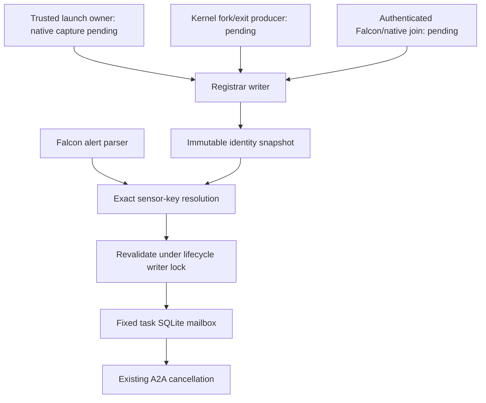

# Trusted admission registrar: implementation and remaining native boundary

`Admitting -> Active -> Draining -> Evicted` is an identity-resolution state machine, not a
claim that an operating-system process has stopped. A sensor alert can resolve only a previously
enrolled native process generation. It cannot create a registration, choose a task, or enroll a
child by supplying a PID or parent name.

## Status and evidence

**Implemented and locally exercised:** the minimal reference table, hardened registrar, and
registrar-aware Falcon HTTP handler. The implementation uses the repository's **.NET 10** stack.
It is a hardened **integration candidate**, not a production-qualified native admission service.

**Not implemented by this change:** the daemon's held-process launch coordinator, kernel
lineage-event producer, authenticated interprocess registration protocol, live Falcon/native
identity join, or Windows Job Object parity. The deployed CLI still uses its existing fixed
operator-supplied binding. It does **not** instantiate the new registrar. Its existing manual
binding path must not be described as automatic trusted registration.

Evidence: [sidecar gate](audits/evidence/2026-11-05-admission-registrar/sidecar-gate.txt),
[offline audit](audits/evidence/2026-11-05-admission-registrar/offline-audit.txt),
[VSTest host trace](audits/evidence/2026-11-05-admission-registrar/vstest-host.txt),
[TRX](audits/evidence/2026-11-05-admission-registrar/focused.trx), and
[source/log manifest](audits/evidence/2026-11-05-admission-registrar/verification.json).
The gate prints the actual check count, including the earlier 74 checks. New checks use synthetic
host/sensor records and real registrar, HTTP-handler and SQLite code. No live kernel, socket,
Falcon tenant, native drain or SOC 2 qualification follows from these tests.

## 1. Mechanical model and continuum placement

At time A, process P belongs to task T's leased cgroup. At time B, P exits. The OS may reuse
P's numeric PID for Q. At time C, an alert describing P arrives. Looking up the numeric PID
at C and signaling its current owner can affect Q. Looking up a task's PID after `spawn()`
also misses a short-lived child that forked and exited before collection.

The lookup key here is the pinned sensor tuple `(tenant, agent, opaque process instance,
profile SHA-256)`. Its value was bound by a trusted writer to `(task UUID, node, boot UUID,
cgroup inode, cgroup lifetime nonce, native PID, start ticks)`. An optional native tuple on an
observation must match every field. Raw Falcon events omit that tuple: the registrar obtains it
from enrollment, never from a current `/proc/<pid>` lookup.

The native owner must keep a pidfd/process handle and the cgroup handle alive while binding
these observations. A pidfd's integer descriptor is local to its process and is not a portable
identity. `/proc/<pid>/stat` field 22 is boot-relative clock ticks, not epoch seconds. Ticks have
finite resolution; PID plus ticks is not a substitute for holding the native identity handle
during enrollment. Repeated procfs reads without a handle do not eliminate the capture race.

`CgroupGeneration` is a host-issued lifetime UUID associated with that held cgroup object.
It is **not** a claimed kernel inode-generation field. The current daemon's
`LeaseState.epoch = 1` cannot serve as a unique cgroup generation. The current daemon does not
yet mint/export the nonce used by this candidate's contract.

Strict pre-execution activation also has a causal prerequisite: the sensor must identify a
held process before the workload is released. If Falcon identifies it only after exec, use a
separately reviewed trusted bootstrap or refuse admission. A timeout cannot authorize release.
This change implements the refusal in the table; it does not establish that the native process
was held. An `Active` row alone is not a launch attestation.

Placement: this is a narrow control-plane hardening step. It retains independent kernel lease
enforcement and adds deterministic identity resolution. It does not yet provide the native and
cryptographic provenance needed for enterprise deployment. No Falcon binary, sensor map, BPF
hook, lease ABI, or existing native proof source was changed.

## 2. Administrative and test-runner closure

The earlier 90-second VSTest abort is diagnosed more precisely. The new testhost trace reports
the installed .NET 10 runtime and then `SocketException (10013)` during its connection to
VSTest's loopback endpoint. A separate TCP preflight reproduces `AccessDenied`. Thus this run's
failure is a denied communication prerequisite, not evidence of failed assertions, SDK mismatch,
or machine slowness. The exact Windows policy responsible was not determined. No firewall,
AppContainer, sandbox or endpoint-security rule was changed.

[test-focused-regressions.ps1](../packaging/test-focused-regressions.ps1) now checks that
prerequisite before running the normal separate build/test sequence, and retains diagnostics.
It does not replace xUnit, suppress warnings, silently skip tests or increase the timeout.
This environment returns a clear nonzero failure before tests. The focused suite still needs
an authorized runner where loopback is permitted; the failed preflight is **not a suite pass**.

```powershell
$sdk = 'C:\Users\s_pla\AppData\Local\Microsoft\dotnet\dotnet.exe'
& .\packaging\test-alert-sidecar.ps1 -DotNetPath $sdk
python -I .\native\splat-agent\validation\test_audit_gaps.py
& .\packaging\test-focused-regressions.ps1 -DotNetPath $sdk
```

- `$sdk` identifies the installed .NET 10 executable; the sandbox redirects `LOCALAPPDATA`.
- `test-alert-sidecar.ps1` performs a normal warning-gated Release build and in-process checks.
- `python -I` executes the existing 33 offline native-audit regressions in isolated Python mode.
- `test-focused-regressions.ps1` requires loopback, then builds with `-m:1` and
  `UseSharedCompilation=false`, then invokes VSTest with `--no-build` and retains TRX/diagnostics.

Git branch creation again failed because `.git` is read-only in this session. No commit or
push succeeded. The checkout remains on `main`; new feature changes and the previous cleanup
remain uncommitted. Run the following from an authorized operator shell after reviewing the
diff and the required test results. These are two separate, path-scoped commits, not a command
to include all uncommitted work. Stop if another worker has changed any listed file.

```powershell
git status --short
git diff -- docs/DECOUPLED-SENSOR-ENFORCEMENT.md packaging/test-alert-sidecar.ps1
git switch -c codex/trusted-admission-registrar
git add -- docs/DECOUPLED-SENSOR-ENFORCEMENT.md packaging/test-alert-sidecar.ps1 docs/FALCON-SIDECAR.md docs/audits/2026-11-05-reconciliation-follow-up.md docs/audits/evidence/2026-11-05-reconciliation/focused-tests.txt docs/audits/evidence/2026-11-05-reconciliation/sidecar-gate.txt docs/audits/evidence/2026-11-05-reconciliation/tests-build.txt docs/audits/evidence/2026-11-05-reconciliation/verification.json
git add -f -- docs/audits/evidence/2026-11-05-reconciliation/focused-tests.trx
git diff --cached --check
git diff --cached
git commit -m "Document Falcon adapter reconciliation and explicit SDK selection"
git add -- src/splat-alert-sidecar/AdmissionIdentity.cs src/splat-alert-sidecar/TrustedAdmissionRegistrar.cs src/splat-alert-sidecar/RegistrarChecks.cs src/splat-alert-sidecar/AlertIngress.cs src/splat-alert-sidecar/FalconAdapter.cs src/splat-alert-sidecar/Contract.cs src/splat-alert-sidecar/Latch.cs src/splat-alert-sidecar/SelfTest.cs packaging/test-focused-regressions.ps1 docs/TRUSTED-ADMISSION-REGISTRAR.md docs/audits/evidence/2026-11-05-admission-registrar/sidecar-gate.txt docs/audits/evidence/2026-11-05-admission-registrar/offline-audit.txt docs/audits/evidence/2026-11-05-admission-registrar/vstest-host.txt docs/audits/evidence/2026-11-05-admission-registrar/preflight.txt docs/audits/evidence/2026-11-05-admission-registrar/verification.json
git add -f -- docs/audits/evidence/2026-11-05-admission-registrar/focused.trx
git diff --cached --check
git diff --cached
git commit -m "Add bounded admission registrar candidate and diagnose VSTest prerequisite"
git status --short
```

- `status` and both diffs identify the exact shared-tree content being reviewed.
- `switch -c` creates an in-place branch; it creates no worktree.
- The first explicit `add` stages only the prior cleanup and its historical evidence.
- The second explicit `add` stages this registrar implementation, tests, diagnosis and evidence.
- `diff --cached` is the final review boundary before each `commit`; stop on unexpected content.
- The two explicit `git add -f` commands retain only the named TRX evidence files, which the general test-output ignore rule otherwise excludes.
- Neither commit implies native qualification. No push is included. Before any later push,
  run `git log origin/main..HEAD` as a separate command and inspect it.

## 3. Identity and descendant topology



- The three pending producers are trust boundaries, not implemented components hidden by arrows.
- `Registrar writer` exclusively owns enrollment, sensor binding, activation, fork, exit and drain.
- `Immutable identity snapshot` publishes task states and sensor-key indexes atomically.
- `Exact sensor-key resolution` accepts neither an alert-selected task UUID nor a bare PID.
- `Revalidate` prevents a previously obtained `Active` result from authorizing a later mailbox write.
- `Fixed task SQLite mailbox` persists only cancellation, never lease minting or PID-directed kill.
- `A2A cancellation` is the existing actuator. This diagram does not prove its native outcome.

Linux fork inheritance is the enforcement mechanism: the daemon already writes `0` to
`cgroup.procs` in `pre_exec` before dropping privilege. The registrar's `Fork` method only records
trusted lineage; it does not hook the kernel, prevent forks, or stop migration itself. A future
producer must capture ordered `sched_process_fork`/exit or equivalent kernel evidence and hold
the relevant identities. Failed collection, a sequence gap, wrong cgroup/generation, or capacity
exhaustion moves the affected registration to `Draining`. A trusted lifecycle owner must consume
that state and revoke/drain the workload; this candidate does not automate that final action.

Root exit is not workload exit. Children and grandchildren retain their task association until
their own sequenced exit or task fencing. An untracked child alert is rejected. Containment of
that child depends on the pre-existing cgroup policy, not on eventual sensor enrollment.

## 4. Pass 1: minimal executable core

[AdmissionIdentity.cs](../src/splat-alert-sidecar/AdmissionIdentity.cs) contains
`MinimalAdmissionRegistrar`: `Register(task, native, sensor)` stores the exact composite pair;
`Resolve(native, sensor)` returns a task only when the set contains exactly one UUID. Its tests
exercise a valid mapping, recycled start ticks and ambiguity. It intentionally has no lifecycle,
expiry or synchronization and is not installed on the HTTP path.

## 5. Pass 2: hardened registrar candidate

[TrustedAdmissionRegistrar.cs](../src/splat-alert-sidecar/TrustedAdmissionRegistrar.cs) provides:

| Operation | State transition or refusal |
| --- | --- |
| `Begin` | Creates `Admitting`; rejects incomplete native identity, reused UUID/cgroup lifetime, invalid scope, expiry or capacity. Lifetime is bounded to one day. |
| `BindSensor` | Binds only an already enrolled native tuple with the configured tenant, agent and profile. Exact retries are harmless. Rebinding is refused. Ambiguous keys fence all claimants. |
| `Activate` | Requires `Admitting` and sensor bindings for every live enrolled process. It does not execute or resume a process. |
| `Fork` | Requires a live exact parent, same native boundary and next lineage sequence. Adds the child with no sensor authority until `BindSensor`. |
| `Exit` | Requires the next sequence and exact process generation; retains a tombstone, leaving live descendants intact. |
| `Drain` | Removes resolution authority. It does not report native termination. |
| `EvictExpired` | Makes expired registrations unresolvable and retains identity tombstones. Lookup also checks expiry, so sweeping delay cannot extend validity. |
| `Resolve` | Acquires one immutable snapshot and returns Unique, Unknown, Ambiguous, Inactive, Stale, IdentityMismatch or ClockRollback. |
| `AdmitToMailbox` | Resolves again under the writer lock, requires the fixed task UUID, then performs the durable SQLite admission. |

Expiry checks both wall time and elapsed monotonic time. Clock rollback rejects lookups and
causes sweeping to evict registrations. Event time must be within the existing 30-second past /
2-second future window, at or after native enrollment, and strictly before task expiry.
These clocks govern the host registration; they do not redefine the guest kernel lease clock.

Reader lookup is lock-free, with a measured allocation-free steady path on the test thread.
Writers allocate immutable dictionaries and rebuild bounded indexes under a monitor. SQLite
may hold this cold-path writer lock during its configured busy timeout and storage operation;
there is no bounded disk-latency guarantee. Kernel hooks do not acquire this lock. Fork-heavy
write throughput and GC pressure have not been benchmarked; do not claim high-throughput or
sub-millisecond admission from the read-loop result.

The defaults cap history at 1,024 tasks and 16,384 total process records. Eviction preserves
tombstones; it does not free capacity for reuse. Exhaustion refuses new admission. Restart
starts empty; there is no trusted persistence/replay mechanism yet. A native coordinator must
drain/reconcile outstanding workloads and create new task/lifetime identities before rebuilding
state. Never reconstruct active authority from delayed alerts or merely clear history to accept
new work.

`AlertIngress` accepts a registrar only when its root/scope/expiry matches the fixed binding and
its mailbox fingerprint matches that binding. `FalconAdapter.Observe` parses the pinned event
schema without copying the configured root identity onto a child alert. Registrar mode never
falls back to the old root-only normalization when lookup fails. The old CLI mode remains
available for existing manually bound installations and gains no automatic-registration claim.

## 6. Identifier and kernel-primitive reference

The gap references below name the remaining gates in
[2026-11-05-reconciliation-follow-up.md](audits/2026-11-05-reconciliation-follow-up.md).

| Identifier / primitive | Operational role and boundary |
| --- | --- |
| `NativeProcess.Node`, `Boot` | Select host and boot namespace; wrong boot/node cannot reuse a mapping. Gate 2 identity. |
| `Cgroup`, `CgroupGeneration` | Inode plus held-object lifetime nonce; paths/inodes alone are insufficient. Native producer pending, gate 2. |
| `Pid`, `StartTicks` | Native locator and boot-relative birth observation; never used alone or converted from the Falcon ID. pidfd-backed capture pending, gate 2. |
| `SensorProcess.Tenant`, `Agent` | Exact tenant/endpoint boundary; no hostname inference. Gate 2. |
| `ProcessInstance`, `ProfileHash` | Opaque exact sensor key and reviewed mapping bytes; no floating-point conversion or fallback between vendor fields. Gate 2. |
| `SensorObservation.Rule`, `AlertId`, `ObservedUnixMs`, `Native` | Approved rule, bounded event identifier, temporal fence and optional exact native cross-check. These are not enrollment authority. Gate 2. |
| `RegisteredProcess.Sensor`, `NotBeforeUnixMs`, `Live`, `Parent` | Pending sensor join, earliest accepted event, process exit fence, exact enrolled parent. Gate 2 descendants. |
| `RegisteredTask.Task`, `Root`, tenant/agent/profile/rule | Immutable task scope, independent of the inbound alert. Gate 2. |
| `State`, `CreatedUnixMs`, `ExpiresUnixMs` | Lifecycle state and admission/expiry window; state is not termination evidence. Gates 2ΓÇô3. |
| `StartedTimestamp`, `Lifetime` | Monotonic expiry even if wall time stops advancing. Host time only; native clock proof remains separate. |
| `LineageSequence`, `Processes` | Strict ordered native lifecycle stream and immutable process records. Missing events fence the registration. Producer pending, gates 2ΓÇô3. |
| `Snapshot.Tasks`, `Index`, `Revision` | Immutable task table, exact sensor lookup including ambiguity/tombstones, publication version. Revision is diagnostic, not a bearer capability. |
| `AdmissionResolution.Status`, `Task`, `Native`, `Revision` | Exactly one task/native result or an explicit rejection. Revalidation is required for mailbox commit. |
| `Volatile.Read/Write`, `Interlocked.CompareExchange` | Acquire/release snapshot publication and atomic wall-clock high-water mark. They are memory-ordering primitives, not cryptographic authentication. |
| `_writer` monitor | Serializes lifecycle changes with SQLite commit; only cold-path code acquires it. Gate 3 race/failure boundary. |
| `pidfd_open`, `/proc/<pid>/stat` field 22 | Required native capture primitives; not invoked by the new C# table. A remote fd integer conveys no authority. Gate 2 remains open. |
| `cgroup.procs`, `sched_process_fork` | Existing pre-exec placement and planned native lineage capture respectively. User-space polling is not equivalent. Gate 2 remains open. |
| Profile SHA-256 | Pins schema bytes only. It does not authenticate the native writer or prove sensor/native correspondence. |
| Pinned host/collector key or authenticated local IPC | Required before cross-process enrollment. Not supplied here; do not expose writer methods as alert endpoints. Gates 2ΓÇô3. |

## 7. Falsification matrix and completion decision

See [RegistrarChecks.cs](../src/splat-alert-sidecar/RegistrarChecks.cs) for executable vectors.

| Falsification | Local result required by the gate | Remaining native experiment |
| --- | --- | --- |
| Valid root | Unique task; real handler can commit only to its fixed mailbox | Capture a held native process and real Falcon identity |
| Recycled PID | Wrong start ticks rejected; exited child's old sensor key cannot resolve to replacement | Force real PID reuse while delayed events arrive |
| Wrong boot/cgroup/generation/node | Exact mismatch rejected | Reboot and destroy/recreate cgroup under controlled capture |
| Wrong tenant/agent/profile | Unknown/rejected; HTTP mailbox remains idle | Authorized tenant negative controls |
| Ambiguous sensor key | Neither claimant wins; both admissions drain logically | Conflicting authenticated producer evidence |
| Pre-admission/stale/future/expired event | Rejected at lookup and commit | Real vendor delay/clock distribution |
| Child/grandchild | Exact sequenced parent association; root exit preserves child | Real fork/exec/exit collector with inherited enforcement |
| Child escape or lost lineage sequence | Draining; new resolution refused | Verify cgroup migration is denied and revocation follows loss |
| Drain after lookup | Previously valid result cannot authorize a later commit | Independent cancellation receipt and workload drain |
| Concurrent publication | Readers see a complete snapshot; no active result after completed drain | Native lifecycle/collector stress |
| Capacity/clock rollback | Fail closed; no authority restored | Disk/restart/collector outage campaign |
| Allocation claim | 100,000 steady lookup calls allocate zero managed bytes on the test thread | Whole-host CPU/GC/latency benchmark; writes allocate |
| Baseline test transport | Permission failure is diagnosed before assertions | Rerun VSTest where loopback is permitted |

**Completion decision:** the in-memory registration/resolution and HTTP-to-mailbox criterion is
demonstrated by local synthetic-producer checks. Option A as a live trusted-admission feature
is **not closed**. Its next blocking deliverable is an authenticated native producer/launch
coordinator that holds process/cgroup identities, joins the reviewed sensor identity, and
releases workload execution only after activation. WSL currently returns `Wsl/E_ACCESSDENIED`,
and no authorized Falcon tenant event was supplied, so native capture/coexistence cannot be
validated in this session. Windows parity also remains unimplemented.

Primary contracts consulted:
[Linux cgroup v2](https://cdn.kernel.org/doc/html/latest/admin-guide/cgroup-v2.html),
[pidfd_open](https://www.man7.org/linux/man-pages/man2/pidfd_open.2.html),
[proc stat](https://www.man7.org/linux/man-pages/man5/proc_pid_stat.5.html), and CrowdStrike's
[field joins](https://library.humio.com/integrations/integrations-crowdstrike-fltr-core-crowdstrike-fltr-core.html).
CrowdStrike's documented TargetProcessId/ContextProcessId join establishes vendor-side
correlation; it does not establish a native SPLAT task binding. No hard-coded universal Falcon
schema or guessed conversion from vendor ID to native PID was added.
